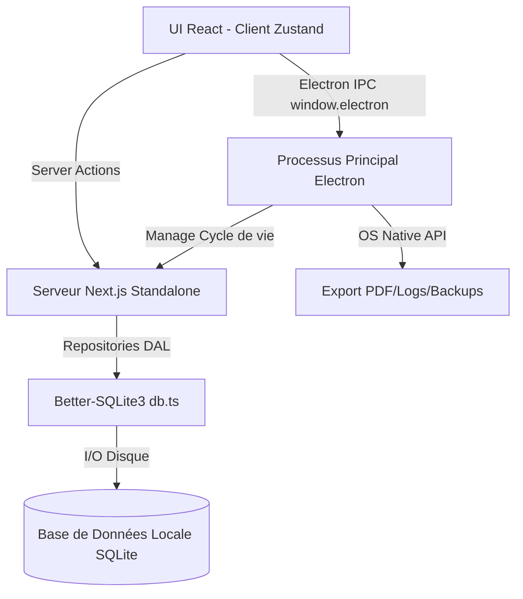

# Rapport d'Audit 360° - Application Facturier (Desktop)

Ce document présente les résultats de l'audit complet de l'application, en se concentrant sur l'architecture, la sécurité, les performances et la qualité du code. L'analyse prend explicitement en compte les modifications apportées jusqu'au commit **5a96de7**.

## Section 1 : Architecture globale & Diagramme de flux

**Architecture de Déploiement :**
- Next.js (16.4.3) est utilisé en mode **Standalone**. Il n'est pas exporté de manière statique car il embarque un backend complet avec des *Server Actions* et Route Handlers qui interrogent une base de données locale (Better-SQLite3).
- L'application est propulsée par **Electron** (42.11.2). Le processus principal d'Electron exécute un serveur Node.js embarqué (Next.js) qui répond aux requêtes du client. L'environnement de production utilise le fichier `.next/standalone/server.js`.
- La communication entre la base de données et le client est encapsulée dans le code du serveur Next.js (et ses Server Actions).
- Les IPC Electron (Inter-Process Communication) sont utilisés pour des actions spécifiques (Exportation PDF/Excel, logs, sauvegarde).

**Diagramme de Flux :**



## Section 2 : Anatomie détaillée par dossier et par fichier

### `apps/desktop/main/` (Processus Electron)
- **Rôle local :** Gère le cycle de vie de l'application Desktop (démarrage du serveur Node.js, splash screen, IPC handlers, mises à jour, configuration anti-OOM).
- **Impact système :** Le fichier `main.js` orchestre tout. S'il ne gère pas bien l'extinction du serveur Next.js, on risque des processus zombies. La configuration `--max-old-space-size=4096` permet d'éviter un crash du renderer V8 sous forte charge, ce qui est critique pour la navigation.
- **Fichiers critiques :**
  - `main.js` : Initialisation et point d'entrée.

### `apps/desktop/app/actions/` (Server Actions)
- **Rôle local :** Fournit les endpoints backend exposés au client pour le CRUD. Contient les règles d'autorisation, validation (Zod) et l'appel aux repositories.
- **Impact système :** Point central de l'I/O réseau entre le frontend React et SQLite. Les goulots d'étranglement ici bloquent directement l'UI.
- **Fichiers critiques :**
  - `invoice.actions.ts` : Contient des actions sensibles pour le calcul, création et suppression des factures.

### `apps/desktop/lib/db.ts` & `lib/db/migrations/`
- **Rôle local :** Connexion SQLite via `better-sqlite3` et exécution des migrations.
- **Impact système :** Impact majeur. L'utilisation du mode `WAL` et du `statementCache` (via Proxy) favorise les performances. La connexion à la DB bloque Node si trop longue, d'où le *timeout* réglé à 5000ms.
- **Fichiers critiques :**
  - `db.ts` : Gestionnaire de l'instance Singleton SQLite.
  - `0002_schema_hardening.ts` : Migrations complexes avec des re-créations de tables (pas de support natif complet ALTER TABLE sous SQLite).

### `apps/desktop/lib/repositories/` (Data Access Layer)
- **Rôle local :** Requêtes brutes SQL encapsulées.
- **Impact système :** Les temps de chargement au login dépendent directement des requêtes écrites ici.
- **Fichiers critiques :**
  - `InvoiceRepository.ts` : Centralise toutes les lectures/écritures sur la table factures.

### `apps/desktop/components/`
- **Rôle local :** Vues de l'application (pages, modales, composants partagés).
- **Impact système :** Contient `data-sync.tsx` qui se charge de remplir l'état Zustand, déclenchant l'hydratation massive au démarrage.
- **Fichiers critiques :**
  - `data-sync.tsx` : Pilote l'hydratation de l'application.
  - `pages/protected-app-shell.tsx` : Composant racine gérant le routage et les droits (RBAC).

## Section 3 : Écarts de conformité et d'architecture

1. **Hydratation massive sans lazy-loading** : Le modèle de l'application suppose de charger presque toute la base de données métier au chargement dans Zustand via `DataSync` (Clients, Services, Settings, Factures, Devis...). Ce n'est pas scalable à long terme (risque OOM) si la volumétrie dépasse des milliers d'enregistrements. Bien que le commit **5a96de7** ait ajouté le composant `DataExportModal` et raffiné l'interface de gestion de l'état UI, il ne résout pas la cause profonde : `DataSync` charge toutes les factures en RAM.
2. **Absence de Transactions sur certaines opérations critiques** : Bien que les migrations utilisent `db.transaction`, certaines Server Actions (ex: `deleteInvoice`) exécutent de multiples écritures ou suppressions de façon séquentielle sans bloc transactionnel. Si une erreur survient au milieu, la base est laissée dans un état incohérent (Incohérence comptable).
3. **Erreurs de typage (any)** : Utilisation de typage faible dans certains retours de DB pour court-circuiter TypeScript (ex: `as any[]` au lieu de types concrets générés).

## Section 4 : Table des anomalies critiques classées par sévérité

| Sévérité | Fichier:Ligne | Anomalie & Cause racine | Extrait Correctif / Solution |
|---|---|---|---|
| **Critique** | `apps/desktop/lib/repositories/InvoiceRepository.ts:13` | **Rechargement massif sans pagination (OOM Risk):** `findAll` fait un `SELECT * ... json_group_array` sans clause LIMIT/OFFSET, chargeant trop de données en RAM via `DataSync` au login. Ceci est la cause racine du problème signalé dans le commit **5a96de7**. | Ajouter des paramètres de pagination `LIMIT` et `OFFSET` à la requête préparée. <br> ```typescript query += ' ORDER BY createdAt DESC LIMIT ? OFFSET ?';``` |
| **Majeure** | `apps/desktop/app/actions/invoice.actions.ts:98` | **Absence de transactions SQL:** `deleteInvoice` lance des écritures séquentielles (`CreditNote`, `softDelete`, `UPDATE quotes`). En cas d'échec intermédiaire, la BDD est corrompue. | Envelopper la logique complète dans un `db.transaction(...)`. <br> ```typescript const executeDelete = db.transaction((...) => { ... }); executeDelete(...); ``` |
| **Majeure** | `apps/desktop/app/actions/invoice.actions.ts:46` | **N+1 Queries:** `getInvoiceById` fait 3 appels DB séquentiels (`findById`, items, payments) au lieu d'une jointure JSON comme dans `findAll`. | `const invoice = InvoiceRepository.findByIdWithRelations(id);` utilisant `json_group_array`. |
| **Mineure** | `apps/desktop/components/pages/invoices.tsx:64` | **Bug UI (État de suppression):** Un échec de suppression déclenche `throw new Error()` *avant* `setInvoiceToDeleteId(null)`, bloquant la modale. | Déplacer `setInvoiceToDeleteId(null)` avant le `throw` ou dans un `finally`. <br> ```typescript if(!response.success){ setInvoiceToDeleteId(null); ... throw new Error(); } ```|
| **Mineure** | `apps/desktop/components/pages/invoices.tsx:223` | **Bug UI (Syntaxe):** Une accolade orpheline `}` interrompt la fonction `confirmPayment`. | Supprimer l'accolade superflue ligne 223. |
| **Mineure** | `apps/desktop/app/actions/invoice.actions.ts:47` | **Dette Technique (Typage):** `const payments = db.prepare(...).all(id) as any[];` échappe à TypeScript. | Utiliser le typage fort : `... as DbPayment[];` |

## Section 5 : Plan d'action priorisé sans régression

1. **Transactionnalité (Court Terme) :** Refactoriser les Server Actions complexes (Création et suppression de factures, d'avoirs et validation de devis) pour utiliser `db.transaction()` dans une couche Service. Ceci empêche la corruption de données applicatives.
2. **Corrections UI / Bugs bloquants (Court Terme) :** Fixer le comportement des Modales en cas d'erreur API (déplacer les appels de réinitialisation d'état Zustand/React avant les `throw` dans `handleDelete`). Retirer l'accolade orpheline dans `confirmPayment` (`invoices.tsx`).
3. **Refonte de l'Hydratation / DataSync (Moyen Terme) :** Remplacer le chargement massif au démarrage (qui cause des pics CPU/RAM sur le backend embarqué) par une approche lazy-loaded, particulièrement sur la table des factures qui implémente déjà de la pagination front-end mais sans pagination back-end (LIMIT/OFFSET). Les repositories doivent prendre ces paramètres pour éviter les blocages au niveau du login et sur la page des factures/devis/avoirs, apportant une **solution définitive au problème du commit 5a96de7**.
4. **Optimisation des requêtes Single-Entity (Long Terme) :** Appliquer l'approche `json_group_array` utilisée en `findAll` pour les méthodes `findById` afin d'éliminer les requêtes séquentielles dans les Server Actions et soulager l'Event Loop de Node.js.
