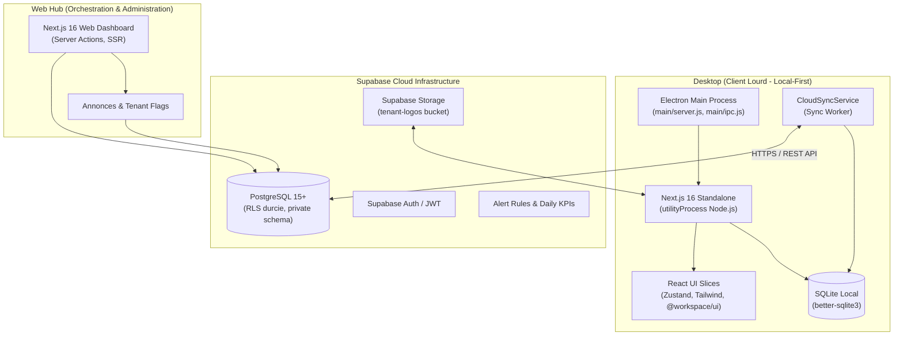
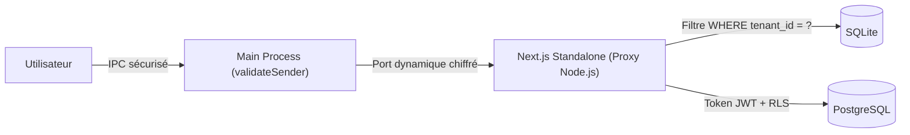

# Architecture Globale du Projet Facturier (Hub & Spoke)

> **Système de Facturation et Gestion Commerciale Multi-Tenant pour la Zone CEMAC / Gabon**  
> *Dernière mise à jour : 28 octobre 2026 (post-plan curatif)*

---

## 1. Vue d'Ensemble et Philosophie « Local-First »

Le projet Facturier repose sur un modèle architectural **Hub & Spoke** combiné à une approche **Local-First** rigoureuse :
- **Spoke (Postes Clients / Desktop)** : Application lourde Electron distribuée aux entreprises abonnées, fonctionnant à 100 % hors-ligne avec une base locale SQLite native (`better-sqlite3`). L'utilisateur crée ses factures, devis, règlements et exports PDF sans aucune latence réseau.
- **Hub (Plateforme Cloud / Web-Hub)** : Application Web Next.js hébergée sur Vercel/Supabase, dédiée aux super-administrateurs et dirigeants pour le suivi consolidé, la facturation des licences d'abonnement, le monitoring des postes et la publication d'alertes/bannières.
- **Canal de Synchronisation** : Réplication bi-directionnelle optimisée (`CloudSyncService`) synchronisant les mutations locales vers Supabase Postgres dès que la connectivité réseau est établie.

---

## 2. Structure du Monorepo

Le dépôt est organisé sous forme de monorepo piloté par **Turborepo** et **npm workspaces** :

| Dossier | Rôle | Stack Technique |
| :--- | :--- | :--- |
| `apps/desktop` | Client lourd de bureau facturier | Electron, Next.js 16, React 19, better-sqlite3, Zustand, PDFRenderer |
| `apps/web-hub` | Hub web super-admin et métriques | Next.js 16, React 19, Supabase SSR, Recharts |
| `packages/ui` | Bibliothèque partagée de composants | Radix UI, Tailwind CSS, Lucide Icons, Sonner |
| `packages/database` | Schémas canoniques, types et moteur fiscal | TypeScript pur, DGI Gabon fiscal engine, types multi-tenant |
| `supabase/` | Migrations Postgres, RLS, fonctions SQL, tests pgTAP | PostgreSQL, pgTAP, Supabase CLI |
| `docs/` | Architecture vivante, runbooks, plans et fiches ADR | Markdown GFM (43 ADRs acceptés) |

---

## 3. Moteur de Synchronisation et Flux de Données

Le système a écarté les moteurs complexes type PowerSync (ADR-0038) au profit d'un service léger direct (`CloudSyncService`) :

### 3.1. Flux Montant (Desktop → Cloud)
1. Chaque création ou modification locale génère un enregistrement dans SQLite avec un UUIDv4 canonique, un `tenant_id` obligatoire, un horodatage `updated_at` et un flag de synchronisation.
2. Le `CloudSyncService` extrait périodiquement les mutations non répliquées par lots de 50 enregistrements.
3. Les données sont injectées dans Supabase via des requêtes `upsert` avec gestion de conflits Last-Write-Wins (LWW) basée sur `updated_at`.
4. Les suppressions sont obligatoirement logiques (`deletedAt IS NOT NULL`).

### 3.2. Flux Descendant (Cloud → Desktop & Canal Hub)
1. Le worker interroge les tables distantes modifiées depuis le dernier watermark (`last_pulled_at`).
2. **Canal Hub (ADR-0039)** : Récupération des bannières d'annonces actives et des drapeaux de fonctionnalités (`tenant_flags`), stockés dans la table locale `hub_cache`.
3. Application immédiate en local sans altération des données créées hors-ligne.

---

## 4. Modèle de Sécurité et Multi-Tenancy

L'isolation des données entre locataires est garantie à tous les niveaux :

1. **Isolation SQLite (Local)** :
   - Tous les schémas imposent `tenant_id TEXT NOT NULL`.
   - `buildTenantFilter` interdit strictement tout enregistrement sans tenant (`tenant_id IS NULL`).
2. **Isolation Postgres Cloud (RLS)** :
   - Fonction d'aide `private.current_tenant_id()` s'exécutant en `security definer` sans cast.
   - Index obligatoires sur toutes les clés étrangères (`invoice_id`, `quote_id`, etc.) prévenant les alertes `auth_rls_initplan`.
3. **Sécurité Electron IPC** :
   - Aucun accès direct au module `remote`.
   - Contrôle systématique de la provenance via `validateSender(event)` dans `apps/desktop/main/ipc.js`.
   - Clés secrètes de session persistées et chiffrées par machine (`main/secrets.js`).
4. **Masquage des Données Sensibles (Logger)** :
   - Centralisation dans `apps/desktop/lib/logger.ts`.
   - Remplacement automatique des tokens, mots de passe et secrets par `***REDACTED***`.

---

## 5. Moteur Fiscal et Conformité Réglementaire

Le moteur fiscal est unifié dans `packages/database/src/fiscal/index.ts` (ADR-0041 & ADR-0043) :

- **Devise** : Franc CFA (XAF), sans centimes — arrondis bancaires stricts à l'entier.
- **Cascade Légale DGI Gabon 2026** :
  $$\text{Net HT} = \text{Sous-Total} - \text{Remise}$$
  $$\text{CSS} = \text{round}(\text{Net HT} \times 1\%)$$
  $$\text{Base Taxable} = \text{Net HT} + \text{CSS}$$
  $$\text{TPS} = \text{round}(\text{Base Taxable} \times 9.5\%)$$
  $$\text{TVA} = \text{round}(\text{Base Taxable} \times 18\%)$$
  $$\text{Total TTC} = \text{Base Taxable} + \text{TPS} + \text{TVA}$$
- **Versionnement du Modèle Fiscal (ADR-0043)** :
  - `taxModelVersion: 1` : Moteur historique unifié `computeTotals`.
  - `taxModelVersion: 2` : Ventilation multi-régimes par ligne (`GOODS`, `SERVICES`, `EXEMPT`) activable dès validation écrite du cabinet comptable.

---

## 6. Index des Décisions Architecturales Clés (ADR)

Toutes les évolutions structurelles sont tracées dans `docs/decisions/` :

- **ADR-0001 à ADR-0037** : Fondation monorepo, authentification, exports PDF/Excel, conformité OHADA.
- **ADR-0038** : Retrait définitif de PowerSync et consolidation de `CloudSyncService`.
- **ADR-0039** : Canal descendant Hub → Desktop (`hub_cache`), moteur d'alertes et nettoyage des zombies.
- **ADR-0040** : Durcissement du schéma SQLite versionné (montants entiers, contraintes de statut) et RLS cloud.
- **ADR-0041** : Moteur fiscal unique, modularisation du main process Electron (`main/*.js`) et découpage des composants monolithiques.
- **ADR-0042** : Harmonisation de la chaîne d'outils, dédoublonnage Radix, convention Next.js 16 `proxy.ts` et rétablissement de la minification.
- **ADR-0043** : Préparation de la fiscalité par ligne, régimes DGI et versionnement du modèle fiscal.
