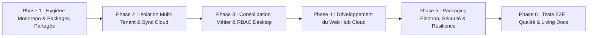

> [!NOTE]
> Document archivé. Remplacé par les plans de référence consolidés dans docs/plans/ (00_DIAGNOSTIC_DETTES_ZOMBIES_FREINS.md, 01_PLAN_CORRECTIF.md, 02_PLAN_CURATIF.md, 03_PLAN_PREVENTIF.md).

# Audit Approfondi & Plan Directeur de Construction — Facturier (Hub & Spoke)

**Date de l'audit** : 19 Octobre 2026  
**Périmètre analysé** : Monorepo complet (`apps/desktop`, `apps/web-hub`, `packages/database`, `packages/ui`, `supabase/migrations`, `docs/`, scripts de build & tests).

---

## Partie 1 : Audit Technique et Fonctionnel Approfondi

### 1.1 Vue d'ensemble de l'état actuel
Le projet a récemment fait l'objet d'une **migration structurelle en Monorepo Turborepo** (passage de la racine monolithique vers `apps/desktop`, `apps/web-hub`, `packages/ui`, `packages/database`) ainsi que de la mise en place d'une **synchronisation SQLite ↔ Supabase** (`CloudSyncService` + migrations RLS Supabase).

| Sous-système | État de maturité | Constat synthétique |
| :--- | :---: | :--- |
| **Desktop — Cœur Métier & UI (`apps/desktop`)** | **85 %** | Tunnel Devis → Factures → Paiements → Avoirs fonctionnel, fiscalité gabonaise (TVA/TPS/CSS) exacte, impression/PDF Electron et sauvegarde locale opérationnels. |
| **Synchronisation Cloud (`lib/sync` & `lib/powersync`)** | **55 %** | Deux moteurs coexistent (`CloudSyncService` actif via Server Actions vs `PowerSync` partiel en WASM). Plusieurs failles critiques de synchronisation multi-postes et multi-tenants identifiées. |
| **Isolation Multi-Tenant Locale (`apps/desktop`)** | **35 %** | **Faille critique** : Bien que la colonne `tenant_id` existe dans SQLite et soit filtrée sur Supabase (RLS), **aucune requête SQLite locale** dans les repositories/actions ne filtre par `tenant_id`. |
| **Hub Cloud Super Admin (`apps/web-hub`)** | **15 %** | Authentification Supabase SSR (`/login` + `proxy.ts`) en place, mais la page d'accueil (`src/app/page.tsx`) est encore le template par défaut `create-next-app`. |
| **Packages Partagés (`packages/database`, `packages/ui`)** | **40 %** | `packages/ui` est opérationnel, mais `packages/database` est **vide** (aucun `package.json`, aucun type exporté), en violation de la règle `.antigravity` §3 & §5. |
| **Hygiène Git & Qualité Monorepo** | **40 %** | 476 fichiers en état transitoire (anciens fichiers supprimés à la racine non commités, nouveaux fichiers untracked), `ignoreBuildErrors: true` activé. |

---

### 1.2 Anomalies Critiques et Dette Technique Identifiées (P0 / P1)

> [!CAUTION]
> **P0-1 : Absence de filtrage `tenant_id` dans les requêtes SQLite locales & Session Desktop**
> - **Constat** : Dans [`auth.actions.ts`](file:///C:/Users/LENOVO/Downloads/fintech-invoicing-app/apps/desktop/app/actions/auth.actions.ts), le cookie `auth_session` stocke `{ userId, name, role, exp }` mais **ne stocke pas `tenantId`**.
> - **Impact** : Toutes les actions serveur ([`client.actions.ts`](file:///C:/Users/LENOVO/Downloads/fintech-invoicing-app/apps/desktop/app/actions/client.actions.ts), [`invoice.actions.ts`](file:///C:/Users/LENOVO/Downloads/fintech-invoicing-app/apps/desktop/app/actions/invoice.actions.ts), [`InvoiceRepository.ts`](file:///C:/Users/LENOVO/Downloads/fintech-invoicing-app/apps/desktop/lib/repositories/InvoiceRepository.ts), [`QuoteRepository.ts`](file:///C:/Users/LENOVO/Downloads/fintech-invoicing-app/apps/desktop/lib/repositories/QuoteRepository.ts), [`MetricsRepository.ts`](file:///C:/Users/LENOVO/Downloads/fintech-invoicing-app/apps/desktop/lib/repositories/MetricsRepository.ts)) exécutent `SELECT * FROM ... WHERE deletedAt IS NULL` sans clause `AND tenant_id = ?`, et les `INSERT` n'insèrent pas `tenant_id` (il n'est rattaché qu'au moment du `pushTable` dans [`CloudSyncService.ts`](file:///C:/Users/LENOVO/Downloads/fintech-invoicing-app/apps/desktop/lib/sync/CloudSyncService.ts#L109-L112)). Si deux comptes d'entreprises différentes se connectent sur le même poste Desktop, leurs données se mélangent et la première qui synchronise absorbe les lignes `tenant_id IS NULL` de l'autre.

> [!CAUTION]
> **P0-2 : Divergences de Schéma & Conflits de Numérotation (`CloudSyncService.ts` ↔ `20261013_desktop_sync.sql`)**
> - **Constat** : Le schéma SQLite local ([`db.ts`](file:///C:/Users/LENOVO/Downloads/fintech-invoicing-app/apps/desktop/lib/db.ts)) mélange `camelCase` (`clientId`, `deletedAt`, `createdAt`, `unitPrice`, `taxBase`, `userId`, `entityType`) et `snake_case` (`created_by`, `tenant_id`, `updated_at`, `synced_at`).
> - Dans [`CloudSyncService.ts`](file:///C:/Users/LENOVO/Downloads/fintech-invoicing-app/apps/desktop/lib/sync/CloudSyncService.ts#L28), la fonction `toSnake` convertit `camelCase` → `snake_case` lors du Push et inversement au Pull.
> - **Mais** plusieurs divergences subsistent :
>   1. `invoices.dueDate` est créé via migration `ALTER TABLE` dans `db.ts`, mais absent du `CREATE TABLE IF NOT EXISTS invoices` initial et absent de `InvoiceService.createInvoice()` (qui n'insère pas `dueDate` !).
>   2. Dans `localSchema.ts`, les triggers `trg_${local}_sync_del` capturent `OLD.id` lors d'un `DELETE` physique (ex: remplacement de `quote_items`), mais pour les tables principales utilisant le Soft Delete (`UPDATE ... SET deletedAt = datetime('now')`), `datetime('now')` produit `YYYY-MM-DD HH:MM:SS` tandis que d'autres endroits écrivent `new Date().toISOString()`.
>   3. **Conflit de numérotation multi-postes (`sequences`)** : La table locale `sequences` n'est pas synchronisée et la numérotation `getNextNumber` est purement locale. Si deux opérateurs créent une facture hors-ligne sur deux postes du même tenant, ils génèrent le même numéro `001/CODE/2026`. Au moment du Push sur Supabase, l'index unique `uq_invoices_tenant_number` rejette la seconde facture avec une erreur `23505 duplicate key`, bloquant définitivement le push de cette facture sans mécanisme de réconciliation.

> [!WARNING]
> **P0-3 : Dualité PowerSync WASM vs `CloudSyncService` (better-sqlite3)**
> - **Constat** : [`Providers.tsx`](file:///C:/Users/LENOVO/Downloads/fintech-invoicing-app/apps/desktop/components/providers.tsx) monte `<PowerSyncProvider>` qui initialise une base WASM `facturier-local.sqlite` dans le navigateur avec seulement 4 tables partielles ([`AppSchema.ts`](file:///C:/Users/LENOVO/Downloads/fintech-invoicing-app/apps/desktop/lib/powersync/AppSchema.ts)), tandis que toute l'application lit et écrit dans `database.sqlite` côté Node via `better-sqlite3` et synchronise via `<CloudSyncRunner />` ([`CloudSyncService.ts`](file:///C:/Users/LENOVO/Downloads/fintech-invoicing-app/apps/desktop/lib/sync/CloudSyncService.ts)).
> - **Impact** : `PowerSyncDatabase` consomme de la mémoire WASM et tente de se connecter à `NEXT_PUBLIC_POWERSYNC_URL` inutilement alors que seul le `connector` (pour la session Supabase Auth côté client) est réellement utilisé par `login-client.tsx` et `cloud-sync-runner.tsx`.

> [!WARNING]
> **P1-1 : Contradiction RBAC Opérateur vs Admin sur Clients & Services**
> - **Constat** : Dans [`store.ts`](file:///C:/Users/LENOVO/Downloads/fintech-invoicing-app/apps/desktop/lib/store.ts#L91-L120) :
>   - `ADMIN_PERMISSIONS` a `canViewCustomers: false`, `canViewQuotes: false`, `canViewInvoices: false`, `canViewServices: false`.
>   - `USER_PERMISSIONS` (Opérateur) a `canViewCustomers: true`, `canViewServices: true`.
>   - Or, dans [`navigation.tsx`](file:///C:/Users/LENOVO/Downloads/fintech-invoicing-app/apps/desktop/components/layout/navigation.tsx#L58-L60), les menus `clients` et `services` ont `roles: ['admin']` uniquement ! Et dans [`client.actions.ts`](file:///C:/Users/LENOVO/Downloads/fintech-invoicing-app/apps/desktop/app/actions/client.actions.ts#L45) / [`service.actions.ts`](file:///C:/Users/LENOVO/Downloads/fintech-invoicing-app/apps/desktop/app/actions/service.actions.ts#L45), seul `admin` peut créer/modifier un client ou un service.
>   - **Conséquence** : Un opérateur (`user`) ne voit pas la page Clients dans la barre latérale malgré `canViewCustomers: true`, et un `admin` a `canViewCustomers: false` dans `store.ts` mais voit l'onglet dans la sidebar. La matrice RBAC doit être alignée entre `store.ts`, `navigation.tsx` et les Server Actions.

> [!WARNING]
> **P1-2 : Non-conformité `packages/database` et Conventions `.antigravity`**
> - `packages/database` ne contient qu'un dossier vide `src/types/`. Les types sont encore définis dans `apps/desktop/lib/types/api.ts` sans préfixe `I` (`IUser`, `IInvoice`, `IClient`, etc.) exigé par `.antigravity` §3 et §5.
> - `apps/web-hub` n'a aucune visibilité sur les types métier ni sur les utilitaires fiscaux.

> [!IMPORTANT]
> **P1-3 : `apps/web-hub` (Portail Cloud Super Admin & Tenant Admin) non implémenté**
> - Hormis `/login` et le middleware Supabase (`src/proxy.ts`), `apps/web-hub` ne contient aucun tableau de bord Super Admin (gestion des tenants/entreprises, licences, utilisateurs globaux, télémétrie de synchronisation) ni vue Cloud consolidée.

---

## Partie 2 : Plan Directeur d'Implémentation (Feuille de Route Complète)

Ce plan est structuré en **6 phases séquentielles et vérifiables**, conçues pour stabiliser d'abord les fondations et la sécurité avant d'étendre les fonctionnalités Cloud.

---

### Phase 1 : Hygiène Monorepo, Typage Partagé (`packages/database`) & Gouvernance
**Objectif** : Aligner l'architecture du monorepo avec les exigences strictes de `.antigravity` et assainir l'arbre Git et la compilation TypeScript.

1. **Initialisation complète de `packages/database` (`@workspace/database`)** :
   - Créer `packages/database/package.json` et `packages/database/tsconfig.json`.
   - Centraliser tous les contrats et interfaces métier avec le préfixe `I` (`IUser`, `ITenant`, `IClient`, `IService`, `IQuote`, `IQuoteItem`, `IInvoice`, `IInvoiceItem`, `IPayment`, `ICreditNote`, `ISettings`, `IAuditLog`, `IDashboardMetrics`) tout en exportant des alias rétrocompatibles pour `apps/desktop`.
   - Déplacer/exporter la logique fiscale pure (`calculateFiscalCascade`, `computeTotals`, `formatDocNumber`) dans `@workspace/database/fiscal` pour qu'elle soit partagée entre `apps/desktop` et `apps/web-hub`.
2. **Alignement de `turbo.json` et `package.json` racine** :
   - Ajouter les tâches `test`, `lint`, `typecheck` dans `turbo.json`.
   - Harmoniser les versions de TypeScript et React entre `apps/desktop`, `apps/web-hub` et `packages/*`.
3. **Retrait de `ignoreBuildErrors: true` dans `apps/desktop/next.config.mjs`** :
   - Corriger toutes les erreurs de typage sous-jacentes pour garantir un build TypeScript strict.
4. **Création des ADR (`docs/decisions/`)** :
   - Rédiger les fiches de décision architecturales pour l'architecture Monorepo et la stratégie de synchronisation, validées par `npm run quality:decisions`.

---

### Phase 2 : Isolation Multi-Tenant Stricte (SQLite) & Fiabilisation de la Synchronisation Cloud
**Objectif** : Garantir une étanchéité absolue des données par `tenant_id` en local comme sur Supabase, et éliminer tout risque de perte ou collision de données lors de la synchronisation.

1. **Propagation de `tenant_id` de bout en bout sur `apps/desktop`** :
   - Inclure `tenantId` dans le payload du cookie signé `auth_session` (`auth.actions.ts` / `setup.actions.ts`).
   - Générer un `tenant_id` UUIDv4 dès le `/setup` local (et réconcilier proprement avec Supabase lors du `provision_tenant` en passant l'UUID local au RPC `provision_tenant(p_tenant_id, p_company_name, ...)` pour éviter tout changement d'ID après coup).
   - Ajouter le filtre `AND tenant_id = ?` sur **tous** les `SELECT`, `UPDATE` et `DELETE` (soft delete) des Repositories (`InvoiceRepository`, `QuoteRepository`, `MetricsRepository`, `UserRepository`, `SettingsRepository`) et Server Actions (`client.actions.ts`, `service.actions.ts`, `payment.actions.ts`, `credit-note.actions.ts`, `audit.actions.ts`).
   - Injecter systématiquement `session.tenantId` dans tous les `INSERT`.
2. **Correction des divergences de schéma & `dueDate`** :
   - Ajouter `dueDate TEXT` dans le `CREATE TABLE IF NOT EXISTS invoices` initial de `db.ts` et dans l'`INSERT` de `InvoiceService.createInvoice()` et `QuoteService.convertToInvoice()`.
   - Normaliser tous les horodatages (`deletedAt`, `createdAt`, `updated_at`) au format ISO-8601 UTC (`YYYY-MM-DDTHH:mm:ss.sssZ`).
3. **Résolution des collisions de numérotation multi-postes** :
   - Préfixer ou partitionner la séquence de numérotation ou implémenter dans `CloudSyncService.pushTable` une gestion automatique du conflit `23505` sur `(tenant_id, number)` (attribution du prochain numéro disponible + journalisation dans `audit_logs`).
4. **Rationalisation PowerSync / CloudSyncService** :
   - Nettoyer l'instance WASM inutilisée ou aligner `AppSchema.ts` avec les 11 tables réelles, et exposer un indicateur d'état de synchronisation en temps réel dans la `TopBar` (En ligne / Synchronisation en cours / Hors-ligne / Dernière sync + bouton « Synchroniser maintenant »).

---

### Phase 3 : Consolidation Métier & Matrice RBAC sur `apps/desktop`
**Objectif** : Parfaire l'expérience utilisateur et la rigueur métier sur le client lourd Desktop.

1. **Harmonisation de la Matrice RBAC (`Admin` vs `Opérateur`)** :
   - Aligner `ADMIN_PERMISSIONS` et `USER_PERMISSIONS` dans `store.ts` avec `navigation.tsx` et les Server Actions :
     - **Admin** : Tableau de bord global du tenant, Gestion des utilisateurs/opérateurs, Catalogue Services, Référentiel Clients, Consultation Devis/Factures/Avoirs/Paiements, Journal d'audit, Paramètres société & Sync Cloud.
     - **Opérateur (`user`)** : Tableau de bord personnel, Consultation Clients & Services (et création rapide client si autorisé), Création/Édition/Conversion de ses Devis, Création/Gestion de ses Factures, Enregistrement des Paiements et Avoirs.
2. **Cycle de vie complet des Devis, Factures et Avoirs** :
   - Vérifier et compléter l'édition de facture brouillon (`edit-invoice`), le suivi des échéances (`dueDate` / relances `overdue`), et l'export Excel (`ExportService.ts`) + PDF A4 (`electron-print.ts`).
3. **Sécurité du changement de mot de passe forcé (`force_password_change`)** :
   - Lorsque qu'un opérateur est créé par l'Admin ou que son mot de passe est réinitialisé (`force_password_change = 1`), afficher un écran/modale obligatoire de changement de mot de passe à la première connexion (et répercuter la mise à jour sur Supabase Auth si connecté).

---

### Phase 4 : Construction du Portail Cloud `apps/web-hub` (Super Admin & Pilotage Cloud)
**Objectif** : Transformer `apps/web-hub` (actuellement à l'état de squelette) en un véritable Hub Cloud de supervision, licensing et télémétrie.

1. **Architecture & Sécurité RBAC du Web Hub** :
   - Vérifier le rôle dans `profiles` dès le middleware (`src/proxy.ts`) et le layout serveur :
     - **Espace Super Admin (`/admin/*`)** : réservé exclusivement au rôle `superadmin`.
     - **Espace Entreprise Cloud (`/tenant/*`)** (optionnel selon besoin) : lecture consolidée en ligne pour le dirigeant (`admin` du tenant).
2. **Fonctionnalités du Portail Super Admin** :
   - **Vue d'ensemble (Dashboard Global)** : Nombre total d'entreprises (tenants) actives, volume global de facturation synchronisé, activité des postes Desktop (dernière synchronisation `server_updated_at`), alertes.
   - **Gestion des Entreprises (`Tenants`) & Licensing** :
     - Création / Suspension / Activation d'un tenant (ajout des colonnes `status`, `plan`, `license_expires_at` dans `public.tenants` via migration Supabase).
     - Vérification de la validité de la licence lors de la synchronisation Desktop (`CloudSyncService`).
   - **Gestion des Comptes Administrateurs & Utilisateurs Cloud** :
     - Liste des profils par entreprise, rattachement, activation/désactivation (`is_active`), création d'un tenant + admin depuis le Hub.
   - **Observabilité & Audit Cloud** :
     - Consultation des journaux d'audit remontés par les postes Desktop (`public.audit_logs`) avec filtres par tenant, utilisateur et période.
3. **Design System Unifié (`@workspace/ui`)** :
   - Utiliser les composants de `@workspace/ui` (esthétique Linear/Stripe/Vercel, dark mode natif, responsive) pour construire les interfaces de `apps/web-hub`.

---

### Phase 5 : Packaging Electron, Sécurité & Résilience Production
**Objectif** : Garantir un installeur Windows (`.exe` NSIS) fiable, sécurisé et autonome.

1. **Sécurisation de la file d'attente Cloud (`pending_cloud_members`)** :
   - Chiffrer temporairement le champ `password` dans `pending_cloud_members` avec une clé dérivée de `SESSION_SECRET` (AES-256-GCM) au lieu de le stocker en clair dans SQLite en attendant la connexion réseau.
2. **Validation du Pipeline de Build Standalone (`npm run build:electron`)** :
   - Vérifier la copie des packages workspaces (`@workspace/ui`, `@workspace/database`) et du binaire natif `better_sqlite3.node` dans `.next/standalone`.
   - Vérifier le mécanisme de backup automatique sur 7 jours glissants (`performDailyBackup` dans `main.js`) et ajouter une action de restauration/export manuel de la base depuis la page Paramètres Desktop.

---

### Phase 6 : Couverture de Tests Systématique (Vitest & Playwright) & Documentation Vivante
**Objectif** : Atteindre 100 % de réussite sur la suite de tests automatisés et mettre à jour la documentation technique et fonctionnelle (`.antigravity` §7, §8, §9).

1. **Tests Unitaires & Intégration (Vitest)** :
   - Tests d'isolation multi-tenant locale (vérifier qu'un utilisateur du Tenant A ne peut jamais lire/modifier une donnée du Tenant B sur la même base SQLite).
   - Tests unitaires du moteur de synchronisation (`CloudSyncService` : push, pull, LWW, tombstones, gestion des conflits de numérotation).
   - Tests de la cascade fiscale gabonaise dans `@workspace/database`.
2. **Tests End-to-End (Playwright)** :
   - Parcours complet Setup → Login → Création Client/Service → Devis → Conversion Facture → Paiement → Avoir.
   - Parcours Web Hub Super Admin (Login → Création/Gestion Tenant → Vérification).
3. **Documentation Vivante (`docs/`)** :
   - Générer `docs/ARCHITECTURE.md` (Hub & Spoke, flux de sync, schéma DB) et `docs/FUNCTIONAL_SPECS.md` (matrice des rôles Super Admin / Admin / Opérateur, règles fiscales DGI Gabon).
   - Valider `npm run quality:decisions`.
