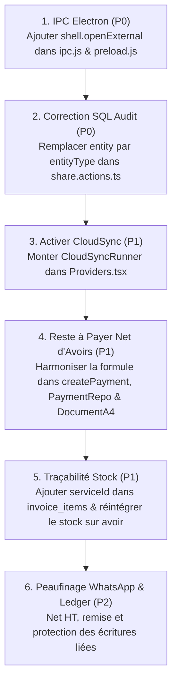

# RAPPORT D'AUDIT ARCHITECTURAL & CONFORMITÉ BACKEND (SPRINTS 1 À 11)

**Projet :** Facturier (Hub & Spoke / Desktop Electron Local-First)  
**Date :** 4 Novembre 2026  
**Auditeur :** Auditeur Principal d'Architecture Logicielle  
**Environnement :** Electron 32+ / Next.js 16 (App Router) / Better-SQLite3 / Supabase Cloud / TypeScript Strict  
**Statut du Document :** Rapport d'Inspection Détaillé & Plan d'Action Curatif  

---

## 1. RÉSUMÉ EXÉCUTIF

Cet audit approfondi a été réalisé en mode **strictement non destructif (lecture seule sur le code applicatif)** afin d'analyser l'intégralité du socle technique développé au fil des Sprints 1 à 11 dans `apps/desktop`. L'objectif est d'identifier les régressions introduites par les fusions successives, les bugs cachés, les risques de désynchronisation de données et les ruptures d'expérience utilisateur avant l'intégration des Sprints 12A/12B menés en parallèle.

### Synthèse des Anomalies Détectées

| Sévérité | Nombre | Description synthétique |
| :--- | :---: | :--- |
| 🔴 **Critique (P0)** | **2** | • Blocage total des liens externes WhatsApp/Mailto (IPC `openExternal` manquant + politique Electron restrictive).<br>• Crash systématique de l'audit logging lors du partage de document (colonne `entity` au lieu de `entityType`). |
| 🟠 **Majeure (P1)** | **5** | • `CloudSyncRunner` orphelin (jamais instancié dans `layout.tsx` / `providers.tsx` : la sync en tâche de fond ne s'exécute jamais).<br>• Déconnexion structurelle du stock : `invoice_items` ne conserve aucun `serviceId`, entraînant l'échec silencieux de la réintégration de stock lors des annulations/avoirs.<br>• Calcul du "Reste à payer" ignorant les avoirs (`credit_notes`) dans `createPayment`, `PaymentRepository` et `DocumentA4`.<br>• Absence de synchronisation Cloud pour `stock_movements` et `ledger_entries` (omises de `SYNC_TABLES`).<br>• Risque de fuite multi-tenant dans `StockRepository.recordStockMovement` (requêtes sans filtre `tenant_id`). |
| 🟡 **Mineure (P2)** | **3** | • `ShareService.ts` étiquette le Brut HT en "Net HT" (omettant la remise) et affiche un "Reste à payer" inapproprié sur les devis.<br>• Absence de verrouillage sur la suppression manuelle des écritures de trésorerie issues de paiements factures (`linkedPaymentId`).<br>• Absence d'enregistrement automatique dans le Grand Livre des flux de trésorerie issus des avoirs remboursés. |

---

## 2. MATRICE DE CONFORMITÉ PAR SPRINT (SPRINTS 1 À 11)

| Sprint | Intitulé Métier | Statut | Synthèse & Analyse Technique |
| :---: | :--- | :---: | :--- |
| **S1** | Initialisation SQLite & Schéma Relationnel | ✅ **Conforme** | Schéma 0001 solide, tables relationnelles conformes, triggers d'horodatage en place. |
| **S2** | Durcissement SQLite & Contraintes XAF | ✅ **Conforme** | Migration 0002 impeccable, typage `INTEGER` strict pour XAF (zéro décimale), contraintes CHECK. |
| **S3** | Multi-Tenancy & Isolation des Données | ⚠️ **Partiel (P1)** | `buildTenantFilter` fonctionnel sur Invoices/Quotes/Clients, mais manquant dans `StockRepository` et `audit_logs`. |
| **S4** | Moteur Fiscal Gabonais (DGI 2026) | ⚠️ **Régression (P1)** | Cascade fiscale (HT -> CSS 1% -> Base -> TPS 9.5% -> TVA 18% -> TTC) conforme dans `@workspace/database/fiscal`. En revanche, le **reste à payer net d'avoirs** est contourné dans l'UI et les actions de paiement. |
| **S5** | Indexation & Performance (N+1) | ✅ **Conforme** | Index de couverture composite intacts dans 0002 ; N+1 résolu via `json_group_array(json_object(...))`. |
| **S6** | Synchronisation Cloud Supabase (Push/Pull) | ⚠️ **Régression (P1)** | Moteur `CloudSyncService.ts` de très haute qualité (LWW, tombstones, quarantaine, drift). Cependant, le runner d'arrière-plan `CloudSyncRunner` n'est jamais monté dans l'arborescence React. |
| **S7** | Gestion des Paiements & Acomptes Multiples | ⚠️ **Partiel (P1)** | Historique chronologique et solde progressif en place, mais calcul du solde restant ignorant les déductions par notes d'avoir. |
| **S8** | Notes d'Avoir & Cycle de Vie Facture | ⚠️ **Partiel (P1)** | Création d'avoir et annulation d'une facture automatisées dans `deleteInvoice`, mais le lien vers le catalogue de stock est rompu. |
| **S9** | Gestion de Stock & Alertes Réassort | ⚠️ **Partiel (P1)** | Table `stock_movements` et alertes minimes opérationnelles en base, mais perte irrémédiable de l'origine article lors de la facturation. |
| **S10** | Partage WhatsApp & Email Direct | 🔴 **Bloqué (P0)** | Totalement inopérant dans Electron : absence de pont IPC `openExternal` et collision de colonnes SQL dans `share.actions.ts`. |
| **S11** | Livre de Caisse & Grand Livre des Comptes | ⚠️ **Partiel (P1)** | Migration 0005, KPIs et synchronisation avec `createPayment` effectives ; exclusion de la synchronisation cloud et aucune intégration des avoirs. |

---

## 3. VÉRIFICATION DÉTAILLÉE DES POINTS DE CONTRÔLE OBLIGATOIRES

### 3.1. Chaîne de Migrations SQLite & Intégrité du Schéma (`apps/desktop/lib/db/migrations/`)

1. **Collisions de numéros de version (`version: 4` / `version: 5`) :**
   - **Inspection :** `apps/desktop/lib/db/migrations/index.ts` déclare ordonnancement strict :
     - `migration0001` : Version `1` (`0001_initial_schema.ts`)
     - `migration0002` : Version `2` (`schema_hardening_integers_and_constraints`)
     - `migration0003` : Version `3` (`0003_backfill_and_sync_schema.ts`)
     - `migration0004` : Version `4` (`0004_stock_management.ts`)
     - `migration0005` : Version `5` (`0005_account_ledger.ts`)
   - **Verdict :** **AUCUNE COLLISION**. Chaque migration incrémente `user_version` de manière séquentielle et déterministe.

2. **Garde anti-boucle en développement (`globalThis`) :**
   - **Inspection :** Dans `apps/desktop/lib/db.ts` (lignes 81-86, 161-186) :
     ```typescript
     const globalForDb = globalThis as unknown as { db: Database.Database; db_ready: boolean; ... };
     if (!globalForDb.db_ready) {
       runMigrations(db, dbPath);
       ...
       const globalForLegacy = globalThis as unknown as { __facturierLegacyMigrated?: boolean };
       if (!globalForLegacy.__facturierLegacyMigrated) {
         migrateLegacyDatabase(db, dbPath);
         globalForLegacy.__facturierLegacyMigrated = true;
       }
       globalForDb.db_ready = true;
     }
     ```
   - **Verdict :** **CONFORME & ROBUSTE**. La double barrière mémoire empêche la ré-exécution intempestive des migrations et des sauvegardes V1->V2 lors des rechargements HMR de Next.js.

3. **Pérennité des index de performance (Sprint 5) :**
   - **Inspection :** `0002_schema_hardening.ts` lignes 445 à 485 définit 28 index d'optimisation couvrant toutes les clés étrangères (`idx_invoice_items_invoiceId`), les filtres multi-tenant (`idx_invoices_tenant`), et les index partiels composites (`idx_invoices_tenant_date WHERE deletedAt IS NULL`).
   - Les migrations 0003, 0004 et 0005 n'exécutent aucun `DROP INDEX` ni reconstruction de table intrusive.
   - **Verdict :** **CONFORME**. Les 28 index de performance sont 100% conservés et actifs.

---

### 3.2. Fondations Sprints 1 à 4 (Transactions, N+1, Fiscalité & Multi-tenant)

1. **Encapsulation Transactionnelle (`db.transaction`) :**
   - `InvoiceService.createInvoice` : Encapsulé dans `db.transaction(...)`.
   - `CreditNoteService.createCreditNote` : Encapsulé dans `db.transaction(...)`.
   - `QuoteService.convertToInvoice` : Encapsulé dans `db.transaction(...)`.
   - `invoice.actions.ts:deleteInvoice` : Encapsulé dans `db.transaction(...)`.
   - `better-sqlite3` gère nativement les transactions imbriquées sous forme de `SAVEPOINT`. L'atomicité multi-tables est assurée.

2. **Résolution du problème N+1 :**
   - `InvoiceRepository.findAll` et `QuoteRepository.findAll` utilisent la sous-requête SQL `(SELECT json_group_array(json_object(...)) FROM invoice_items WHERE invoiceId = i.id ...) as items` et `as payments`.
   - **Verdict :** **CONFORME**. Zéro requête N+1 lors du listing de documents.

3. **Isolation Multi-tenant (`buildTenantFilter`) :**
   - Correctement appliquée dans les requêtes de lecture et de suppression logique des documents de facturation.
   - ⚠️ **Anomalie P1 détectée dans `StockRepository.ts`** : Les requêtes `SELECT stockQuantity, trackStock FROM services WHERE id = ?` (ligne 55) et `UPDATE services SET stockQuantity = ? WHERE id = ?` (ligne 77) omettent le filtrage `tenant_id`.
   - ⚠️ **Anomalie P1 détectée dans `PaymentRepository.ts`** : `findPaymentsByClientId` applique `${tf.sql}` sur l'alias `i` (`invoices`), mais omet de filtrer `p.tenant_id = ?` sur la table `payments`.

4. **Calculs Fiscaux (DGI Gabon 2026 / XAF) :**
   - Moteur unifié dans `@workspace/database/fiscal` :
     - Arrondi entier strict : `Math.round((quantity * unitPrice))` (pas de centimes XAF).
     - Ordre de la cascade : `subtotal - discount = Net HT` $\rightarrow$ `CSS = round(Net HT * 1%)` $\rightarrow$ `Base Taxable = Net HT + CSS` $\rightarrow$ `TPS = round(Base * 9.5%)` $\rightarrow$ `TVA = round(Base * 18%)` $\rightarrow$ `Total TTC = Base + TPS + TVA`.
   - ⚠️ **Anomalie P1 détectée sur le Reste à payer** : `invoice-logic.ts:updateInvoiceStatus` respecte bien la formule `reste = totalTTC - totalAvoirs - totalPaid`. Cependant, `apps/desktop/components/document-a4.tsx` (ligne 59), `payment.actions.ts:createPayment` (lignes 81-83) et `PaymentRepository.ts` calculent le reste dû comme `totalTTC - totalPaid`, ignorant complètement les montants crédités par les avoirs.

---

### 3.3. Synchronisation Cloud & IPC Electron (Sprints 2, 6, 10)

1. **Filtrage de `deleted_at` lors du push vers Supabase :**
   - **Inspection :** Dans `apps/desktop/lib/sync/CloudSyncService.ts` lignes 334 à 348 :
     ```typescript
     const LOCAL_ONLY_COLUMNS: Record<string, Set<string>> = {
       credit_note_items: new Set(['deletedAt', 'deleted_at']),
       invoice_items: new Set(['deletedAt', 'deleted_at']),
       quote_items: new Set(['deletedAt', 'deleted_at']),
     };
     ```
   - **Verdict :** **CONFORME**. Les tables d'items locales ne transmettent pas `deleted_at` au schéma Supabase distant.

2. **Gestion des tables `stock_movements` et `ledger_entries` :**
   - Dans `apps/desktop/lib/sync/localSchema.ts`, `SYNC_TABLES` ne comprend que les 11 tables historiques.
   - **Conséquence :** `CloudSyncService` n'échoue pas (il ignore ces tables), mais **ces tables ne sont JAMAIS sauvegardées ni synchronisées avec le Cloud**. En environnement multi-postes, le stock et le grand livre divergent immédiatement.

3. **Cooldown de 5 minutes & Exécution du Runner :**
   - `apps/desktop/components/cloud-sync-runner.tsx` implémente un cooldown de 300 000 ms via `lastSyncTimeRef`.
   - 🔴 **Anomalie P1 (Composant orphelin)** : `CloudSyncRunner` n'est **importé ni instancié nulle part dans l'application** (`layout.tsx` ou `providers.tsx`). Le cycle de synchronisation automatique ne démarre donc jamais.

4. **IPC Electron, Preload et Sécurité :**
   - 🔴 **Anomalie P0 (Méthode IPC manquante)** : `types/electron.d.ts` déclare `openExternal?: (url: string) => Promise<void>`, mais :
     - `apps/desktop/preload.js` n'expose **AUCUNE** méthode `openExternal`.
     - `apps/desktop/main/ipc.js` ne déclare **AUCUN** handler pour ouvrir des URLs externes.
     - `apps/desktop/main/window.js` bloque systématiquement toute ouverture de fenêtre externe (`setWindowOpenHandler` renvoie `{ action: 'deny' }`).
   - Les liens vers WhatsApp (`https://wa.me/...`) et le client mail (`mailto:...`) sont totalement inopérants.

---

### 3.4. Logique Métier des Sprints 7, 9, 10 et 11

1. **Sprint 7 (Paiements & Acomptes) :**
   - `PaymentRepository.findPaymentsByInvoiceId` calcule le solde progressif de manière ordonnée.
   - Mais l'absence de déduction des avoirs fausse le plafond autorisé dans `createPayment` : un utilisateur peut enregistrer un paiement dont le montant cumulé dépasse le reste à payer réel d'une facture ayant fait l'objet d'un avoir partiel.

2. **Sprint 9 (Gestion de Stock) :**
   - Dans `InvoiceService.createInvoice` (lignes 113-124), l'application déduit le stock si `item.id` est fourni.
   - Mais dans le schéma de validation `invoiceItemSchema` (`validations.ts`), il n'existe aucun champ `serviceId`.
   - La table `invoice_items` ne stocke aucun lien avec `services(id)`.
   - Lors de la suppression/annulation d'une facture (`deleteInvoice`), `CreditNoteService.createCreditNote` reçoit des articles sans identifiant de catalogue, rendant la réintégration en stock (`CREDIT_NOTE_RESTOCK`) impossible.

3. **Sprint 10 (Partage WhatsApp/Email) :**
   - `share.actions.ts` tente d'insérer dans `audit_logs` avec la colonne `entity`, alors que le schéma SQLite impose `entityType`. L'action échoue à 100%.

4. **Sprint 11 (Livre des Comptes) :**
   - `LedgerRepository.ts` est complet (calculs de solde net, filtres, KPIs par méthode et catégorie).
   - La création et suppression de paiements dans `payment.actions.ts` répercutent bien les écritures `IN`.
   - Manquent : la répercussion des remboursements d'avoirs et le verrouillage en suppression des écritures issues de factures.

---

## 4. CATALOGUE DÉTAILLÉ DES ANOMALIES PAR SÉVÉRITÉ

### 🔴 ANOMALIES CRITIQUES (SÉVÉRITÉ P0)

---

#### [P0-01] Blocage irrémédiable de l'ouverture des liens externes WhatsApp et Email dans Electron
* **Fichiers concernés :**
  - [`apps/desktop/preload.js`](file:///c:/Users/LENOVO/Downloads/fintech-invoicing-app/apps/desktop/preload.js) (Lignes 16-88)
  - [`apps/desktop/main/ipc.js`](file:///c:/Users/LENOVO/Downloads/fintech-invoicing-app/apps/desktop/main/ipc.js) (Lignes 30-265)
  - [`apps/desktop/main/window.js`](file:///c:/Users/LENOVO/Downloads/fintech-invoicing-app/apps/desktop/main/window.js) (Lignes 342-349)
  - [`apps/desktop/components/features/share/ShareDocumentModal.tsx`](file:///c:/Users/LENOVO/Downloads/fintech-invoicing-app/apps/desktop/components/features/share/ShareDocumentModal.tsx) (Lignes 93-98)
* **Code défaillant (`ShareDocumentModal.tsx:93-98`) :**
  ```typescript
  if (typeof window !== "undefined" && window.electron?.openExternal) {
    await window.electron.openExternal(finalUrl);
  } else {
    window.open(finalUrl, "_blank");
  }
  ```
  Et dans `window.js:342-349` :
  ```javascript
  mainWindow.webContents.setWindowOpenHandler(({ url }) => {
    if (url.startsWith(LOCAL_ORIGIN) || url.startsWith('http://localhost') || url.startsWith('http://127.0.0.1')) {
      mainWindow.loadURL(url);
    } else {
      logToFile('WARN', `[Confinement] Pop-up externe bloquée: ${url}`);
    }
    return { action: 'deny' };
  });
  ```
* **Cause racine :**
  1. `preload.js` n'expose pas `openExternal` dans l'objet `window.electron`, bien que le fichier de typage TypeScript `types/electron.d.ts` (ligne 39) l'ait déclaré.
  2. Aucun gestionnaire IPC `shell.openExternal` n'a été enregistré dans `main/ipc.js`.
  3. L'exécution bascule dans la branche de repli `window.open(finalUrl, "_blank")`.
  4. La politique de sécurité d'Electron (`setWindowOpenHandler`) intercepte l'appel, constate que l'URL ne commence pas par `http://127.0.0.1`, consigne un avertissement de confinement et renvoie systématiquement `{ action: 'deny' }`.
* **Impact utilisateur :**
  Le bouton "Partager sur WhatsApp" ou "Envoyer par email" ne produit absolument aucun effet. L'utilisateur clique et aucune fenêtre ne s'ouvre.
* **Correction recommandée pour Jules :**
  1. Dans `main/ipc.js` :
     ```javascript
     const { shell } = require('electron');
     ipcMain.handle('app:open-external', async (event, url) => {
       if (!validateSender(event?.senderFrame)) throw new Error('Expéditeur non autorisé');
       if (/^(https:\/\/wa\.me\/|mailto:)/.test(url)) {
         await shell.openExternal(url);
         return { success: true };
       }
       throw new Error('Protocole ou domaine non autorisé');
     });
     ```
  2. Dans `preload.js` :
     ```javascript
     openExternal: (url) => ipcRenderer.invoke('app:open-external', url),
     ```

---

#### [P0-02] Crash SQL de la journalisation d'audit lors du partage de documents
* **Fichier concerné :** [`apps/desktop/app/actions/share.actions.ts`](file:///c:/Users/LENOVO/Downloads/fintech-invoicing-app/apps/desktop/app/actions/share.actions.ts) (Lignes 24-36)
* **Code défaillant :**
  ```typescript
  db.prepare(`
    INSERT INTO audit_logs (id, userId, action, entity, entityId, details, createdAt, tenant_id)
    VALUES (?, ?, ?, ?, ?, ?, ?, ?)
  `).run(
    crypto.randomUUID(),
    session.userId,
    "SHARE",
    "DOCUMENT",
    documentNumber,
    `Document ${documentNumber} partagé via ${channel} à ${recipient}`,
    new Date().toISOString(),
    activeTenantId
  );
  ```
* **Cause racine :**
  Dans le schéma SQLite initial (`0001_initial_schema.ts:217`) et durci (`0002_schema_hardening.ts:391`), la colonne s'appelle `entityType` et non `entity`. L'instruction préparée échoue immédiatement avec l'erreur `SqliteError: table audit_logs has no column named entity`.
* **Impact utilisateur :**
  Chaque tentative de partage déclenche une erreur serveur et renvoie `{ success: false, error: 'Échec de la journalisation' }`.
* **Correction recommandée pour Jules :**
  Remplacer `entity` par `entityType` dans la requête SQL de `share.actions.ts`.

---

### 🟠 ANOMALIES MAJEURES (SÉVÉRITÉ P1)

---

#### [P1-01] Désactivation complète de la synchronisation automatique en arrière-plan (Composant orphelin)
* **Fichiers concernés :**
  - [`apps/desktop/components/cloud-sync-runner.tsx`](file:///c:/Users/LENOVO/Downloads/fintech-invoicing-app/apps/desktop/components/cloud-sync-runner.tsx)
  - [`apps/desktop/app/layout.tsx`](file:///c:/Users/LENOVO/Downloads/fintech-invoicing-app/apps/desktop/app/layout.tsx)
  - [`apps/desktop/components/providers.tsx`](file:///c:/Users/LENOVO/Downloads/fintech-invoicing-app/apps/desktop/components/providers.tsx)
* **Cause racine :**
  Le composant client `CloudSyncRunner` a été écrit pour cadencer la synchronisation automatique (au démarrage, au retour en ligne et toutes les 10 minutes avec cooldown de 5 minutes). Cependant, il n'a **jamais été inséré** dans `Providers` ni dans le `RootLayout`. Aucune autre partie de l'application n'appelle `runCloudSync`.
* **Impact métier :**
  La synchronisation avec Supabase Cloud ne s'exécute jamais automatiquement. Les modifications apportées sur l'application Desktop ne remontent jamais au Hub, et les modifications distantes ne sont jamais rapatriées.
* **Correction recommandée pour Jules :**
  Importer et monter `<CloudSyncRunner />` à l'intérieur de `Providers.tsx` (dans le contexte client).

---

#### [P1-02] Perte d'association du catalogue et impossibilité de réintégrer le stock sur annulation de facture
* **Fichiers concernés :**
  - [`apps/desktop/lib/services/InvoiceService.ts`](file:///c:/Users/LENOVO/Downloads/fintech-invoicing-app/apps/desktop/lib/services/InvoiceService.ts) (Lignes 113-124)
  - [`apps/desktop/lib/services/CreditNoteService.ts`](file:///c:/Users/LENOVO/Downloads/fintech-invoicing-app/apps/desktop/lib/services/CreditNoteService.ts) (Lignes 105-116)
  - [`apps/desktop/app/actions/invoice.actions.ts`](file:///c:/Users/LENOVO/Downloads/fintech-invoicing-app/apps/desktop/app/actions/invoice.actions.ts) (Lignes 154-168)
  - [`apps/desktop/lib/validations.ts`](file:///c:/Users/LENOVO/Downloads/fintech-invoicing-app/apps/desktop/lib/validations.ts) (Lignes 68-76)
* **Code défaillant (`InvoiceService.ts:113-124`) :**
  ```typescript
  if (item.id) { // Assuming item.id contains the serviceId if it's a catalog item
    try {
       StockRepository.recordStockMovement({
         serviceId: item.id,
         type: 'INVOICE_DEDUCTION',
         quantity: item.quantity,
         referenceDoc: number,
       }, userId, activeTenantId);
    } catch (e) {
       // Ignore if it's not a valid service or doesn't track stock
    }
  }
  ```
* **Cause racine :**
  1. Le schéma SQLite de `invoice_items` ne possède aucune colonne `serviceId`.
  2. `invoiceItemSchema` définit `id` comme optionnel pour représenter l'identifiant de la ligne elle-même.
  3. Lorsque l'utilisateur facture un article de stock, son `serviceId` d'origine est perdu dès l'insertion en base de données.
  4. Dans `deleteInvoice` (`invoice.actions.ts:160-164`), la création de la note d'avoir de contrepassation ne transmet aucun identifiant de service :
     ```typescript
     items: items.map((it) => ({
       description: it.description,
       quantity: it.quantity,
       unitPrice: it.unitPrice,
     }))
     ```
  5. Dans `CreditNoteService.ts:105`, `(item as any).id` est indéfini. La réintégration de stock (`CREDIT_NOTE_RESTOCK`) n'est jamais déclenchée.
* **Impact métier :**
  Le stock physique déduit lors de la facturation reste définitivement déduit même lorsque la facture est annulée ou supprimée.

---

#### [P1-03] Calcul erroné du "Reste à payer" ignorant les avoirs (`credit_notes`)
* **Fichiers concernés :**
  - [`apps/desktop/app/actions/payment.actions.ts`](file:///c:/Users/LENOVO/Downloads/fintech-invoicing-app/apps/desktop/app/actions/payment.actions.ts) (Lignes 79-87)
  - [`apps/desktop/lib/repositories/PaymentRepository.ts`](file:///c:/Users/LENOVO/Downloads/fintech-invoicing-app/apps/desktop/lib/repositories/PaymentRepository.ts) (Lignes 74, 110)
  - [`apps/desktop/components/document-a4.tsx`](file:///c:/Users/LENOVO/Downloads/fintech-invoicing-app/apps/desktop/components/document-a4.tsx) (Lignes 58-59)
* **Code défaillant (`payment.actions.ts:81-86`) :**
  ```typescript
  const checkTotalPaidStmt = db.prepare(`SELECT COALESCE(SUM(amount), 0) as totalPaid FROM payments WHERE invoiceId = ? AND deletedAt IS NULL${tf.sql}`);
  const paidResult = checkTotalPaidStmt.get(invoiceId, ...tf.params) as { totalPaid: number };
  const totalPaid = Math.round(paidResult.totalPaid || 0);
  const totalTTC = Math.round(invoice.total);
  const remaining = totalTTC - totalPaid;

  if (Math.round(amount) > remaining) {
    return { success: false, error: `Le montant du paiement (${amount} XAF) excède le reste à charge de la facture (${remaining} XAF)` };
  }
  ```
* **Cause racine :**
  Alors que `invoice-logic.ts:updateInvoiceStatus` applique scrupuleusement la formule légale `reste = totalTTC - totalAvoirs - totalPaid`, `createPayment`, `PaymentRepository` et `DocumentA4` ignorent la table `credit_notes`.
* **Impact métier :**
  Si une facture de 100 000 FCFA fait l'objet d'un avoir partiel de 40 000 FCFA :
  - La facture affiche toujours un reste à payer de 100 000 FCFA sur l'aperçu A4 imprimable au client.
  - Le système permet d'encaisser jusqu'à 100 000 FCFA au lieu des 60 000 FCFA réellement exigibles, causant une surfacturation et un désaccord comptable majeur.

---

#### [P1-04] Omission des tables `stock_movements` et `ledger_entries` dans le schéma de synchronisation Cloud
* **Fichier concerné :** [`apps/desktop/lib/sync/localSchema.ts`](file:///c:/Users/LENOVO/Downloads/fintech-invoicing-app/apps/desktop/lib/sync/localSchema.ts) (Lignes 18-30)
* **Cause racine :**
  Lors des Sprints 9 et 11, les tables `stock_movements` et `ledger_entries` ont été créées dans SQLite, mais le tableau `SYNC_TABLES` n'a pas été enrichi. De plus, aucun trigger de suivi des modifications (`updated_at` / `synced_at`) ni tombstone n'a été défini pour ces tables.
* **Impact métier :**
  En cas d'utilisation multi-postes ou de restauration après réinstallation de la machine, l'ensemble des mouvements de stocks et des lignes du grand livre de trésorerie sont perdus ou restent confinés à un poste unique.

---

#### [P1-05] Risque de fuite multi-tenant dans `StockRepository`
* **Fichier concerné :** [`apps/desktop/lib/repositories/StockRepository.ts`](file:///c:/Users/LENOVO/Downloads/fintech-invoicing-app/apps/desktop/lib/repositories/StockRepository.ts) (Lignes 55, 77)
* **Code défaillant :**
  ```typescript
  const service = db.prepare('SELECT stockQuantity, trackStock FROM services WHERE id = ?').get(data.serviceId);
  ...
  db.prepare('UPDATE services SET stockQuantity = ? WHERE id = ?').run(newStock, data.serviceId);
  ```
* **Cause racine :**
  Aucun filtrage sur `tenant_id` n'est appliqué lors de la lecture ou de la mise à jour du stock dans le service. Un appel falsifié ou erroné pourrait modifier le niveau de stock d'un article appartenant à un autre tenant.
* **Correction recommandée :**
  Ajouter explicitement `AND tenant_id = ?` aux deux requêtes SQL.

---

### 🟡 ANOMALIES MINEURES & DETTE TECHNIQUE (SÉVÉRITÉ P2)

---

#### [P2-01] Erreur d'étiquetage et calcul de remise dans le message de partage WhatsApp (`ShareService.ts`)
* **Fichier concerné :** [`apps/desktop/lib/services/ShareService.ts`](file:///c:/Users/LENOVO/Downloads/fintech-invoicing-app/apps/desktop/lib/services/ShareService.ts) (Lignes 51-60)
* **Cause racine :**
  Le message affiche `*Montant Net HT :* ${formatCurrency(document.subtotal)}`. Or, `subtotal` correspond au **Brut HT**. Si une remise a été accordée (`document.discount > 0`), le vrai Net HT est `subtotal - discount`. Par ailleurs, la ligne `Reste à payer : ${formatCurrency(document.total)}` est affichée y compris pour un devis (qui n'a pas de solde exigible) ou pour une facture avec acomptes.

---

#### [P2-02] Absence de protection contre la suppression manuelle des écritures de trésorerie liées aux factures
* **Fichier concerné :** [`apps/desktop/lib/repositories/LedgerRepository.ts`](file:///c:/Users/LENOVO/Downloads/fintech-invoicing-app/apps/desktop/lib/repositories/LedgerRepository.ts) (Ligne 174)
* **Cause racine :**
  `softDelete` autorise la suppression directe de n'importe quelle écriture dans `ledger_entries`, y compris celles ayant `linkedPaymentId IS NOT NULL`. Cela détruit la correspondance entre les paiements enregistrés sur les factures et le livre de caisse.

---

#### [P2-03] Absence d'enregistrement des avoirs remboursés dans le Grand Livre
* **Fichiers concernés :**
  - [`apps/desktop/lib/services/CreditNoteService.ts`](file:///c:/Users/LENOVO/Downloads/fintech-invoicing-app/apps/desktop/lib/services/CreditNoteService.ts)
  - [`apps/desktop/app/actions/credit-note.actions.ts`](file:///c:/Users/LENOVO/Downloads/fintech-invoicing-app/apps/desktop/app/actions/credit-note.actions.ts)
* **Cause racine :**
  Contrairement à `createPayment` qui insère automatiquement une ligne `IN` dans le livre des comptes, l'émission d'un avoir remboursé ou décaissé n'alimente pas le livre de caisse en flux de sortie (`OUT`).

---

## 5. PLAN D'ACTION CURATIF POUR L'ÉQUIPE (JULES & TEAM)

Pour garantir une fusion propre et sans régression avec les Sprints 12A/12B, voici la séquence d'interventions priorisée :



### Checklist d'Implémentation Recommandée :
1. **Étape 1 (Urgence P0)** :
   - [ ] Dans `apps/desktop/main/ipc.js`, implémenter le handler `'app:open-external'` avec validation de protocole (`https://wa.me/`, `mailto:`).
   - [ ] Dans `apps/desktop/preload.js`, exposer `openExternal: (url) => ipcRenderer.invoke('app:open-external', url)`.
   - [ ] Dans `apps/desktop/app/actions/share.actions.ts`, corriger l'insert `audit_logs` (`entityType` au lieu de `entity`).
2. **Étape 2 (Stabilisation P1)** :
   - [ ] Dans `apps/desktop/components/providers.tsx`, insérer `<CloudSyncRunner />`.
   - [ ] Dans `apps/desktop/app/actions/payment.actions.ts` et `apps/desktop/components/document-a4.tsx`, déduire systématiquement `totalAvoirs` du montant total pour obtenir le reste à payer réel.
   - [ ] Dans `apps/desktop/lib/db/migrations/`, préparer une migration d'appoint pour ajouter `serviceId TEXT REFERENCES services(id)` dans `invoice_items` et `credit_note_items`.
   - [ ] Dans `apps/desktop/lib/sync/localSchema.ts`, ajouter `stock_movements` et `ledger_entries` à `SYNC_TABLES`.
3. **Étape 3 (Finitions P2)** :
   - [ ] Corriger le libellé Net HT et la déduction de remise dans `ShareService.ts`.
   - [ ] Ajouter une garde interdisant la suppression manuelle des écritures comptables possédant un `linkedPaymentId`.

