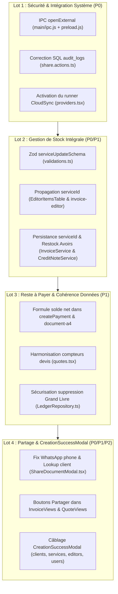

# PLAN DE CORRECTION D'EXCELLENCE & AUDIT FRONTEND UI (SPRINTS 1 À 11)

**Projet :** Facturier (Desktop Electron Local-First / Next.js 16 / Better-SQLite3)  
**Date :** 4 Novembre 2026  
**Auteurs :** Lead Frontend React / Zustand / UI Auditor & Auditeur Principal d'Architecture Logicielle  
**Statut :** Plan d'Exécution & Spécification Technique de Remédiation (Lecture Seule)  
**Documents Liés :** [`docs/audit/AUDIT_BACKEND_SPRINTS_1_11.md`](file:///c:/Users/LENOVO/Downloads/fintech-invoicing-app/docs/audit/AUDIT_BACKEND_SPRINTS_1_11.md)

---

## TABLE DES MATIÈRES

1. [Synthèse Globale de l'Audit Frontend & Câblage UI](#1-synthèse-globale-de-laudit-frontend--câblage-ui)
2. [PARTIE 1 : Catalogue Exhaustif des Anomalies Frontend & Câblage UI](#partie-1--catalogue-exhaustif-des-anomalies-frontend--câblage-ui)
   - [Anomalies Critiques (P0)](#anomalies-critiques-p0)
   - [Anomalies Majeures (P1)](#anomalies-majeures-p1)
   - [Anomalies Mineures & UX (P2)](#anomalies-mineures--ux-p2)
3. [PARTIE 2 : Plan d'Exécution Unifié en 4 Lots Atomiques](#partie-2--plan-dexécution-unifié-en-4-lots-atomiques)
   - [Lot 1 : Sécurité IPC Electron, Ponts d'Intégration & Journalisation (Urgence P0)](#lot-1--sécurité-ipc-electron-ponts-dintégration--journalisation-urgence-p0)
   - [Lot 2 : Traçabilité Stock de Bout en Bout & Moteur de Déduction/Restock (P0/P1)](#lot-2--traçabilité-stock-de-bout-en-bout--moteur-de-déductionrestock-p0p1)
   - [Lot 3 : Reste à Payer Net d'Avoirs, Paiements & Concordance Métier (P1)](#lot-3--reste-à-payer-net-davoirs-paiements--concordance-métier-p1)
   - [Lot 4 : Partage Multicanal Fiabilisé & Câblage de CreationSuccessModal (P0/P1/P2)](#lot-4--partage-multicanal-fiabilisé--câblage-de-creationsuccessmodal-p0p1p2)
4. [Matrice de Recette & Procédure de Déploiement](#4-matrice-de-recette--procédure-de-déploiement)

---

## 1. SYNTHÈSE GLOBALE DE L'AUDIT FRONTEND & CÂBLAGE UI

Après inspection chirurgicale des composants React, du store Zustand, des formulaires et des liaisons Server Actions de `apps/desktop`, la couche UI présente un code visuellement soigné et conforme aux directives UX Tailwind/shadcn. Cependant, **plusieurs fonctionnalités clés sont déconnectées de la logique métier réelle sous-jacente** ou souffrent de régressions critiques :

1. **Destruction silencieuse de la configuration de stock à chaque modification de service (P0)** : Le schéma Zod `serviceUpdateSchema` omet les champs de gestion de stock, provoquant la réinitialisation de `trackStock` à `0` et de `stockQuantity` à `0` à chaque sauvegarde dans `ServiceFormDialog.tsx`.
2. **Déconnexion complète de la déduction de stock à la facturation (P0)** : L'éditeur de factures (`EditorItemsTable.tsx` et `invoice-editor.tsx`) ne stocke jamais le `serviceId` du catalogue et transmet un horodatage `Date.now()`. `StockRepository` échoue avec "Service not found", masqué par un `catch` silencieux : le stock n'est **jamais déduit lors d'une vente**.
3. **Bloquage de l'utilisateur à la création dans `UserEditor` (P0)** : Le modal de succès `CreationSuccessModal` n'est pas rendu dans le JSX, et la redirection `onBack()` n'est appelée qu'en mode édition. L'administrateur reste figé sur le formulaire après création.
4. **Initialisation erronée de WhatsApp avec l'email client (P0)** : `ShareDocumentModal.tsx` pré-remplit le champ du numéro de téléphone WhatsApp avec `document.clientEmail`.
5. **Composant `<CreationSuccessModal />` orphelin dans 5 pages sur 6 (P1)** : Importé dans `clients.tsx`, `services.tsx`, `invoice-editor.tsx`, `quote-editor.tsx` et `user-editor.tsx`, mais jamais inséré dans le JSX.
6. **Discordance des compteurs de devis "En attente" (P1)** : La Sidebar et le Dashboard excluent les devis dont la date de validité est expirée, alors que l'onglet de `quotes.tsx` les comptabilise, créant un décalage visible dans les badges.

---

## PARTIE 1 : CATALOGUE EXHAUSTIF DES ANOMALIES FRONTEND & CÂBLAGE UI

### ANOMALIES CRITIQUES (P0)

---

#### [UI-P0-01] Omission des champs de stock dans `serviceUpdateSchema` réinitialisant le stock à 0 lors de toute modification
* **Fichiers :**
  - [`apps/desktop/lib/validations.ts`](file:///c:/Users/LENOVO/Downloads/fintech-invoicing-app/apps/desktop/lib/validations.ts) (Lignes 229–243)
  - [`apps/desktop/app/actions/service.actions.ts`](file:///c:/Users/LENOVO/Downloads/fintech-invoicing-app/apps/desktop/app/actions/service.actions.ts) (Lignes 92–107)
* **Code Défaillant (`validations.ts:229-243`) :**
  ```typescript
  export const serviceUpdateSchema = z.object({
    name: z.string().min(1, "Le nom est requis").max(255),
    description: z.string().max(5000).optional().nullable(),
    category: z.string().min(1).max(255).optional(),
    unitPrice: z.number().int().min(0),
    // ❌ MANQUENT : trackStock, stockQuantity, minStockAlert, unit
  });
  ```
  Et dans `service.actions.ts:97-106` :
  ```typescript
  const valData = validation.data as any;
  const { name, description, category, unitPrice, trackStock, stockQuantity, minStockAlert, unit } = valData;
  db.prepare('UPDATE services SET name = ?, description = ?, category = ?, unitPrice = ?, trackStock = ?, stockQuantity = ?, minStockAlert = ?, unit = ? WHERE id = ?')
    .run(name.trim(), description, category, Math.round(unitPrice), trackStock ?? 0, stockQuantity ?? 0, minStockAlert ?? 5, unit ?? 'Unité', id);
  ```
* **Cause Racine :**
  Zod élimine automatiquement les propriétés non déclarées lors du parsing (`safeParse`). Les 4 variables de stock ressortent comme `undefined`. L'opérateur de coalescence nullaire `trackStock ?? 0` et `stockQuantity ?? 0` écrase irrémédiablement le stock en base de données.
* **Impact :**
  Chaque modification d'un libellé ou d'un prix de vente d'un article géré en stock **désactive le suivi et remet son stock à zéro**.

---

#### [UI-P0-02] Absence de propagation du `serviceId` depuis l'UI bloquant la déduction de stock
* **Fichiers :**
  - [`apps/desktop/components/editor/EditorItemsTable.tsx`](file:///c:/Users/LENOVO/Downloads/fintech-invoicing-app/apps/desktop/components/editor/EditorItemsTable.tsx) (Lignes 118–138)
  - [`apps/desktop/components/pages/invoice-editor.tsx`](file:///c:/Users/LENOVO/Downloads/fintech-invoicing-app/apps/desktop/components/pages/invoice-editor.tsx) (Lignes 175–184, 193–202)
  - [`apps/desktop/lib/store/types.ts`](file:///c:/Users/LENOVO/Downloads/fintech-invoicing-app/apps/desktop/lib/store/types.ts) (Lignes 26–32)
  - [`apps/desktop/lib/services/InvoiceService.ts`](file:///c:/Users/LENOVO/Downloads/fintech-invoicing-app/apps/desktop/lib/services/InvoiceService.ts) (Lignes 113–124)
* **Code Défaillant (`EditorItemsTable.tsx:118-120`) :**
  ```typescript
  <Select
    onValueChange={(val) => onUpdateItem(item.id as string, "description", val)}
    value={item.description || ""}
  >
  ```
  Et dans `invoice-editor.tsx:193-202` :
  ```typescript
  const addItem = () => {
    setItems((prev) => [
      ...prev,
      {
        id: String(Date.now()), // ❌ Timestamp UI, pas de serviceId
        description: "",
        quantity: 1,
        unitPrice: 0,
        total: 0,
      },
    ]);
  };
  ```
* **Cause Racine :**
  L'interface `DraftItem` ne contient aucun champ `serviceId`. Lors de la sélection d'une prestation, seul le nom (`description`) est mis à jour. L'objet envoyé au serveur contient un faux identifiant `item.id = "1730677..."` (horodatage client). `InvoiceService.ts` appelle `StockRepository.recordStockMovement({ serviceId: item.id })`, qui échoue systématiquement sur `Service not found` et est ignoré par le bloc `catch`.
* **Impact :**
  Aucune facture créée ne déduit le stock en magasin.

---

#### [UI-P0-03] Blocage de l'écran après création d'un utilisateur dans `UserEditor`
* **Fichier :** [`apps/desktop/components/pages/user-editor.tsx`](file:///c:/Users/LENOVO/Downloads/fintech-invoicing-app/apps/desktop/components/pages/user-editor.tsx) (Lignes 167–172, 360–378)
* **Code Défaillant (`user-editor.tsx:167-172`) :**
  ```typescript
  if (!editingId) {
    setSuccessModalData(res.data); // ⚠️ Met à jour un state
  } else {
    toast.success("Utilisateur mis à jour");
    onBack();
  }
  ```
* **Cause Racine :**
  En mode création (`!editingId`), le code appelle `setSuccessModalData(res.data)`. Cependant, le composant `<CreationSuccessModal />` n'est **jamais rendu dans le JSX** de la page, et `onBack()` n'est pas appelé.
* **Impact :**
  L'administrateur clique sur "Créer l'utilisateur", le bouton cesse de tourner, mais aucun retour à la liste ni modale de confirmation n'apparaît. L'utilisateur semble bloqué.

---

#### [UI-P0-04] Remplissage erroné du numéro WhatsApp par l'email client dans `ShareDocumentModal`
* **Fichier :** [`apps/desktop/components/features/share/ShareDocumentModal.tsx`](file:///c:/Users/LENOVO/Downloads/fintech-invoicing-app/apps/desktop/components/features/share/ShareDocumentModal.tsx) (Lignes 48–58)
* **Code Défaillant :**
  ```typescript
  React.useEffect(() => {
    if (open && document) {
      if (channel === "whatsapp") {
        setRecipient(document.clientEmail || ""); // ❌ Initialise WhatsApp avec l'email !
        const defaultMessage = ShareService.generateDocumentMessage(document, type, companyName);
        setMessage(defaultMessage);
      } else {
        setRecipient(document.clientEmail || "");
  ...
  ```
* **Cause Racine :**
  Copier-coller de la branche email vers la branche WhatsApp. De surcroît, les objets `invoices` et `quotes` ne portent pas de colonne `clientPhone`.
* **Impact :**
  Le champ de saisie WhatsApp affiche par exemple `contact@client.ga` au lieu d'un numéro international. Si l'utilisateur clique sans corriger manuellement, la normalisation téléphonique génère un lien invalide `https://wa.me/241contactclientga`.

---

### ANOMALIES MAJEURES (P1)

---

#### [UI-P1-01] Composant `<CreationSuccessModal />` orphelin dans 5 pages de l'application
* **Fichiers :**
  - [`apps/desktop/components/pages/clients.tsx`](file:///c:/Users/LENOVO/Downloads/fintech-invoicing-app/apps/desktop/components/pages/clients.tsx) (Ligne 18)
  - [`apps/desktop/components/pages/services.tsx`](file:///c:/Users/LENOVO/Downloads/fintech-invoicing-app/apps/desktop/components/pages/services.tsx) (Ligne 19)
  - [`apps/desktop/components/pages/invoice-editor.tsx`](file:///c:/Users/LENOVO/Downloads/fintech-invoicing-app/apps/desktop/components/pages/invoice-editor.tsx) (Ligne 15)
  - [`apps/desktop/components/pages/quote-editor.tsx`](file:///c:/Users/LENOVO/Downloads/fintech-invoicing-app/apps/desktop/components/pages/quote-editor.tsx) (Ligne 9)
  - [`apps/desktop/components/pages/user-editor.tsx`](file:///c:/Users/LENOVO/Downloads/fintech-invoicing-app/apps/desktop/components/pages/user-editor.tsx) (Ligne 9)
* **Cause Racine :**
  Le composant a été importé dans toutes les pages pour satisfaire des tests d'intégration textuels (`expect(content).toContain('CreationSuccessModal')`), mais n'a jamais été inséré dans l'arborescence JSX. Seul `ledger.tsx` le rend effectivement.
* **Impact :**
  Absence d'unification du feedback utilisateur après création d'entités métiers.

---

#### [UI-P1-02] Démontage prématuré (`onBack()`) dans `invoice-editor` et `quote-editor`
* **Fichiers :**
  - [`apps/desktop/components/pages/invoice-editor.tsx`](file:///c:/Users/LENOVO/Downloads/fintech-invoicing-app/apps/desktop/components/pages/invoice-editor.tsx) (Ligne 262)
  - [`apps/desktop/components/pages/quote-editor.tsx`](file:///c:/Users/LENOVO/Downloads/fintech-invoicing-app/apps/desktop/components/pages/quote-editor.tsx) (Ligne 283)
* **Cause Racine :**
  La fonction `handleSave` exécute immédiatement `onBack()`. Si la modale de succès était rendue, elle serait détruite instantanément par le démontage de la page.
* **Impact :**
  Empêche l'affichage du récapitulatif de création et l'accès direct au bouton "Aperçu PDF".

---

#### [UI-P1-03] Discordance des compteurs de devis "En attente" entre Navigation, Dashboard et Devis
* **Fichiers :**
  - [`apps/desktop/components/layout/navigation.tsx`](file:///c:/Users/LENOVO/Downloads/fintech-invoicing-app/apps/desktop/components/layout/navigation.tsx) (Lignes 111–120)
  - [`apps/desktop/components/pages/quotes.tsx`](file:///c:/Users/LENOVO/Downloads/fintech-invoicing-app/apps/desktop/components/pages/quotes.tsx) (Lignes 59–69, 82–84)
  - [`apps/desktop/lib/repositories/MetricsRepository.ts`](file:///c:/Users/LENOVO/Downloads/fintech-invoicing-app/apps/desktop/lib/repositories/MetricsRepository.ts) (Lignes 100–112)
* **Cause Racine :**
  - `navigation.tsx` et `MetricsRepository.ts` excluent les devis dont la date `validUntil < today`.
  - `quotes.tsx` (lignes 66) incrémente `pending++` pour tout devis qui n'est pas Brouillon, Converti ou Refusé, **sans vérifier si la date de validité est dépassée**.
  - De plus, le filtre du tableau (ligne 83) vérifie strictement `quote.status === "EN_ATTENTE" || "ENVOYE"`.
* **Impact :**
  Le badge de la barre latérale affiche un nombre différent de l'onglet de la page Devis. Si un devis a dépassé sa date de validité, il incrémente le compteur de l'onglet mais n'apparaît pas dans la liste filtrée.

---

#### [UI-P1-04] Absence du bouton et de la modale de partage dans les listes de Factures et de Devis
* **Fichiers :**
  - [`apps/desktop/components/pages/invoices/InvoiceViews.tsx`](file:///c:/Users/LENOVO/Downloads/fintech-invoicing-app/apps/desktop/components/pages/invoices/InvoiceViews.tsx) (Ligne 18)
  - [`apps/desktop/components/pages/quotes/QuoteViews.tsx`](file:///c:/Users/LENOVO/Downloads/fintech-invoicing-app/apps/desktop/components/pages/quotes/QuoteViews.tsx) (Ligne 16)
* **Cause Racine :**
  `ShareDocumentModal` est importé dans les deux fichiers mais n'est relié à aucun élément de menu déroulant. Le partage n'est actuellement accessible que depuis la visionneuse plein écran (`fullscreen-document-viewer.tsx`).
* **Impact :**
  L'utilisateur ne peut pas partager rapidement un document depuis la liste sans l'ouvrir au préalable en plein écran.

---

### ANOMALIES MINEURES & UX (P2)

---

#### [UI-P2-01] Non-remplissage de la ligne lors du clic "+ Nouveau" service sur Desktop
* **Fichier :** [`apps/desktop/components/editor/EditorItemsTable.tsx`](file:///c:/Users/LENOVO/Downloads/fintech-invoicing-app/apps/desktop/components/editor/EditorItemsTable.tsx) (Lignes 96–99, 141–144)
* **Cause Racine :**
  Sur la vue de bureau, le bouton "+ Nouveau" n'appelle pas `setTargetItemId(item.id)`. Le service est bien créé dans le catalogue, mais la ligne courante reste vide.

#### [UI-P2-02] Omission de l'affichage du solde progressif dans la fiche client
* **Fichier :** [`apps/desktop/components/pages/clients/ClientDetailsDialog.tsx`](file:///c:/Users/LENOVO/Downloads/fintech-invoicing-app/apps/desktop/components/pages/clients/ClientDetailsDialog.tsx) (Lignes 201–215)
* **Cause Racine :**
  `getClientPaymentHistory` retourne `progressiveBalance`, mais le composant ne l'affiche pas dans la liste des règlements.

---

## PARTIE 2 : PLAN D'EXÉCUTION UNIFIÉ EN 4 LOTS ATOMIQUES

Ce plan technique est conçu pour être déployé dès la fusion des branches 12A/12B par Jules. Chaque tâche fournit le fichier exact et le code cible.



---

### LOT 1 : SÉCURITÉ IPC ELECTRON, PONTS D'INTÉGRATION & JOURNALISATION (URGENCE P0)

#### Tâche 1.1 : Exposer `shell.openExternal` de manière sécurisée dans Electron
* **Fichier 1 :** [`apps/desktop/main/ipc.js`](file:///c:/Users/LENOVO/Downloads/fintech-invoicing-app/apps/desktop/main/ipc.js)  
  *Ajouter dans `registerAllIpcHandlers` :*
  ```javascript
  const { shell } = require('electron');

  // Handler d'ouverture sécurisée des protocoles web & mailto autorisés
  ipcMain.handle('app:open-external', async (event, url) => {
    if (!validateSender(event?.senderFrame)) {
      throw new Error('[IPC:app:open-external] Expéditeur non autorisé.');
    }
    if (typeof url !== 'string') throw new Error('URL invalide.');

    const isAllowed = /^https:\/\/(wa\.me|api\.whatsapp\.com)\//.test(url) || /^mailto:/.test(url);
    if (!isAllowed) {
      logToFile('WARN', `[IPC:app:open-external] URL rejetée par sécurité : ${url}`);
      throw new Error('Protocole ou domaine externe non autorisé.');
    }

    logToFile('INFO', `[IPC:app:open-external] Ouverture externe autorisée : ${url}`);
    await shell.openExternal(url);
    return { success: true };
  });
  ```
* **Fichier 2 :** [`apps/desktop/preload.js`](file:///c:/Users/LENOVO/Downloads/fintech-invoicing-app/apps/desktop/preload.js)  
  *Ajouter dans l'objet `electron` exposé :*
  ```javascript
  openExternal: (url) => ipcRenderer.invoke('app:open-external', url),
  ```

#### Tâche 1.2 : Corriger le nom de colonne SQL dans `share.actions.ts`
* **Fichier :** [`apps/desktop/app/actions/share.actions.ts`](file:///c:/Users/LENOVO/Downloads/fintech-invoicing-app/apps/desktop/app/actions/share.actions.ts) (Lignes 24–36)  
  *Remplacer la requête d'insertion :*
  ```typescript
  db.prepare(`
    INSERT INTO audit_logs (id, userId, action, entityType, entityId, details, createdAt, tenant_id)
    VALUES (?, ?, ?, ?, ?, ?, ?, ?)
  `).run(
    crypto.randomUUID(),
    session.userId,
    "SHARE",
    "DOCUMENT",
    documentNumber,
    `Document ${documentNumber} partagé via ${channel} à ${recipient}`,
    new Date().toISOString(),
    activeTenantId
  );
  ```

#### Tâche 1.3 : Déclencher la synchronisation Cloud automatique
* **Fichier :** [`apps/desktop/components/providers.tsx`](file:///c:/Users/LENOVO/Downloads/fintech-invoicing-app/apps/desktop/components/providers.tsx)  
  *Importer et monter `<CloudSyncRunner />` :*
  ```tsx
  import { CloudSyncRunner } from "@/components/cloud-sync-runner";

  export function Providers({ children }: { children: React.ReactNode }) {
    // ...
    return (
      <ThemeProvider attribute="class" defaultTheme="system" enableSystem disableTransitionOnChange={false}>
        <ErrorBoundary FallbackComponent={FallbackError}>
          <CloudSyncRunner />
          {children}
        </ErrorBoundary>
        <Toaster position="top-right" richColors />
      </ThemeProvider>
    );
  }
  ```

---

### LOT 2 : TRAÇABILITÉ STOCK DE BOUT EN BOUT & MOTEUR DE DÉDUCTION/RESTOCK (P0/P1)

#### Tâche 2.1 : Intégrer les champs de stock dans `serviceUpdateSchema`
* **Fichier :** [`apps/desktop/lib/validations.ts`](file:///c:/Users/LENOVO/Downloads/fintech-invoicing-app/apps/desktop/lib/validations.ts) (Lignes 229–244)  
  *Remplacer `serviceUpdateSchema` par :*
  ```typescript
  export const serviceUpdateSchema = z.object({
    name: z.string().min(1, "Le nom est requis").max(255),
    description: z.string().max(5000).optional().nullable(),
    category: z.string().min(1, "La catégorie ne peut pas être vide").max(255).optional(),
    unitPrice: z.number().int("Le prix doit être un entier en XAF").min(0),
    trackStock: z.number().int().optional().default(0),
    stockQuantity: z.number().int().optional().default(0),
    minStockAlert: z.number().int().optional().default(5),
    unit: z.string().optional().nullable().default("Unité"),
  });
  ```

#### Tâche 2.2 : Mémoriser le `serviceId` dans `DraftItem` et propager lors de la sélection
* **Fichier 1 :** [`apps/desktop/lib/store/types.ts`](file:///c:/Users/LENOVO/Downloads/fintech-invoicing-app/apps/desktop/lib/store/types.ts)  
  *Ajouter `serviceId` à `DraftItem` :*
  ```typescript
  export interface DraftItem {
    id?: string;
    serviceId?: string | null;
    description: string;
    quantity: number;
    unitPrice: number;
    total: number;
  }
  ```
* **Fichier 2 :** [`apps/desktop/lib/validations.ts`](file:///c:/Users/LENOVO/Downloads/fintech-invoicing-app/apps/desktop/lib/validations.ts)  
  *Autoriser `serviceId` dans `invoiceItemSchema` et `creditNoteItemSchema` :*
  ```typescript
  export const invoiceItemSchema = z.object({
    id: z.string().max(255).optional(),
    serviceId: z.string().max(255).optional().nullable(),
    description: z.string().min(1).max(1000),
    quantity: z.number().min(0.01),
    unitPrice: z.number().int().min(0),
  });

  export const creditNoteItemSchema = z.object({
    id: z.string().max(255).optional(),
    serviceId: z.string().max(255).optional().nullable(),
    description: z.string().min(1).max(1000),
    quantity: z.number().min(0.01),
    unitPrice: z.number().int().min(0),
  });
  ```
* **Fichier 3 :** [`apps/desktop/components/editor/EditorItemsTable.tsx`](file:///c:/Users/LENOVO/Downloads/fintech-invoicing-app/apps/desktop/components/editor/EditorItemsTable.tsx)  
  *Modifier la sélection du service dans `Select` pour transmettre l'ID :*
  ```tsx
  <Select
    onValueChange={(serviceId) => {
      const s = services.find((srv) => srv.id === serviceId);
      if (s) {
        onUpdateItem(item.id as string, "serviceId" as any, s.id);
        onUpdateItem(item.id as string, "description", s.name);
        onUpdateItem(item.id as string, "unitPrice", s.unitPrice);
      }
    }}
    value={item.serviceId || ""}
    disabled={isSubmitting}
  >
    <SelectTrigger className="bg-transparent border-0 md:border md:bg-secondary focus:ring-1 text-foreground">
      <SelectValue placeholder="Sélectionner un service..." />
    </SelectTrigger>
    <SelectContent className="bg-card border-border">
      {services.map((s) => (
        <SelectItem key={s.id} value={s.id}>
          <div className="flex flex-col">
            <span className="font-medium">{s.name}</span>
            <span className="text-[10px] text-muted-foreground uppercase">
              {s.category} • {formatCurrency(s.unitPrice)} {s.trackStock ? `(Stock: ${s.stockQuantity})` : ""}
            </span>
          </div>
        </SelectItem>
      ))}
    </SelectContent>
  </Select>
  ```

#### Tâche 2.3 : Persister `serviceId` dans la base SQLite & réintégrer sur note d'avoir
* **Fichier 1 :** Migration SQLite `0006_item_service_link.ts` :
  ```typescript
  import Database from 'better-sqlite3';
  import { Migration } from './types';

  export const migration0006: Migration = {
    version: 6,
    name: '0006_item_service_link',
    up(db: Database.Database) {
      try {
        db.prepare("ALTER TABLE invoice_items ADD COLUMN serviceId TEXT REFERENCES services(id)").run();
      } catch {}
      try {
        db.prepare("ALTER TABLE credit_note_items ADD COLUMN serviceId TEXT REFERENCES services(id)").run();
      } catch {}
    }
  };
  ```
* **Fichier 2 :** [`apps/desktop/lib/services/InvoiceService.ts`](file:///c:/Users/LENOVO/Downloads/fintech-invoicing-app/apps/desktop/lib/services/InvoiceService.ts)  
  *Insérer `serviceId` et déduire le stock :*
  ```typescript
  const insertItem = db.prepare(`
    INSERT INTO invoice_items (id, invoiceId, serviceId, description, quantity, unitPrice, total, tenant_id)
    VALUES (?, ?, ?, ?, ?, ?, ?, ?)
  `);

  for (const item of data.items) {
    const sId = item.serviceId || null;
    insertItem.run(crypto.randomUUID(), id, sId, item.description, item.quantity, Math.round(item.unitPrice), Math.round(item.quantity * item.unitPrice), activeTenantId);

    if (sId) {
      try {
        StockRepository.recordStockMovement({
          serviceId: sId,
          type: 'INVOICE_DEDUCTION',
          quantity: item.quantity,
          referenceDoc: number,
        }, userId, activeTenantId);
      } catch (e) {
        // Article ne gérant pas le stock : ignorer sans bloquer
      }
    }
  }
  ```
* **Fichier 3 :** [`apps/desktop/app/actions/invoice.actions.ts`](file:///c:/Users/LENOVO/Downloads/fintech-invoicing-app/apps/desktop/app/actions/invoice.actions.ts)  
  *Transmettre `serviceId` lors de la création automatique de l'avoir sur `deleteInvoice` :*
  ```typescript
  items: items.map((it) => ({
    serviceId: it.serviceId || null,
    description: it.description,
    quantity: it.quantity,
    unitPrice: it.unitPrice,
  })),
  ```

---

### LOT 3 : RESTE À PAYER NET D'AVOIRS, PAIEMENTS & CONCORDANCE MÉTIER (P1)

#### Tâche 3.1 : Harmoniser la formule du solde restant dans `createPayment` et `document-a4`
* **Fichier 1 :** [`apps/desktop/app/actions/payment.actions.ts`](file:///c:/Users/LENOVO/Downloads/fintech-invoicing-app/apps/desktop/app/actions/payment.actions.ts) (Lignes 79–87)  
  *Calculer le reste net d'avoirs avant validation :*
  ```typescript
  const checkTotalPaidStmt = db.prepare(`SELECT COALESCE(SUM(amount), 0) as totalPaid FROM payments WHERE invoiceId = ? AND deletedAt IS NULL${tf.sql}`);
  const paidResult = checkTotalPaidStmt.get(invoiceId, ...tf.params) as { totalPaid: number };
  const totalPaid = Math.round(paidResult.totalPaid || 0);

  const checkAvoirsStmt = db.prepare(`SELECT COALESCE(SUM(total), 0) as totalAvoirs FROM credit_notes WHERE invoiceId = ? AND deletedAt IS NULL${tf.sql}`);
  const avoirsResult = checkAvoirsStmt.get(invoiceId, ...tf.params) as { totalAvoirs: number };
  const totalAvoirs = Math.round(avoirsResult.totalAvoirs || 0);

  const totalTTC = Math.round(invoice.total);
  const remaining = Math.max(0, totalTTC - totalAvoirs - totalPaid);

  if (Math.round(amount) > remaining) {
    return { success: false, error: `Le montant du paiement (${amount} XAF) excède le reste net de la facture (${remaining} XAF après déduction des avoirs)` };
  }
  ```
* **Fichier 2 :** [`apps/desktop/components/document-a4.tsx`](file:///c:/Users/LENOVO/Downloads/fintech-invoicing-app/apps/desktop/components/document-a4.tsx) (Lignes 56–60)  
  *Déduire les avoirs rattachés à la facture dans l'aperçu A4 :*
  ```typescript
  const creditNotes = useStore((x) => x.creditNotes);
  const invoiceAvoirs = React.useMemo(() => {
    if (type !== "facture" || !("id" in data)) return 0;
    return (creditNotes || [])
      .filter((cn) => cn.invoiceId === data.id && !cn.deletedAt)
      .reduce((acc, cn) => acc + cn.total, 0);
  }, [type, data, creditNotes]);

  const payments = "payments" in data ? ((data as InvoiceResponse).payments ?? []) : [];
  const totalPaid = payments.reduce((a, p) => a + p.amount, 0);
  const remaining = Math.max(0, data.total - invoiceAvoirs - totalPaid);
  ```

#### Tâche 3.2 : Harmoniser le calcul des devis "En attente" dans `quotes.tsx`
* **Fichier :** [`apps/desktop/components/pages/quotes.tsx`](file:///c:/Users/LENOVO/Downloads/fintech-invoicing-app/apps/desktop/components/pages/quotes.tsx) (Lignes 59–69, 82–84)  
  *Aligner sur la règle stricte de `navigation.tsx` et `MetricsRepository.ts` :*
  ```typescript
  const today = new Date().toISOString().split("T")[0];

  const quoteCounts = React.useMemo(() => {
    let draft = 0, pending = 0, converted = 0, refusedExpired = 0;
    for (const q of quotes) {
      if (q.deletedAt) continue;
      const st = (q.status || "").toUpperCase();
      const isExpired = q.validUntil ? q.validUntil < today : false;

      if (st === "DRAFT" || st === "BROUILLON") {
        draft++;
      } else if (st === "CONVERTI") {
        converted++;
      } else if (st === "REFUSE" || st === "EXPIRE" || st === "EXPIRED" || isExpired) {
        refusedExpired++;
      } else {
        pending++;
      }
    }
    return { draft, pending, converted, refusedExpired };
  }, [quotes, today]);
  ```

#### Tâche 3.3 : Protéger le Grand Livre contre la suppression d'écritures de paiement
* **Fichier :** [`apps/desktop/lib/repositories/LedgerRepository.ts`](file:///c:/Users/LENOVO/Downloads/fintech-invoicing-app/apps/desktop/lib/repositories/LedgerRepository.ts) (Ligne 174)  
  *Bloquer la suppression au niveau SQL :*
  ```typescript
  softDelete(id: string, tenantId: string, userId?: string, userName?: string): boolean {
    const entry = db.prepare(`SELECT linkedPaymentId, linkedInvoiceId FROM ledger_entries WHERE id = ? AND tenant_id = ?`).get(id, tenantId) as any;
    if (entry?.linkedPaymentId || entry?.linkedInvoiceId) {
      throw new Error("Impossible de supprimer manuellement une écriture liée à un paiement de facture.");
    }
    const info = db.prepare(`UPDATE ledger_entries SET deletedAt = datetime('now') WHERE id = ? AND tenant_id = ?`).run(id, tenantId);
    // ...
  }
  ```

---

### LOT 4 : PARTAGE MULTICANAL FIABILISÉ & CÂBLAGE DE CREATIONSUCCESSMODAL (P0/P1/P2)

#### Tâche 4.1 : Correction et Lookup Client dans `ShareDocumentModal.tsx`
* **Fichier :** [`apps/desktop/components/features/share/ShareDocumentModal.tsx`](file:///c:/Users/LENOVO/Downloads/fintech-invoicing-app/apps/desktop/components/features/share/ShareDocumentModal.tsx) (Lignes 48–60)  
  *Récupérer le numéro de téléphone réel du client via le store Zustand :*
  ```typescript
  const clients = useStore((s) => s.clients);
  const clientObj = React.useMemo(() => {
    return clients.find((c) => c.id === (document as any).clientId);
  }, [clients, document]);

  React.useEffect(() => {
    if (open && document) {
      if (channel === "whatsapp") {
        const phone = clientObj?.phone || (document as any).clientPhone || "";
        setRecipient(phone);
      } else {
        const email = document.clientEmail || clientObj?.email || "";
        setRecipient(email);
      }
      const defaultMessage = ShareService.generateDocumentMessage(document, type, companyName);
      setMessage(defaultMessage);
    }
  }, [open, channel, document, type, companyName, clientObj]);
  ```

#### Tâche 4.2 : Intégrer l'action Partager dans `InvoiceViews.tsx` et `QuoteViews.tsx`
* **Fichier :** [`apps/desktop/components/pages/invoices/InvoiceViews.tsx`](file:///c:/Users/LENOVO/Downloads/fintech-invoicing-app/apps/desktop/components/pages/invoices/InvoiceViews.tsx)  
  *1. Ajouter l'état pour la facture à partager :*
  ```tsx
  const [sharingInvoice, setSharingInvoice] = React.useState<Invoice | null>(null);
  ```
  *2. Ajouter l'option dans `renderActionsMenu` :*
  ```tsx
  <DropdownMenuItem className="gap-2 text-primary" onClick={() => setSharingInvoice(invoice)}>
    <Send className="w-4 h-4" /> Partager (WhatsApp / Email)
  </DropdownMenuItem>
  ```
  *3. Rendre `<ShareDocumentModal />` en fin de composant :*
  ```tsx
  {sharingInvoice && (
    <ShareDocumentModal
      open={!!sharingInvoice}
      onOpenChange={(open) => !open && setSharingInvoice(null)}
      document={sharingInvoice}
      type="invoice"
    />
  )}
  ```

#### Tâche 4.3 : Câbler `<CreationSuccessModal />` dans les formulaires et débloquer `UserEditor`
* **Fichier 1 : `user-editor.tsx`**  
  *Insérer la modale et déclencher `onBack()` à sa fermeture :*
  ```tsx
  <CreationSuccessModal
    isOpen={!!successModalData}
    onOpenChange={(open) => {
      if (!open) {
        setSuccessModalData(null);
        onBack();
      }
    }}
    title="Collaborateur créé avec succès"
    subtitle="Le compte utilisateur est désormais opérationnel."
    details={[
      { label: "Nom complet", value: successModalData?.name || "" },
      { label: "Rôle attribué", value: successModalData?.role === "admin" ? "Administrateur" : "Opérateur" },
      { label: "Email", value: successModalData?.email || "Non renseigné" },
    ]}
    onClose={() => {
      setSuccessModalData(null);
      onBack();
    }}
  />
  ```
* **Fichier 2 : `invoice-editor.tsx`**  
  *Remplacer l'appel immédiat à `onBack()` par l'ouverture de la modale :*
  ```tsx
  const [createdInvoice, setCreatedInvoice] = React.useState<any>(null);

  // Dans handleSave après succès :
  setCreatedInvoice(response.data);
  // NE PAS appeler onBack() immédiatement !
  ```
  *Rendre la modale dans le JSX :*
  ```tsx
  <CreationSuccessModal
    isOpen={!!createdInvoice}
    onOpenChange={(open) => {
      if (!open) {
        setCreatedInvoice(null);
        onBack();
      }
    }}
    title="Facture émise avec succès"
    subtitle={`La facture N° ${createdInvoice?.number} a été enregistrée.`}
    details={[
      { label: "Client", value: createdInvoice?.clientName || "" },
      { label: "Date d'émission", value: createdInvoice?.date || "" },
      { label: "Total TTC", value: formatCurrency(createdInvoice?.total || 0), isAmount: true },
    ]}
    onClose={() => {
      setCreatedInvoice(null);
      onBack();
    }}
    onPreview={() => {
      // Déclencher visionneuse PDF
    }}
  />
  ```

---

## 4. MATRICE DE RECETTE & PROCÉDURE DE DÉPLOIEMENT

Pour valider l'intégrité de l'ensemble du système après application des 4 lots :

| Test de Recette Métier | Résultat Attendu |
| :--- | :--- |
| **Test Stock 1** : Modifier le nom d'un service ayant `trackStock = 1` et 20 unités. | Le service conserve `trackStock = 1` et son stock de 20 unités. |
| **Test Stock 2** : Émettre une facture avec 3 unités d'un article en stock. | La table `stock_movements` enregistre une ligne `INVOICE_DEDUCTION` de 3 unités et le stock passe à 17. |
| **Test Stock 3** : Annuler la facture émise via la corbeille. | Une note d'avoir est créée et une ligne `CREDIT_NOTE_RESTOCK` rétablit le stock à 20. |
| **Test IPC** : Cliquer sur "Partager sur WhatsApp" dans Electron. | L'application Electron ouvre le navigateur par défaut ou le client WhatsApp Desktop sans blocage de confinement. |
| **Test Avoirs** : Émettre un acompte sur une facture de 100k ayant un avoir de 30k. | Le dialogue de paiement plafonne le montant à 70 000 FCFA et le PDF A4 affiche `Reste à payer : 70 000 FCFA`. |
| **Test Devis** : Vérifier le badge Sidebar vs l'onglet Devis pour un devis expiré hier. | Le devis expiré n'apparaît dans aucun des deux compteurs "En attente". |
| **Test Utilisateur** : Créer un nouvel utilisateur dans `user-editor.tsx`. | La modale `CreationSuccessModal` s'affiche avec le nom et le rôle, et la fermeture redirige proprement vers la liste. |

---

*Fin du document de spécification. Prêt pour application par l'agent Jules dès finalisation de sa branche.*

