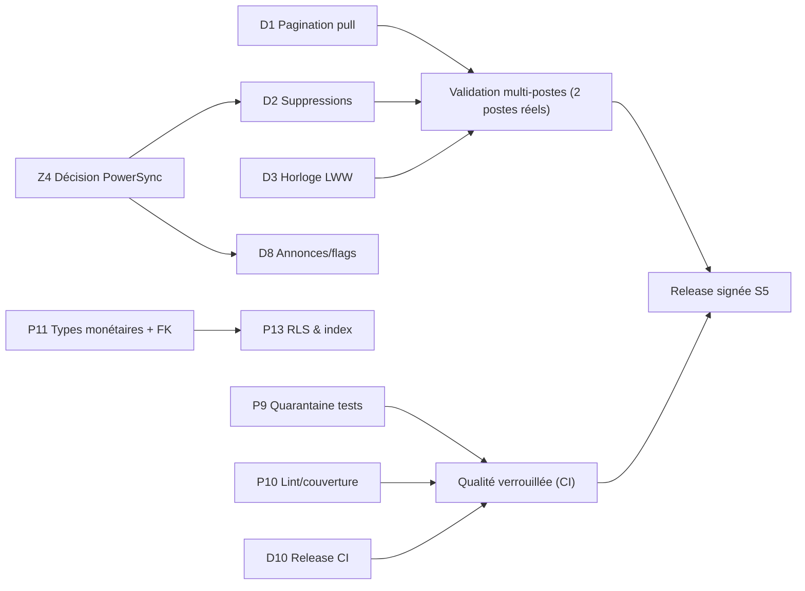

# Diagnostic global — Dettes, zombies, parasites et freins à long terme

> **Date** : 28 octobre 2026 · **Périmètre** : `apps/desktop`, `apps/web-hub`, `packages/*`, `supabase/`, `powersync/`, CI, dépôt Git, docs.
> **Méthode** : lecture du code (références `fichier:ligne`), recherche d'usages réels (grep sur tout le dépôt), `npm audit`, confrontation à la documentation versionnée via **Context7** (§6), croisement avec les captures Supabase (24 tables, tailles et nombres de lignes réels).
> **Ce document alimente** : [01 — Plan correctif](./01_PLAN_CORRECTIF.md) · [02 — Plan curatif](./02_PLAN_CURATIF.md) · [03 — Plan préventif](./03_PLAN_PREVENTIF.md).

---

## 1. Verdict en une page

Le socle est **solide et bien documenté** (33 ADR, 0 erreur TypeScript, 261 + 58 tests verts, fiscalité testée, RLS généralisée). Mais trois constats empêchent aujourd'hui de dire « terminé, stable, sans reproche » :

1. **La synchronisation multi-postes a 3 défauts d'intégrité réels** (perte de lignes à la pagination, suppressions non propagées, arbitrage par horloge client) — invisibles tant qu'il n'y a **qu'un seul poste par entreprise**, destructeurs dès le deuxième.
2. **Plusieurs fonctionnalités annoncées n'existent pas côté Desktop** : annonces, feature flags, moteur d'alertes, rollup KPI (vide en production). Elles sont documentées comme « actives » alors qu'elles sont **décoratives** (§3).
3. **Le filet de sécurité qualité a des trous** : 19 suites d'intégration sont en **quarantaine** (donc non exécutées), pas de CI de tests, pas de linter côté Desktop, workflow de release probablement cassé.

| Axe | Note | Pourquoi |
| :--- | :---: | :--- |
| Fonctionnel (poste unique) | 🟢 90 % | Tunnel devis → facture → paiement → avoir complet et testé |
| Fonctionnel (multi-postes / sync) | 🔴 55 % | C1, C2, C3 ci-dessous |
| Intégrité des données | 🟠 65 % | Montants `REAL`/`double precision`, aucune FK ni `CHECK` côté cloud |
| Sécurité | 🟠 70 % | Bonnes bases ; CSP, validation d'expéditeur IPC, `safeStorage`, signature absents |
| Maintenabilité | 🟠 60 % | Fichiers de 700–1 360 lignes, doublons de moteurs fiscaux, 3 toolchains TS |
| Qualité / tests | 🟠 60 % | 19 suites exclues, pas de CI, pas de seuil de couverture |
| Scalabilité cloud | 🟠 60 % | RLS non optimisée, plan Supabase *Free*, logo en base64 répliqué |
| Industrialisation | 🔴 45 % | Release CI très probablement non fonctionnelle, aucune signature de code |

---

## 2. Registre des constats

**Légende gravité** : 🔴 bloquant pour la mise en production multi-postes · 🟠 à traiter avant ouverture à d'autres clients · 🟡 dette confortable à planifier.
**Types** : `D` défaut · `Z` zombie · `P` parasite · `F` frein long terme.

### 2.1 Défauts fonctionnels et d'intégrité (→ Plan correctif)

| ID | Gravité | Constat | Preuve | Conséquence |
| :--- | :---: | :--- | :--- | :--- |
| **D1** | 🔴 | **Pagination du *pull* par curseur temporel strict (`gt`)**. `server_updated_at` est posé par un trigger `now()` : un lot de 200 lignes poussées dans la même transaction partage **le même horodatage**. Si la coupure de page (1 000) tombe au milieu de ce groupe, les lignes restantes sont **définitivement ignorées**. | [CloudSyncService.ts L.300-353](../../apps/desktop/lib/sync/CloudSyncService.ts#L300-L353) ; trigger [20261013_desktop_sync.sql L.55-61](../../supabase/migrations/20261013_desktop_sync.sql#L55-L61) | Données manquantes sur un 2ᵉ poste, sans erreur remontée |
| **D2** | 🔴 | **Suppressions physiques non propagées aux autres postes.** Les *tombstones* font un `DELETE` côté Supabase, mais le *pull* ne reçoit que des lignes existantes. Cas réel : modifier un devis fait `DELETE FROM quote_items` puis réinsère. | [quote.actions.ts L.191](../../apps/desktop/app/actions/quote.actions.ts#L191) ; [CloudSyncService.ts L.264-287](../../apps/desktop/lib/sync/CloudSyncService.ts#L264-L287) | **Lignes de devis dupliquées/fantômes** sur le 2ᵉ poste |
| **D3** | 🔴 | **Last-Write-Wins sur l'horloge du poste** (`updated_at` écrit côté client). Un PC dont l'heure est fausse (très courant sans NTP) écrase des données plus récentes. | [CloudSyncService.ts L.319-324](../../apps/desktop/lib/sync/CloudSyncService.ts#L319-L324) | Perte silencieuse de modifications |
| **D4** | 🟠 | **Avoirs : aucun plafond cumulé**, statut facture insensible aux avoirs, et **deux chemins de création** (service + action de suppression de facture). | [CreditNoteService.ts L.94-97](../../apps/desktop/lib/services/CreditNoteService.ts#L94-L97) ; [invoice.actions.ts L.154-177](../../apps/desktop/app/actions/invoice.actions.ts#L154-L177) | Sur-crédit possible ; risque fiscal |
| **D5** | 🟠 | **Sauvegarde = `copyFileSync` d'un fichier SQLite en mode WAL**, sans checkpoint ni fichier `-wal`, une seule fois au démarrage, sur le même disque, sans vérification. Après un arrêt brutal, la copie peut être **incomplète ou incohérente**. | [main.js L.755-806](../../apps/desktop/main.js#L755-L806) | Fausse impression de sécurité |
| **D6** | 🟠 | **Numérotation** : (a) suffixe `-A3F9` en cas de collision ⇒ numérotation non continue ; (b) table `sequences` sans `tenant_id` ; (c) **`formatDocNumber` implémentée deux fois** avec des signatures différentes. | [CloudSyncService.ts L.189-205](../../apps/desktop/lib/sync/CloudSyncService.ts#L189-L205) ; [numbering.ts](../../apps/desktop/lib/api/numbering.ts) vs [fiscal/index.ts L.132](../../packages/database/src/fiscal/index.ts#L132) | Écart avec l'ADR-0002 ; risque comptable |
| **D7** | 🟠 | **Rollup KPI conditionnel à `pg_cron`** avec simple `RAISE NOTICE` si l'extension est absente. `kpi_tenant_daily` = **0 ligne en production** (capture). | [20261021 L.432-452](../../supabase/migrations/20261021_hub_telemetry_kpis.sql#L432-L452) | Dashboards Hub vides ou trompeurs |
| **D8** | 🟠 | **Annonces / flags non consommés par le Desktop** : aucune lecture de `announcements` ni `tenant_flags` hors `AppSchema.ts` (PowerSync dormant). Le scénario de recette S4 « annonce visible sous 60 s » ne peut pas passer. | grep `apps/desktop` ; [PLAN_CONTINUATION S4](../PLAN_CONTINUATION_ET_FINALISATION.md) | Fonction promise non livrée |
| **D9** | 🟠 | **Aucun moteur d'alertes** : rien n'insère dans `alerts` ; `alert_rules` (3 lignes) n'est lue que pour un libellé. | grep `insert into alerts` = 0 | Alertes jamais déclenchées |
| **D10** | 🟠 | **Release GitHub probablement non fonctionnelle** : `npx next build` et `electron-builder` sont lancés **à la racine** (aucun `working-directory`), alors que l'app est dans `apps/desktop` ; la racine n'a pas de dossier `app/`. | [release.yml L.36-51](../../.github/workflows/release.yml#L36-L51) | Pas de livraison automatisée fiable |
| **D11** | 🟡 | **Tolérance `tenant_id IS NULL`** dans `buildTenantFilter` (visible de tous les tenants du poste) + repli sur « le premier admin ». | [tenant.ts L.57-70](../../apps/desktop/lib/api/tenant.ts#L57-L70) | Fuite inter-tenant locale en cas de base mal migrée |
| **D12** | 🟡 | **Régime fiscal par ligne** (TVA marchandises / TPS prestations) non modélisé — à valider avec la comptabilité. | [01_AUDIT_GLOBAL §5.1](../rapport/01_AUDIT_GLOBAL.md) | Écart possible avec la règle DGI |
| **D13** | 🟡 | **Dépendances vulnérables** : `npm audit --omit=dev` ⇒ **5 vulnérabilités (3 hautes : `zod`, `brace-expansion`, `source-map-js` ; 2 modérées)**. | `npm audit` du 28/10/2026 | Dette de sécurité de la chaîne d'approvisionnement |

### 2.2 Zombies — code, tables et dépendances sans usage réel (→ Plan curatif)

| ID | Élément | Preuve d'inutilité | Décision proposée |
| :--- | :--- | :--- | :--- |
| **Z1** | Table `tenant_flags` | **0 référence** dans `apps/`, `packages/` (seule la migration la crée) | Brancher (D8) **ou** supprimer |
| **Z2** | Tables `clients_legacy`, `invoices_legacy` | 0 ligne, 0 référence ; créées par renommage défensif | Supprimer **après accord explicite** (`DROP` irréversible) |
| **Z3** | Tables `alerts`, `alert_rules` | UI lit/met à jour, **rien n'écrit ni n'évalue** | Implémenter le moteur (D9) |
| **Z4** | **Pile PowerSync entière** : `lib/powersync/*` (5 fichiers), `AppSchema.ts` (14 tables), `@powersync/web`, `@powersync/react`, `@journeyapps/wa-sqlite`, **deux** `sync_rules.yaml` (`powersync/` et `supabase/`) | `new PowerSyncDatabase(...)` instancié **à l'import** ([Provider.tsx L.11](../../apps/desktop/lib/powersync/Provider.tsx#L11)) mais `init()` seulement si `NEXT_PUBLIC_POWERSYNC_URL` ; le vrai moteur est `CloudSyncService`. Le `connector` ne sert qu'à porter la session JWT. | **Trancher** (ADR) : garder `CloudSyncService` et retirer PowerSync, ou l'inverse |
| **Z5** | Hooks `use-invoices.ts`, `use-quotes.ts`, `use-mobile.ts` | 0 import | Supprimer |
| **Z6** | `adm-zip` (dépendance) | 0 usage | Retirer |
| **Z7** | Dossier vide `components/ui/` ; `types/electron.d.ts` dupliqué (racine + `apps/desktop/types`) | — | Supprimer le doublon |
| **Z8** | Binaire versionné [`apps/desktop/build/standalone.zip`](../../apps/desktop/build) ; `tests/artifacts/*` et `test-results/.last-run.json` **suivis par Git malgré `.gitignore`** | `git ls-files` | `git rm --cached` + purge d'historique si volumineux |
| **Z9** | `next` et `@next/env` dans le `package.json` **racine** | Le workspace racine ne contient aucune app Next | Retirer (après vérification du hoisting) |
| **Z10** | Docs périmées : `AUDIT_AND_MASTER_PLAN.md` (19/10), `PLAN_CONTINUATION_ET_FINALISATION.md` (« 171 tests, 88 %, 17 ADR, 19 tables ») | Réalité : 261+58 tests, 33 ADR, 24 tables | Archiver / remplacer par ces 3 plans |

### 2.3 Parasites — présents, actifs, mais nuisibles (→ Plans curatif et préventif)

| ID | Parasite | Preuve | Effet |
| :--- | :--- | :--- | :--- |
| **P1** | **Minification webpack désactivée en production** (commentaire obsolète « OOM SWC Next 15 ») | [next.config.mjs L.66-70](../../apps/desktop/next.config.mjs#L66-L70) | Bundle client alourdi, démarrage plus lent |
| **P2** | **Moteurs fiscaux dupliqués** : `computeTotals` et `calculateFiscalCascade` (même cascade, formes de résultat différentes `netHT`/`netHt`), plus 2 couches de ré-export côté Desktop | [fiscal/index.ts](../../packages/database/src/fiscal/index.ts) ; `math-logic.ts`, `lib/fiscal/index.ts` | Risque de divergence de calcul |
| **P3** | **Trois toolchains TypeScript** : Desktop `^7.0.2`, Hub/UI/Database `^5` ; `react` épinglé `19.3.0` (Hub) vs `^19.2.0` (Desktop) ; `@types/node` 22 vs 20 | `package.json` ×4 | Comportements de compilation différents selon l'app |
| **P4** | **Dépendances déclarées en double** : ~14 paquets Radix + `recharts` (×3 versions épinglées différemment) + `cmdk`/`react-day-picker`/`date-fns` déclarés dans Desktop **et** dans `packages/ui` | `package.json` desktop/ui/hub | Doublons dans le bundle, mises à jour divergentes |
| **P5** | **Fichiers monolithiques** : `setup-client.tsx` (1 363 l.), `main.js` (1 287 l.), `clients.tsx` (1 006), `store.ts` (942), `invoices.tsx` (803), 6 autres > 700 | mesure du 28/10 | Relecture/tests difficiles, conflits de merge |
| **P6** | **`any`, `@ts-ignore`, `console.*`** : `@ts-ignore` dans [ExportService.ts L.9](../../apps/desktop/lib/services/ExportService.ts#L9) ; `any` dans ~38 fichiers `lib/`/`app/`/`components/` ; `console.*` dans ~38 fichiers (aucun logger structuré côté serveur Next) | grep | Régressions de typage, logs non exploitables |
| **P7** | **Données fictives livrées en valeurs par défaut** : NIF `XXXXXXXXXX`, RCCM `GA-LBV-XX-XXXX-XXXX`, IBAN `GAXX XXXX…` | [store.ts L.476-485](../../apps/desktop/lib/store.ts#L476-L485) | Risque d'apparaître sur une facture légale |
| **P8** | **`middleware.ts` déprécié** côté Desktop (le Hub est déjà passé à `proxy.ts`) | Context7 : *Next.js 16 — `middleware` renommé `proxy`* | Dette de migration, avertissements |
| **P9** | **19 suites d'intégration/performance en quarantaine** (`financial-flow`, `payments-rbac`, `quotes-rbac`, `phase2…phase10`, `setup-onboarding`…) : « échouent à l'import (0 test exécuté) » | [vitest.config.ts L.11-31](../../apps/desktop/vitest.config.ts#L11-L31), ADR-0006 | **Couverture illusoire** : les 261 tests verts n'incluent pas ces parcours |
| **P10** | **Aucun ESLint ni script `lint` côté Desktop** (le Hub en a un) ; `fileParallelism:false` ⇒ 89 s de tests ; couverture configurée **sans seuil** | `package.json`, `vitest.config.ts` | Qualité non verrouillée |
| **P11** | **Colonnes monétaires `REAL` (SQLite) / `double precision` (Postgres)**, **dates en `text`**, `tenant_id text` (non relié à `tenants.id uuid`), **aucune FK ni `CHECK` côté cloud** | [db.ts L.222-384](../../apps/desktop/lib/db.ts#L222), [20261013 L.201-286](../../supabase/migrations/20261013_desktop_sync.sql#L201-L286) | Intégrité reposant uniquement sur le code |
| **P12** | **Logo en base64 dans `tenant_settings.logo`** : la capture montre **322 kB pour 1 ligne** et il est répliqué à chaque synchro | capture Supabase | Gonflement, synchro lente, quota *Free* |
| **P13** | **Politiques RLS non optimisées** : `current_tenant_id()` / `is_superadmin()` appelées **sans `(select …)`** ; comparaison `id::text = …` qui neutralise l'index ; pas d'index sur les colonnes de jointure (`invoice_id`, `client_id`…) | Context7 *Supabase — « Call functions with select »*, *« Add indexes »* ; [20261013 L.76-97, 306-308](../../supabase/migrations/20261013_desktop_sync.sql#L76-L97) | Lenteur croissante avec le volume |

### 2.4 Sécurité résiduelle (→ Plans correctif et préventif)

| ID | Constat | Référence |
| :--- | :--- | :--- |
| **S1** | Pas de **Content-Security-Policy** (aucun en-tête CSP dans [next.config.mjs L.51-65](../../apps/desktop/next.config.mjs#L51-L65)) | Electron Security §« CSP » (Context7) |
| **S2** | Handlers IPC (`print-document`, `export-pdf`, `app:get-userData-path`…) **sans validation de `event.senderFrame`** et acceptant du HTML brut | Electron Security n° 17 (Context7) ; [main.js L.936-1096](../../apps/desktop/main.js#L936-L1096) |
| **S3** | `secrets.json` en clair dans `userData` ; `safeStorage` disponible sur Windows après l'événement `ready` | Context7 *Electron safeStorage* ; audit 01 §S2 |
| **S4** | Verrouillage anti-force-brute **en mémoire** (perdu au redémarrage) | audit 01 §S1 |
| **S5** | **Pas de signature de code** ⇒ SmartScreen ; la vérification de signature des mises à jour (`verifyUpdateCodeSignature` + `publisherName`) est donc inactive | Context7 *electron-builder* |
| **S6** | Mot de passe d'enrôlement cloud ≥ 6 caractères | audit 01 §S3 |

### 2.5 Freins à long terme (→ Plan préventif)

| ID | Frein | Pourquoi c'est un problème dans 12–24 mois |
| :--- | :--- | :--- |
| **F1** | **Électron 42.11** alors que Context7 référence déjà la **v44.9** : 42 est la plus ancienne des 3 majeures publiées au dépôt documentaire. Chaque montée impose de **recompiler `better-sqlite3`** (ABI) et d'adapter `utilityProcess`. | Sortie du support de sécurité Chromium si l'on ne suit pas (cadence ≈ 8 semaines). *À confirmer sur le calendrier officiel Electron.* |
| **F2** | **Premier *pull* complet** : un nouveau poste rapatrie tout l'historique table par table (pages de 1 000, sans instantané) | Après 3–5 ans de factures, l'installation d'un poste devient très longue |
| **F3** | **Plan Supabase *Free*** (badge visible sur les captures) : mise en pause après inactivité, pas de PITR, base limitée | Inacceptable pour une base financière de production. *À vérifier sur la grille tarifaire officielle.* |
| **F4** | **Taux fiscaux codés en dur pour le Gabon** (`DEFAULT_GABON_TAX_RATES`) ; `tenants.country` existe mais n'est pas exploité | Extension CEMAC (Cameroun, Congo…) = refonte |
| **F5** | **Aucune observabilité** : pas de suivi d'erreurs centralisé, logs uniquement locaux (`logToFile`), télémétrie Hub agrégée | Impossible de diagnostiquer un incident chez un client |
| **F6** | **Licence évaluée avec l'horloge locale** ; recul de date = contournement possible de l'expiration | Manque à gagner / fraude |
| **F7** | **`audit_logs` sans archivage ni rétention** (seul `sync_runs` est purgé à 90 jours) | Croissance illimitée répliquée |
| **F8** | **Facture électronique normalisée (QR / signature DGI)** non anticipée dans le modèle | Obligation réglementaire probable |

---

## 3. Correction de mes livrables précédents (transparence)

L'audit des 24 tables du [Fichier 1](../rapport/FICHIER_1_MODELISATION_DONNEES_MCD_MLD.md) concluait « *aucune table zombie* ». **Cette conclusion était trop optimiste** : elle se fondait sur la présence d'une UI Hub, pas sur un usage réel. Après vérification de code :

| Table | Ancien statut | Statut vérifié |
| :--- | :---: | :--- |
| `tenant_flags` | « Active » | **Zombie** (0 référence) |
| `alert_rules` / `alerts` | « Active (règles automatisées) » | **Décoratives** (aucun moteur d'évaluation) |
| `announcements` | « Diffusées vers les terminaux » | **Écrites par le Hub, jamais lues par le Desktop** |
| `kpi_tenant_daily` | « Active » | **Vide en production** (cron conditionnel) |
| `clients_legacy`, `invoices_legacy` | « Conservatoire » | **Résidus** (0 ligne, 0 référence) |

Le [Fichier 3](../rapport/FICHIER_3_ECOSYSTEME_TECHNIQUE_ET_JUSTIFICATIONS.md) contenait aussi des chiffres de benchmark **non mesurés** (durée Vitest 3,82 s, ops/s de SQLite), une politique RLS **simplifiée** qui n'est pas celle du code, et une description du moteur fiscal qui différait du code. Ces points ont été corrigés ou requalifiés dans les fichiers concernés (voir §5 de chaque plan).

---

## 4. Cartographie des dépendances entre constats

> **Lecture** : on ne peut pas certifier la sync (D1-D3) sans trancher PowerSync (Z4) ; on ne peut pas figer les types monétaires (P11) avant d'avoir des tests d'intégration réactivés (P9).

---

## 5. Index des IDs par plan

| Plan | IDs traités |
| :--- | :--- |
| **01 — Correctif** (réparer ce qui est cassé) | D1 D2 D3 D4 D5 D6 D7 D10 D11 D13 · S1 S2 (partiel) |
| **02 — Curatif** (assainir l'existant) | Z1–Z10 · P1 P2 P3 P4 P5 P6 P7 P8 P11 P12 P13 · D8 D9 D12 |
| **03 — Préventif** (empêcher le retour) | P9 P10 · S1–S6 · F1–F8 · gouvernance, CI/CD, observabilité |

---

## 6. Sources consultées via Context7 (documentation versionnée)

| Sujet | Bibliothèque Context7 | Enseignement retenu |
| :--- | :--- | :--- |
| `middleware` → `proxy` | `/vercel/next.js` (v16.2.9) | Export `middleware` **déprécié**, codemod `npx @next/codemod@canary middleware-to-proxy .` |
| RLS performante | `/supabase/supabase` | Envelopper `auth.uid()`/fonctions `security definer` dans `(select …)` (initPlan) ; indexer toute colonne filtrée par une politique ; fonctions `security definer` avec `set search_path = ''` dans un schéma privé |
| Secrets au repos | `/electron/electron` (v42) | `safeStorage.encryptString/decryptString`, `isEncryptionAvailable()` (Windows : vrai après `ready`) |
| Sécurité Electron | `/electron/electron` (v42) | Recommandation n° 17 : **valider `senderFrame`** ; définir une **CSP** restrictive |
| Sauvegarde SQLite | `/wiselibs/better-sqlite3` | `db.backup(dest)` (API de sauvegarde en ligne, cohérente), **une seule connexion** doit muter pendant la sauvegarde |
| Signature & mises à jour | `/electron-userland/electron-builder` | `publisherName` + vérification de signature des mises à jour ; **Azure Trusted Signing** sans certificat local |
| File d'upload de synchro | `/powersync-ja/powersync-docs` | La file d'envoi est une **FIFO bloquante** ; une erreur non acquittée bloque tout le flux → stratégie d'erreur explicite requise |
| Tests | `/vitest-dev/vitest` | `coverage.thresholds`, `test.projects` pour monorepo |
| CI monorepo | `/vercel/turborepo` | `turbo run … --affected`, `inputs` par tâche, cache distant |
