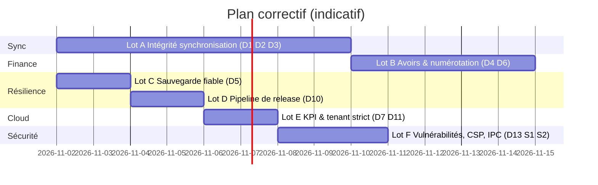

# Plan correctif — Réparer ce qui est cassé ou dangereux

> **Objectif** : rendre **fiable** ce qui existe déjà. Aucun nouveau périmètre fonctionnel : uniquement des défauts prouvés ([diagnostic](./00_DIAGNOSTIC_DETTES_ZOMBIES_FREINS.md)).
> **Charge estimée** : **≈ 22 jours-développeur** (4 semaines calendaires pour une personne) — estimations indicatives, à recaler après le premier lot.
> **Règle projet** : toute décision structurante ⇒ une fiche `docs/decisions/00NN-*.md` + `npm run quality:decisions`. Les ADR à créer sont signalés **[ADR]**.

---

## 0. Principes d'exécution

1. **Test d'abord** : chaque correctif commence par un test qui **échoue** et reproduit le défaut.
2. **Un lot = une branche = une PR** ; merge uniquement si `tsc --noEmit` + `vitest run` (Desktop **et** Hub) sont verts.
3. **Aucune opération irréversible sans accord** (`DROP`, purge d'historique Git, suppression de fichiers de sauvegarde) — voir règle de prévention de perte de données.
4. **Données de production** (24 tables Supabase) : toute migration SQL est écrite en `create … if not exists` / `alter … if exists`, testée sur une branche Supabase avant la production.



---

## Lot A — Intégrité de la synchronisation multi-postes (D1, D2, D3)

> 🔴 **Prérequis de toute mise en service à plusieurs postes.** Durée ≈ 8 j.

### A0. Banc d'essai « deux postes » (1,5 j) — à faire en premier
Créer `apps/desktop/tests/integration/sync-two-devices.test.ts` : deux bases SQLite en mémoire (poste P1, P2) + un faux Supabase en mémoire (ou projet Supabase local `supabase start`). Scénarios qui doivent **échouer avant correction** :

| # | Scénario | Défaut ciblé |
| :-: | :--- | :--- |
| S-A1 | P1 pousse 1 500 lignes (batches de 200), P2 tire avec `PULL_PAGE = 1000` | D1 |
| S-A2 | P1 modifie un devis (suppression + recréation des lignes), P2 synchronise | D2 |
| S-A3 | P1 (horloge +2 h) modifie une facture ; P2 (heure correcte) modifie plus tard ; synchro des deux | D3 |
| S-A4 | Panne réseau au milieu d'un lot, reprise | idempotence |

### A1. Curseur composite pour le *pull* — D1 (1 j)
Remplacer le curseur `server_updated_at` seul par **`(server_updated_at, id)`** (ordre total strict).

```ts
// CloudSyncService.pullTable — esquisse
type Cursor = { ts: string; id: string } | null;
const parse = (raw: string | null): Cursor => (raw ? JSON.parse(raw) : null);

let q = sb.from(cfg.remote).select('*').eq('tenant_id', tenantId)
  .order('server_updated_at', { ascending: true })
  .order(cfg.remotePk, { ascending: true })
  .limit(PULL_PAGE);

if (cursor) {
  // (ts > c.ts) OU (ts = c.ts ET id > c.id)
  q = q.or(`server_updated_at.gt.${cursor.ts},and(server_updated_at.eq.${cursor.ts},${cfg.remotePk}.gt.${cursor.id})`);
}
// … puis : setMeta(cursorKey, JSON.stringify({ ts: last.server_updated_at, id: last[cfg.remotePk] }))
```
- **Migration du curseur** : lire l'ancien format (chaîne ISO) et le convertir en `{ts, id: ''}` ; ne jamais perdre l'avance.
- **Index cloud** : `create index if not exists idx_<t>_sync2 on public.<t> (tenant_id, server_updated_at, id);` (remplace `idx_<t>_sync`).
- **Critère d'acceptation** : S-A1 vert ; 10 000 lignes au même horodatage ⇒ 10 000 lignes locales.

### A2. Propagation des suppressions — D2 (3 j) **[ADR]**
**Décision recommandée : suppression logique partout, y compris pour les lignes d'articles** (cohérent avec la règle projet « Soft Delete obligatoire »).

1. **Schéma** : ajouter `deletedAt` (local) / `deleted_at` (cloud) à `quote_items`, `invoice_items`, `credit_note_items` (colonne nullable, index partiel `where deleted_at is null`).
2. **Édition d'un devis** ([quote.actions.ts L.191](../../apps/desktop/app/actions/quote.actions.ts#L191)) : remplacer `DELETE … WHERE quoteId = ?` par un **diff par `id`** : mise à jour des lignes conservées, insertion des nouvelles, `deletedAt = now` pour les retirées.
3. **Lecture** : toutes les requêtes d'items filtrent `deletedAt IS NULL` (centraliser dans un repository).
4. **Pull** : une ligne `deleted_at` renseignée écrase la ligne locale (déjà géré par l'upsert générique).
5. **Tombstones** : conserver la table `sync_tombstones` uniquement comme **filet** pour les suppressions physiques résiduelles ; ajouter un test qui **échoue** si un `DELETE FROM` apparaît dans `app/` ou `lib/services/` sur une table synchronisée (garde-fou, cf. plan préventif).
- **Critère d'acceptation** : S-A2 vert (2ᵉ poste voit exactement les lignes du 1ᵉʳ, sans doublon ni fantôme).

### A3. Arbitrage par horloge de confiance — D3 (2 j) **[ADR]**
Deux mesures complémentaires :

**(a) Côté serveur — le cloud ne croit pas l'horloge du poste.**
```sql
-- migration 2026XXXX_sync_lww_guard.sql (esquisse, à appliquer table par table)
create or replace function public.sync_lww_guard() returns trigger
language plpgsql as $$
begin
  -- 1) jamais d'horodatage dans le futur (tolérance 5 min)
  if new.updated_at is not null and new.updated_at > now() + interval '5 minutes' then
    new.updated_at := now();
  end if;
  -- 2) ignorer une écriture plus ancienne que la ligne existante
  if tg_op = 'UPDATE' and old.updated_at is not null and new.updated_at < old.updated_at then
    return old;
  end if;
  return new;
end $$;
-- create trigger trg_<t>_lww before insert or update on public.<t> for each row execute function public.sync_lww_guard();
```
> L'ordre d'exécution des triggers `BEFORE` est alphabétique : nommer ce trigger de façon à passer **avant** `trg_<t>_server_ts`.

**(b) Côté poste — mesurer et corriger la dérive.** À chaque synchro, comparer l'en-tête `Date` de la réponse Supabase à `Date.now()` ; stocker `clock_offset_ms` dans `sync_meta` ; si `|offset| > 2 min`, afficher une alerte bloquante « Heure du poste incorrecte » et appliquer l'offset aux nouveaux `updated_at`.
- **Critère d'acceptation** : S-A3 vert ; un poste à +2 h ne peut plus écraser une donnée plus récente.

### A4. Politique d'erreur de la file d'envoi (0,5 j)
D'après la documentation PowerSync (Context7), une file FIFO qui ne peut pas avancer **bloque tout le flux**. Notre `pushTable` lance une exception pour une table non numérotée en erreur : les tables suivantes sont tout de même tentées (OK), mais la ligne en erreur est **retentée indéfiniment sans trace durable**.
- Ajouter une table locale `sync_failures(table, record_id, error, attempts, last_attempt_at)` ; après 5 échecs, mettre la ligne « en quarantaine » et l'afficher dans **Paramètres → Synchronisation**.

---

## Lot B — Intégrité financière (D4, D6, D12)

> 🟠 Durée ≈ 5 j. **Préalable bloquant : validation comptable** (voir B3).

### B1. Avoirs : plafond cumulé et chemin unique — D4 (2 j)
- Dans `CreditNoteService.createCreditNote`, calculer `déjàCrédité = Σ total des avoirs actifs de la facture` ; refuser si `déjàCrédité + nouvelAvoir > factureTTC`.
- Passer le statut en `CANCELLED` quand `déjàCrédité + nouvelAvoir ≥ factureTTC` (et non `computed.total ≥ invoiceTotal` d'un seul avoir).
- **Un seul point d'entrée** : faire appeler `CreditNoteService` par la création automatique de [invoice.actions.ts L.154-177](../../apps/desktop/app/actions/invoice.actions.ts#L154-L177) (supprimer le SQL dupliqué).
- `updateInvoiceStatus` : `reste = total − Σ avoirs − Σ paiements`.
- **Tests** : 2 avoirs partiels + 1 avoir complémentaire ; avoir > solde refusé ; suppression d'un avoir rouvre la facture.

### B2. Numérotation — D6 (2 j) **[ADR]**
Recommandation : **série continue par poste**, jamais de suffixe aléatoire.
1. À l'enrôlement, le Hub attribue un **code de poste** unique (`P1`, `P2`…) stocké dans `sync_devices`.
2. Le format devient `FAC-P1-001/GM/2026` ; la table `sequences` reçoit `tenant_id` (clé `(tenant_id, name, year)`).
3. Le repli `-A3F9` est conservé **uniquement comme filet** et déclenche une alerte d'audit `NUMBERING_COLLISION` visible dans le Hub.
4. **Dédoublonner `formatDocNumber`** : garder celle de `@workspace/database/fiscal`, supprimer la copie de [numbering.ts](../../apps/desktop/lib/api/numbering.ts).
- **Point de vigilance** : faire confirmer par le comptable/DGI qu'une **série par poste** satisfait l'exigence de continuité (chaque série étant continue).

### B3. Régime fiscal — D12 (1 j de cadrage, réalisation en plan curatif)
Obtenir **par écrit** de la comptabilité Global Maintenance : *TVA 18 % seule sur marchandises, TPS 9,5 % seule sur prestations ? CSS sur quelle base ?* Consigner la réponse dans l'ADR. **Ne pas coder avant cette réponse** (hors compétence de l'équipe, risque légal).

---

## Lot C — Sauvegarde réellement fiable (D5) — ≈ 2 j

Problème : copier `database.sqlite` seul, en WAL, peut ignorer des écritures présentes dans `database.sqlite-wal`.

**Solution** (Context7 — `better-sqlite3` : API de sauvegarde en ligne ; **une seule connexion doit muter** pendant la sauvegarde) : exécuter la sauvegarde **dans le processus Next qui possède la connexion en écriture**, pas depuis `main.js`.

```ts
// apps/desktop/lib/backup.ts — esquisse
import db from '@/lib/db';
import fs from 'node:fs';
import path from 'node:path';

export async function createVerifiedBackup(dir: string, label: string) {
  fs.mkdirSync(dir, { recursive: true });
  const dest = path.join(dir, `backup_${label}_${new Date().toISOString().replace(/[:.]/g, '-')}.sqlite`);
  await db.backup(dest);                                    // copie cohérente (pas de copyFileSync)
  const check = new (await import('better-sqlite3')).default(dest, { readonly: true });
  const ok = check.pragma('integrity_check', { simple: true }) === 'ok';
  check.close();
  if (!ok) { fs.rmSync(dest); throw new Error('Sauvegarde corrompue : supprimée'); }
  return dest;
}
```
- **Déclencheurs** : quotidien, **avant chaque synchro**, **avant chaque migration**, à la fermeture. Rétention 7 quotidiennes + 4 hebdomadaires + 12 mensuelles.
- **Deuxième emplacement** : bouton « Copier vers… » (clé USB / dossier synchronisé) — la copie locale seule ne protège pas d'un disque mort ou d'un vol.
- **Restauration** : écran « Restaurer une sauvegarde » (vérifie `integrity_check` avant remplacement, sauvegarde l'état courant d'abord).
- **Critère d'acceptation** : test qui force un arrêt brutal (`kill -9` simulé) pendant des écritures, puis restaure : 0 perte de transaction validée.

---

## Lot D — Pipeline de release (D10) — ≈ 2 j

Corriger [release.yml](../../.github/workflows/release.yml) : exécuter dans `apps/desktop`, valider **avant** de packager, aligner Node sur le poste de développement (v24).

```yaml
name: Build and Release Facturier
on:
  push: { tags: ['v*'] }
  workflow_dispatch:
jobs:
  verify:
    runs-on: windows-latest
    steps:
      - uses: actions/checkout@v4
      - uses: actions/setup-node@v4
        with: { node-version: '24', cache: 'npm' }
      - run: npm ci
      - run: npm run typecheck          # turbo : tous les workspaces
      - run: npm test                   # turbo : desktop + hub
      - run: npm run quality:decisions
  release:
    needs: verify
    runs-on: windows-latest
    permissions: { contents: write }
    defaults: { run: { working-directory: apps/desktop } }
    env: { NEXT_TELEMETRY_DISABLED: '1', NEXT_BUILD: '1' }
    steps:
      - uses: actions/checkout@v4
      - uses: actions/setup-node@v4
        with: { node-version: '24', cache: 'npm' }
      - run: npm ci
        working-directory: .
      - run: npm run build:electron      # build + rebuild ABI Electron + sync-sqlite + patch + prepare
      - run: npx electron-builder --win --publish always
        env: { GH_TOKEN: '${{ secrets.GITHUB_TOKEN }}' }
```
- **Critère d'acceptation** : un tag `v1.0.1-rc1` produit un `.exe` installable **depuis la CI**, installé sur une VM Windows propre et démarré sans erreur.

---

## Lot E — Cloud : KPI et filtre tenant strict (D7, D11) — ≈ 2 j

### E1. Rollup KPI fiable — D7
1. Dans Supabase → *Database → Extensions*, **activer `pg_cron`** ; ré-exécuter le bloc §12 de [20261021](../../supabase/migrations/20261021_hub_telemetry_kpis.sql).
2. Remplacer le `RAISE NOTICE` silencieux par un **échec explicite** (`raise exception`) afin qu'une migration ne passe plus « verte » sans planification.
3. Ajouter au Hub un indicateur **« Dernier rollup KPI : il y a X h »** (alerte si > 26 h) ; lancer une première fois `select public.hub_collect_daily_kpis();` pour amorcer.
4. Plan B si `pg_cron` indisponible : *Vercel Cron* appelant une route protégée qui exécute la fonction.
- **Acceptation** : `kpi_tenant_daily` contient une ligne par tenant et par jour sur 3 jours consécutifs.

### E2. Filtre tenant strict — D11
- Ajouter un compteur de diagnostic : `SELECT COUNT(*) … WHERE tenant_id IS NULL OR tenant_id=''` pour chaque table synchronisée, loggé au démarrage.
- Quand le compteur est **0 sur toutes les tables**, positionner `sync_meta.tenant_strict = 1` ; `buildTenantFilter` n'émet alors plus `OR … IS NULL`. (La suppression définitive et le `NOT NULL` sont traités au plan curatif, lot « schéma ».)

---

## Lot F — Sécurité immédiate (D13, S1, S2) — ≈ 3 j

| Tâche | Détail | Durée |
| :--- | :--- | :-: |
| **F1 `npm audit`** | Corriger les 3 vulnérabilités hautes (`zod`, `brace-expansion`, `source-map-js`) : `npm audit fix`, montée de `zod` vers la version corrigée, **relancer toute la suite** (la validation des formulaires dépend de `zod`) | 1 j |
| **F2 Validation de l'expéditeur IPC (S2)** | Envelopper tous les `ipcMain.handle` d'un `validateSender(event.senderFrame)` (hôte `127.0.0.1` + port du serveur interne uniquement) — recommandation n° 17 d'Electron | 1 j |
| **F3 CSP (S1)** | Démarrer en `Content-Security-Policy-Report-Only`, relever les violations pendant une semaine, puis passer en mode bloquant : `default-src 'self'; script-src 'self'; img-src 'self' data:; connect-src 'self' https://*.supabase.co; object-src 'none'; frame-ancestors 'none'` (adapter pour le HMR en dev) | 1 j |

---

## 4. Tableau de suivi et critères de sortie

| ID | Livrable | Preuve attendue | Statut |
| :--- | :--- | :--- | :---: |
| D1 | Curseur composite | Test S-A1 vert (10 000 lignes même `ts`) | ☐ |
| D2 | Soft delete des items | Test S-A2 vert ; aucun `DELETE FROM` sur table synchronisée | ☐ |
| D3 | Garde LWW serveur + dérive d'horloge | Test S-A3 vert ; alerte « heure incorrecte » | ☐ |
| D4 | Plafond cumulé des avoirs | 4 tests métier verts ; un seul chemin de création | ☐ |
| D5 | Sauvegarde vérifiée | `integrity_check = ok` ; test d'arrêt brutal | ☐ |
| D6 | Séries par poste | 2 postes, 0 collision, 0 suffixe | ☐ |
| D7 | KPI quotidiens | 3 jours de lignes dans `kpi_tenant_daily` | ☐ |
| D10 | Release CI | `.exe` produit par la CI et installé sur VM propre | ☐ |
| D11 | Tenant strict | Compteur NULL = 0 ; filtre strict actif | ☐ |
| D13 | Audit dépendances | `npm audit --omit=dev` : **0 haute / critique** | ☐ |
| S1/S2 | CSP + IPC | CSP bloquante sans violation ; sender validé | ☐ |

**Définition de « terminé » du plan correctif** : tous les ☐ cochés **et** la suite complète (Desktop + Hub + nouveaux tests multi-postes) verte **sur la CI**.

---

## 5. Corrections de documentation associées (déjà appliquées)

- [Fichier 1](../rapport/FICHIER_1_MODELISATION_DONNEES_MCD_MLD.md) : statuts de `tenant_flags`, `alert_rules`, `announcements`, `kpi_tenant_daily`, `*_legacy` rectifiés.
- [Fichier 2](../rapport/FICHIER_2_FONCTIONNEMENT_METIER_ET_SYSTEME.md) : la diffusion d'annonces est requalifiée « prévue, non livrée côté Desktop ».
- [Fichier 3](../rapport/FICHIER_3_ECOSYSTEME_TECHNIQUE_ET_JUSTIFICATIONS.md) : chiffres non mesurés signalés comme indicatifs ; politique RLS et moteur fiscal alignés sur le code.
