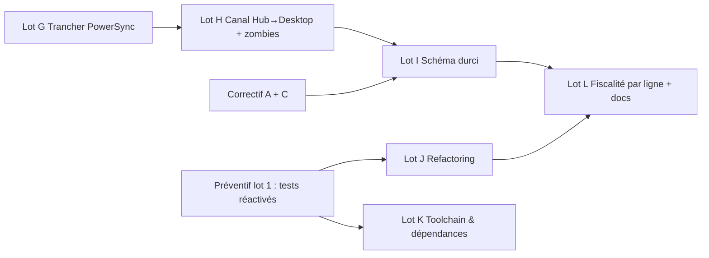

# Plan curatif — Assainir l'existant (zombies, parasites, dette structurelle)

> **Objectif** : retirer ce qui est mort, unifier ce qui est dupliqué, durcir le schéma et découper ce qui est monolithique, **sans changer le comportement visible**.
> **Charge estimée** : **≈ 38 jours-développeur**, à lancer **après** le [plan correctif](./01_PLAN_CORRECTIF.md) (les lots A et C sont des prérequis).
> Références d'IDs : [diagnostic](./00_DIAGNOSTIC_DETTES_ZOMBIES_FREINS.md). Les ADR à rédiger sont marqués **[ADR]**.

---

## 0. Garde-fous (non négociables)

> [!CAUTION]
> Les opérations suivantes sont **irréversibles** et exigent un **accord explicite écrit** avant exécution : `DROP TABLE` en production, purge d'historique Git (`git filter-repo`), suppression de sauvegardes, reconstruction de tables SQLite chez un client.

1. **Toujours** une sauvegarde vérifiée (Lot C du correctif) avant toute migration.
2. **Toujours** une branche Supabase de test avant la production ; script de retour arrière écrit **avant** le script d'avancée.
3. **Aucun refactoring sans filet** : les 19 suites en quarantaine doivent être réactivées (plan préventif, lot 1) avant les lots J et K, sinon on découpe des fichiers sans test.



---

## Lot G — Trancher le moteur de synchronisation : PowerSync ou `CloudSyncService` (Z4) — ≈ 3 j **[ADR]**

### G1. Constat
Deux moteurs coexistent. En production, **seul `CloudSyncService`** (better-sqlite3 ↔ Supabase) réplique les données ; PowerSync n'est initialisé que si `NEXT_PUBLIC_POWERSYNC_URL` existe, et son `SupabaseConnector` ne sert qu'à porter la session JWT. Mais `new PowerSyncDatabase(...)` est **exécuté à l'import** du module, ce qui alloue un worker WASM même inutilisé.

### G2. Matrice de décision

| Critère | Garder `CloudSyncService` (retirer PowerSync) | Migrer entièrement vers PowerSync |
| :--- | :--- | :--- |
| Effort | **Faible** (suppression + correctifs A) | **Très élevé** : remplacer `better-sqlite3` par SQLite WASM côté navigateur, réécrire toutes les Server Actions, déployer un service PowerSync managé |
| Dépendance externe | Aucune (Supabase seul) | Service PowerSync (coût + SLA) |
| Compatibilité avec l'architecture actuelle (Server Actions + SQLite natif) | **Totale** | Rupture |
| Gestion des conflits | Code maintenu en interne (corrigé au lot A) | Fournie, mais écriture serveur (`uploadData`) à implémenter |
| Risque avant la v1 | Faible | **Élevé** |

**Recommandation : conserver `CloudSyncService`, retirer PowerSync**, et consigner dans l'ADR les conditions de réouverture (par exemple : > 50 postes par tenant ou besoin de synchro temps réel).

### G3. Mode opératoire de retrait (dans cet ordre)
1. Extraire la logique de session du `SupabaseConnector` dans `lib/auth/supabaseSession.ts` (3 composants l'importent : `navigation.tsx`, `cloud-sync-runner.tsx`, `force-password-change-dialog.tsx`).
2. Remplacer ces imports ; supprimer `PowerSyncProvider` de [providers.tsx](../../apps/desktop/components/providers.tsx).
3. Supprimer `lib/powersync/` (5 fichiers), `tests/unit/powersync-schema-sync-rules.test.ts`, le mock `vi.mock('@/lib/powersync')` de `tests/setup.ts`.
4. Retirer `@powersync/web`, `@powersync/react`, `@journeyapps/wa-sqlite` du `package.json` ; relancer `npm install`.
5. Archiver `powersync/sync_rules.yaml` et `supabase/sync_rules.yaml` dans `docs/archive/` (ils sont **dupliqués**).
6. Mettre à jour [ADR-0018] par un nouvel ADR « remplace » ; `npm run quality:decisions`.
- **Acceptation** : build Electron OK, taille de l'installeur mesurée **avant/après** (objectif : réduction sensible), 0 référence à `powersync` dans `apps/desktop/**` hors archives, tests verts.

---

## Lot H — Canal Hub → Desktop et élimination des zombies fonctionnels (Z1, Z3, D8, D9) — ≈ 6 j

Au lieu de supprimer des fonctionnalités utiles (annonces, drapeaux, alertes), on **les relie enfin au Desktop** avec le moteur de synchronisation existant.

### H1. Canal descendant (3 j) **[ADR]**
Dans `syncWithCloud`, après le *pull* métier, ajouter `pullHubChannel(sb, tenantId)` (3 lectures légères) :
- `announcements` visibles (`target_tenant_id` = tenant ou `NULL`, `is_active`, fenêtre `starts_at/ends_at`) ;
- `tenant_flags` du tenant ;
- statut du tenant et licence (déjà lus dans `resolveContext`).

Stocker dans une table locale `hub_cache(kind, key, payload, fetched_at)` ; afficher une **bannière** dans `protected-app-shell.tsx` (annonce urgente) ; exposer `isFlagEnabled('nom')` pour piloter des fonctionnalités par tenant.
- **Acceptation** : le scénario de recette **S4** du plan de continuation passe (annonce publiée sur le Hub → bannière sur le Desktop à la synchro suivante, ≤ 60 s si en ligne).
- `tenant_flags` n'est plus un zombie ; documenter les 2–3 premiers drapeaux utiles (`read_only_mode`, `beta_features`, `max_devices_override`).

### H2. Moteur d'alertes (2 j) **[ADR]**
Créer `public.hub_evaluate_alerts()` (SQL) exécutée **juste après** `hub_collect_daily_kpis()` :
```sql
-- esquisse : pour chaque règle active, comparer la métrique du jour au seuil
insert into public.alerts (tenant_id, rule_id, severity, message, status)
select k.tenant_id, r.id, r.severity,
       format('%s : %s %s %s', r.name, k.value, r.operator, r.threshold), 'open'
from public.alert_rules r
join lateral public.hub_metric_value(r.metric_name) k on true   -- à définir par métrique
where r.is_active
  and ((r.operator = '>'  and k.value >  r.threshold)
    or (r.operator = '<'  and k.value <  r.threshold))
  and not exists (select 1 from public.alerts a
                  where a.rule_id = r.id and a.tenant_id = k.tenant_id and a.status = 'open');
```
- Dédoublonnage (pas de nouvelle alerte tant qu'une est ouverte) ; résolution automatique quand la métrique revient sous le seuil.
- **Acceptation** : test SQL (pgTAP ou script) : une règle « échecs de synchro > 3 » crée **une** alerte, puis aucune doublon, puis auto-résolue.

### H3. Résidus de migration `*_legacy` (Z2) — 0,5 j, **accord requis**
1. `select count(*)` sur `clients_legacy` et `invoices_legacy` (déjà 0 d'après les captures) ;
2. export de sécurité (`pg_dump --table` ou CSV) ;
3. **Après accord explicite** : migration `drop table if exists public.clients_legacy, public.invoices_legacy;`
4. Retirer du script `20261013_desktop_sync.sql` le bloc de renommage `_legacy` (§5) pour qu'il ne les recrée plus.

### H4. Hygiène du dépôt (Z5–Z10) — 0,5 j
| Action | Commande / détail |
| :--- | :--- |
| Hooks morts | supprimer `hooks/use-invoices.ts`, `use-quotes.ts`, `use-mobile.ts` (0 import) |
| Dépendance morte | `npm uninstall adm-zip --workspace=facturier-desktop` |
| Dossier vide / doublon | supprimer `components/ui/` vide ; garder **un seul** `electron.d.ts` |
| Binaires et artefacts | `git rm --cached apps/desktop/build/standalone.zip apps/desktop/tests/artifacts -r test-results` ; ajouter `release/`, `apps/desktop/build/*.zip` au `.gitignore` |
| Dépendances racine | retirer `next` / `@next/env` du `package.json` racine, vérifier `npm ci` + build |
| Docs périmées | déplacer `AUDIT_AND_MASTER_PLAN.md` et `PLAN_CONTINUATION_ET_FINALISATION.md` vers `docs/archive/` avec bandeau « remplacé par `docs/plans/` » |
| Taille de l'historique | si `standalone.zip` pèse lourd dans l'historique, proposer `git filter-repo` — **uniquement avec accord** |

---

## Lot I — Durcissement du schéma local et cloud (P11, P12, P13, D11) — ≈ 10 j **[ADR]**

> Prérequis : sauvegarde vérifiée (correctif C), tests de migration sur copie de la base de production.

### I1. Cadre de migrations SQLite (1 j)
Remplacer l'enchaînement `CREATE TABLE IF NOT EXISTS` + `ALTER` opportunistes par un **runner versionné** (`PRAGMA user_version`) : `lib/db/migrations/0001_*.ts … NNNN_*.ts`, chaque migration dans **une transaction**, journalisée, précédée d'une sauvegarde automatique.

### I2. Montants en entiers, contraintes et `tenant_id` obligatoire — SQLite (3 j)
SQLite ne sait pas modifier le type d'une colonne : **reconstruction de table** (`CREATE TABLE new … ; INSERT … SELECT round(col) ; DROP ; RENAME`), avec `PRAGMA foreign_keys=OFF` pendant l'opération puis `PRAGMA foreign_key_check`.
- `subtotal, discount, taxBase, tpsAmount, tvaAmount, cssAmount, total, unitPrice, amount` → `INTEGER NOT NULL DEFAULT 0 CHECK (… >= 0)` ; `quantity` reste `REAL`.
- `status` → `CHECK (status IN (...))` selon les constantes `INVOICE_STATUS` / `QUOTE_STATUS`.
- `tenant_id TEXT NOT NULL` ; **suppression définitive de `OR tenant_id IS NULL`** dans `buildTenantFilter` et des tests qui s'appuient sur la tolérance.
- **Acceptation** : `PRAGMA integrity_check` = ok, `foreign_key_check` vide, totaux de contrôle (somme des factures avant/après) **identiques**.

### I3. Postgres : types, clés étrangères, contraintes (3 j)
Migration `2026XXXX_schema_hardening.sql`, en **trois temps** pour limiter le risque :

1. **Contrôles préalables** (doivent retourner 0) :
```sql
select count(*) from public.invoices where tenant_id !~ '^[0-9a-f-]{36}$';
select count(*) from public.invoice_items i left join public.invoices v on v.id = i.invoice_id where v.id is null;
```
2. **Montants** : `alter table … alter column total type bigint using round(total)::bigint` (idem sous-totaux, taxes, `unit_price`, `amount`) ; `check (total >= 0)`.
3. **Intégrité référentielle** : `tenant_id` → `uuid` + `references public.tenants(id)` ; FK enfants (`invoice_items.invoice_id`, `payments.invoice_id`, `credit_notes.invoice_id`, `quote_items.quote_id`, `credit_note_items.credit_note_id`) ajoutées **`not valid` puis `validate constraint`** (pas de verrou long) ; `check (status in (...))`.
> Les dates `text` → `timestamptz`/`date` sont **reportées** (impact sur le contrat de synchro) : phase 2 après stabilisation.

### I4. RLS performante — P13 (1,5 j)
Appliquer la recommandation Supabase vérifiée via Context7 : **fonction d'aide dans un schéma privé, `security definer`, `set search_path = ''`, appelée via `(select …)`**, comparaison sans cast, index adéquats.
```sql
create schema if not exists private;
create or replace function private.current_tenant_id() returns uuid
language sql stable security definer set search_path = '' as $$
  select tenant_id from public.profiles where id = (select auth.uid())
$$;
revoke execute on function private.current_tenant_id() from public;
grant usage on schema private to authenticated;
grant execute on function private.current_tenant_id() to authenticated;

-- politique type (après passage de tenant_id en uuid)
create policy tenant_isolation on public.invoices for all to authenticated
  using ( tenant_id = (select private.current_tenant_id()) or (select private.is_superadmin()) )
  with check ( tenant_id = (select private.current_tenant_id()) or (select private.is_superadmin()) );
create index if not exists idx_invoice_items_invoice on public.invoice_items (invoice_id);
```
- **Acceptation** : le *Database Advisor* de Supabase ne signale plus `auth_rls_initplan` (0003) ni FK non indexées ; `EXPLAIN ANALYZE` d'un `select` paginé sur 100 000 factures de test < 50 ms.

### I5. Logo hors de la base — P12 (1,5 j)
- Créer le bucket Supabase Storage `tenant-logos` (politique RLS : écriture admin du tenant, lecture membres) ; colonnes `logo_path`, `logo_sha256`.
- Desktop : cache disque dans `userData/logos/<sha256>.png` ; le PDF lit le fichier local ; la synchro n'échange que `logo_path` + empreinte.
- Migration unique : extraire le base64 existant → Storage → vider `tenant_settings.logo`.
- **Acceptation** : `tenant_settings` repasse de **322 kB à quelques kB** (capture de comparaison).

---

## Lot J — Refactoring structurel (P2, P5, P6, P7) — ≈ 9 j

> Méthode « étrangleur » : une extraction à la fois, tests verts à chaque commit, aucun changement visuel.

| Chantier | Cible | Durée |
| :--- | :--- | :-: |
| **J1 Un seul moteur fiscal (P2)** | `computeTotals` devient l'unique implémentation ; `calculateFiscalCascade` devient un *wrapper déprécié* puis disparaît ; supprimer les couches `lib/math-logic.ts` et `lib/fiscal/index.ts` (importer directement `@workspace/database/fiscal`) ; **un seul** type de résultat (`netHT`) | 1 j |
| **J2 `main.js` en modules (P5)** | `main/` : `server.js` (utilityProcess), `window.js`, `ipc.js` (avec `validateSender`), `backup.js`, `updater.js`, `secrets.js`, `logging.js` — objectif ≤ 250 lignes/fichier | 2 j |
| **J3 `setup-client.tsx` (1 363 l.)** | 1 composant par étape (société, fiscalité, banque, admin, cloud) + hook `useSetupWizard` | 1,5 j |
| **J4 Pages > 700 lignes** | `clients`, `invoices`, `quotes`, `quote-editor`, `services`, `invoice-editor` : séparer *liste / filtres / formulaire / dialogues / hooks de données* | 2 j |
| **J5 `store.ts` (942 l.)** | découper en *slices* Zustand par domaine (`clients`, `quotes`, `invoices`, `settings`, `session`) | 1 j |
| **J6 Typage et journalisation (P6)** | supprimer `any` des services via des *mappers* de lignes validés par Zod ; retirer le `@ts-ignore` d'`ExportService` (typage `exceljs` local) ; introduire `lib/logger.ts` (niveaux, contexte `tenant/user`, masquage des données sensibles) et remplacer les `console.*` | 1,5 j |
| **J7 Valeurs fictives (P7)** | valeurs par défaut du magasin → chaînes vides ; l'assistant de démarrage **interdit** de continuer avec un NIF/RCCM/IBAN non conforme ; test dédié | 0,5 j |

**Seuil de sortie** : aucun fichier source > 400 lignes (hors tests/données) ; `grep -r ": any"` = 0 dans `lib/`, `app/`, `components/`.

---

## Lot K — Chaîne d'outils et dépendances (P1, P3, P4, P8) — ≈ 4 j

1. **Une seule version de TypeScript** (P3) : compiler Hub, UI et Database avec la version du Desktop (ou l'inverse) via une `devDependency` racine ; une seule version de `react`/`react-dom` et de `@types/node`.
2. **Dédoublonner (P4)** : déclarer Radix, `cmdk`, `react-day-picker`, `date-fns`, `recharts` **uniquement dans `packages/ui`** ; les apps n'ajoutent que ce qu'elles utilisent directement.
3. **Réactiver la minification (P1)** : retirer `config.optimization.minimize = false` ; mesurer taille du bundle et temps de build **avant/après** ; si le crash mémoire réapparaît, fixer `NODE_OPTIONS=--max-old-space-size` en CI plutôt que de désactiver la minification.
4. **`middleware.ts` → `proxy.ts` (P8)** : `npx @next/codemod@canary middleware-to-proxy .` (Context7, Next.js 16). **Attention** : conserver l'exemption de `/api/health` (ADR-0022) et rejouer le test de démarrage de l'installeur.
5. **Mises à jour majeures à évaluer** (un ADR chacune, jamais en bloc) : `zod` 3→4, `recharts` 2→3, Electron 42→44 (cf. plan préventif F1).

---

## Lot L — Fiscalité par ligne et documentation vivante (D12) — ≈ 6 j

### L1. Régime fiscal par ligne — **uniquement après validation écrite** du comptable (correctif B3)
- Ajouter `taxRegime` (`GOODS` | `SERVICES` | `EXEMPT`) à `services`, `quote_items`, `invoice_items`, `credit_note_items` (local + cloud, avec défaut `SERVICES` pour la reprise).
- `computeTotals` ventile par régime : bases TVA et TPS séparées, **sans double application** ; ligne récapitulative par taux sur le PDF.
- Migration de reprise : documents existants **inchangés** (régime figé = comportement historique) ; nouveau calcul pour les nouveaux documents (champ `taxModelVersion` sur l'en-tête).
- **Tests** : jeux de valeurs validés par le comptable (cas marchandise seule, prestation seule, mixte, remise globale).

### L2. Documentation (1 j)
- Régénérer `tree.txt` / `project_structure.txt` ; mettre à jour les [Fichiers 1-3](../rapport/) ; créer `docs/ARCHITECTURE.md` (une page : composants, flux, décisions) et `docs/RUNBOOK.md` (sauvegarde, restauration, incident de synchro, rotation de secrets).

---

## 3. Récapitulatif et critères de sortie

| Lot | Charge | IDs résolus | Preuve de fin |
| :--- | :-: | :--- | :--- |
| G PowerSync | 3 j | Z4 | 0 référence `powersync` ; ADR publié |
| H Canal Hub + zombies | 6 j | Z1 Z2 Z3 Z5–Z10 D8 D9 | S4 vert ; alertes créées/résolues ; dépôt propre |
| I Schéma durci | 10 j | P11 P12 P13 D11 | Advisor Supabase sans alerte ; totaux de contrôle identiques |
| J Refactoring | 9 j | P2 P5 P6 P7 | ≤ 400 lignes/fichier ; 0 `any` |
| K Toolchain | 4 j | P1 P3 P4 P8 | 1 version TS/React ; bundle réduit mesuré |
| L Fiscalité & docs | 6 j | D12 | Jeux validés par le comptable |
| **Total** | **≈ 38 j** | | |

**Définition de « terminé » du plan curatif** : plus aucun ID `Z*` ouvert, `npm audit` propre, schéma cloud sans alerte du *Database Advisor*, aucun fichier > 400 lignes, documentation synchronisée avec le code.
