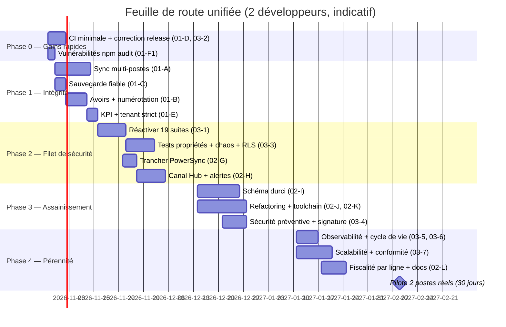

# Plan préventif — Empêcher le retour des défauts et garantir la tenue dans le temps

> **Objectif** : transformer les corrections des plans [01](./01_PLAN_CORRECTIF.md) et [02](./02_PLAN_CURATIF.md) en **garanties automatiques et mesurables**. Un défaut déjà vu ne doit plus pouvoir revenir sans qu'une CI le bloque.
> **Charge estimée** : **≈ 37 jours-développeur** (une partie, les lots 1-2, doit démarrer **avant** les plans correctif et curatif).
> Références d'IDs : [diagnostic](./00_DIAGNOSTIC_DETTES_ZOMBIES_FREINS.md).

---

## 0. Philosophie : « un défaut = un test = une règle »

| Défaut rencontré | Garde-fou permanent |
| :--- | :--- |
| D1 pagination qui perd des lignes | Test de non-régression « 10 000 lignes au même horodatage » exécuté à chaque PR |
| D2 suppression physique non propagée | Règle automatique : un `DELETE FROM` sur table synchronisée **fait échouer la CI** |
| D3 horloge fausse | Test « poste à +2 h » + alerte de dérive affichée dans le Hub |
| Doublon de moteur fiscal | Test de propriété : un seul module exporte la cascade (import interdit ailleurs) |
| Zombie / dépendance morte | `knip` / `depcheck` en CI (échec si dépendance ou export inutilisé) |
| Type monétaire flottant | Test de schéma : aucune colonne `REAL`/`double precision` sur un montant |
| Vulnérabilité de dépendance | `npm audit --omit=dev --audit-level=high` bloquant + mises à jour automatisées |
| Documentation périmée | Les chiffres de la doc (tests, ADR, tables) sont **générés** par un script, pas écrits à la main |

---

## Lot 1 — Réactiver les 19 suites en quarantaine (P9) — ≈ 6 j · **À FAIRE EN PREMIER**

> Les 261 tests verts **ne couvrent pas** `financial-flow`, `payments-rbac`, `quotes-rbac` (844 lignes), `setup-onboarding`, `phase2…phase10`… Tant qu'elles sont exclues, la couverture est **illusoire** et tout refactoring (plan curatif, lots J-K) est dangereux.

1. **Lister et trier** les 19 fichiers de [vitest.config.ts](../../apps/desktop/vitest.config.ts#L11-L31) par valeur métier : (1) flux financier, paiements, RBAC devis, onboarding ; (2) phases 2-10 ; (3) performances.
2. **Migrer un fichier par PR** : remplacer les imports d'anciennes routes `@/app/api/**` par les **Server Actions** (`app/actions/*`) ou, mieux, par les **services** (`InvoiceService`, `QuoteService`, `CreditNoteService`) testés sur une SQLite réelle (helper `tests/helpers/db.ts`).
3. Retirer le fichier de `LEGACY_QUARANTINE` dans la **même PR**.
4. **Supprimer** (avec justification dans l'ADR-0006 mis à jour) les suites devenues redondantes plutôt que de les maintenir.
5. Interdire tout **nouveau** fichier dans `LEGACY_QUARANTINE` (test qui vérifie que la liste est vide).
- **Sortie** : `LEGACY_QUARANTINE = []`, nombre de tests actualisé (objectif réaliste : > 350), ADR-0006 clos.

---

## Lot 2 — Portes de qualité automatiques (P10, D10) — ≈ 3 j

### 2.1 Pipeline `ci.yml` sur chaque *pull request*
```yaml
name: CI
on: { pull_request: {}, push: { branches: [main] } }
jobs:
  quality:
    runs-on: windows-latest          # même OS que la cible (binaire natif better-sqlite3)
    steps:
      - uses: actions/checkout@v4
        with: { fetch-depth: 0 }     # nécessaire pour turbo --affected
      - uses: actions/setup-node@v4
        with: { node-version: '24', cache: 'npm' }
      - run: npm ci
      - run: npm run lint
      - run: npx turbo run typecheck test --affected
      - run: npm run quality:decisions
      - run: npm audit --omit=dev --audit-level=high
      - run: npx knip --no-exit-code=false      # zombies : exports/dépendances inutilisés
      - run: npx gitleaks detect --no-banner     # secrets
```
- **Turborepo** (Context7) : `turbo run … --affected` limite le travail aux paquets modifiés ; activer `futureFlags.affectedUsingTaskInputs` et déclarer des `inputs` par tâche dans [turbo.json](../../turbo.json) pour de meilleurs *cache hits*.
- **Protection de branche** : `main` n'accepte un merge que si `quality` est vert et qu'**un relecteur** a approuvé.

### 2.2 Lint et formatage (le Desktop n'en a aucun)
- Ajouter ESLint (config *flat*, `eslint-config-next`) au Desktop et au `packages/*`, script `lint` dans chaque workspace (Turborepo l'orchestre déjà).
- Règles : `@typescript-eslint/no-explicit-any: error` (avec *baseline* des fichiers existants à résorber au lot J6), `no-console: warn` (sauf `lib/logger.ts`), `no-restricted-imports` (interdit d'importer `@/lib/powersync`, `calculateFiscalCascade`, ou `better-sqlite3` hors `lib/db`), `no-restricted-syntax` ciblant `DELETE FROM` sur les tables synchronisées.
- Prettier + `lint-staged` (hook *pre-commit*).

### 2.3 Couverture avec seuils (Vitest — Context7 : `coverage.thresholds`)
```ts
// vitest.config.ts (extrait)
coverage: {
  provider: 'v8',
  thresholds: {
    lines: 70, functions: 70, branches: 60, statements: 70,        // plancher global (à relever par paliers)
    'packages/database/src/fiscal/**': { lines: 95, branches: 90 }, // fiscalité : quasi exhaustive
    'apps/desktop/lib/services/**':    { lines: 85 },
    'apps/desktop/lib/sync/**':        { lines: 85 },
  },
}
```
- **Cliquet** : les seuils ne peuvent que monter (script qui compare au dernier `main`).
- **Accélérer** : séparer les *projects* Vitest — **unitaires en parallèle** (`fileParallelism: true`, `node`/`jsdom`) et **intégration en série** ; objectif Desktop : **89 s → < 45 s**.

---

## Lot 3 — Tests qui attrapent les défauts d'architecture — ≈ 7 j

| Test | Ce qu'il prouve | Outil |
| :--- | :--- | :--- |
| **Propriétés fiscales** (aléatoires) | `total = taxBase + TPS + TVA` ; chaque taxe ≥ 0 ; écart d'arrondi ≤ 1 XAF ; remise ≥ sous-total ⇒ total 0 ; monotonie (plus de quantité ⇒ total non décroissant) | `fast-check` (1 j) |
| **Chaos de synchronisation** | ordre aléatoire des lots, doublons, coupures, horloges décalées ⇒ **convergence** des 2 postes vers le même état | banc « deux postes » du correctif A0 étendu à N postes (2 j) |
| **Migration sur bases dorées** | des fichiers `.sqlite` figés (V1 sans `tenant_id`, V2, V3) migrent vers la version courante sans perte (totaux de contrôle identiques) | Vitest + fixtures (1 j) |
| **Isolation RLS** | 2 tenants × 2 utilisateurs : aucun `select/insert/update/delete` ne franchit la frontière, sur **les 11 tables métier** et les tables Hub | `supabase test db` (pgTAP) (1,5 j) |
| **Parcours E2E critique** | installation → assistant de démarrage → client → devis → conversion → facture → paiement partiel → avoir → PDF | Playwright, **nocturne**, sur l'application **empaquetée** (1,5 j) |
| **Fumée de l'installeur** | l'`.exe` démarre, `/api/health` répond 200 en < 3 s, la connexion fonctionne | script PowerShell en CI de release |

---

## Lot 4 — Sécurité préventive (S3–S6) — ≈ 5 j

| Mesure | Détail | Réf. |
| :--- | :--- | :--- |
| **Secrets chiffrés (S3)** | Chiffrer `secrets.json` avec `safeStorage.encryptString` ; migration au démarrage (lire le clair → chiffrer → supprimer le clair) ; repli contrôlé si `isEncryptionAvailable()` est faux | Context7 *Electron safeStorage* |
| **Anti-force-brute persistant (S4)** | Table `login_attempts` (compteur + `locked_until`) au lieu de la `Map` mémoire | audit 01 §S1 |
| **Politique de mot de passe (S6)** | ≥ 10 caractères, rejet des mots de passe courants, indicateur de robustesse | audit 01 §S3 |
| **Signature de code (S5)** | Azure Trusted Signing (sans certificat local) ou certificat classique ; renseigner `publisherName` et activer la **vérification de signature des mises à jour** | Context7 *electron-builder* |
| **Durcissement Electron** | *Fuses* (désactiver `runAsNode`, variables `NODE_OPTIONS`, inspecteur ; activer la validation d'intégrité ASAR) — **à vérifier dans la documentation v42 avant application** | Electron Security |
| **Sessions révocables** | Jeton de session stocké côté serveur local (rotation, révocation immédiate à la désactivation d'un utilisateur) | audit 01 §S6 |
| **Journal d'audit infalsifiable** | Chaînage de hachages (`hash_i = H(hash_{i-1} ‖ entrée_i)`) vérifiable depuis le Hub | audit 01 §S7 |
| **Chaîne d'approvisionnement** | Dependabot/Renovate (PRs groupées hebdomadaires), `gitleaks`, **SBOM CycloneDX** joint à chaque release | — |
| **Clé `service_role`** | Test automatique : la clé n'apparaît **jamais** dans le bundle Desktop (grep du build) ; réservée au Hub serveur | — |

---

## Lot 5 — Observabilité et exploitation (F5) — ≈ 3 j

1. **Journalisation structurée** (livrée au lot J6) : niveaux, identifiant de corrélation, `tenant`/`user` hachés, **masquage** des montants/NIF dans les erreurs.
2. **Suivi d'erreurs** (Sentry ou équivalent auto-hébergé) pour Electron, le serveur Next local et le Hub, avec purge des données personnelles.
3. **Indicateurs de santé remontés au Hub** (via `hub_record_sync_telemetry`, déjà en place) : *âge de la dernière sauvegarde*, *dérive d'horloge*, *retard de synchro*, *version de l'application* (distribution), *lignes en quarantaine* (`sync_failures`).
4. **Règles d'alerte** correspondantes (moteur du lot H2).
5. **Objectifs de niveau de service (SLO)** suivis dans le Hub :

| SLO | Cible |
| :--- | :---: |
| Taux de synchronisations réussies | ≥ 99 % |
| Durée p95 d'une synchro incrémentale (≤ 1 000 lignes) | < 15 s |
| Sessions sans plantage | ≥ 99,5 % |
| Démarrage (splash → écran de connexion) | < 6 s |
| Âge maximal de la dernière sauvegarde vérifiée | < 24 h |

6. **Runbook** (`docs/RUNBOOK.md`) : restauration d'une sauvegarde, collision de numérotation, poste à l'heure fausse, rotation des secrets, rollback d'une mise à jour.

---

## Lot 6 — Cycle de vie des plateformes (F1) — ≈ 2 j

| Règle | Détail |
| :--- | :--- |
| **Cadence Electron** | Suivre la dernière majeure **au plus 8 semaines après sa sortie** ; la version 42 ne doit jamais devenir l'unique version encore supportée (*consulter le calendrier officiel Electron avant chaque trimestre*) |
| **« Jour des mises à jour »** trimestriel | Electron, Next.js, `@supabase/supabase-js`, `better-sqlite3`, Turborepo : une PR par composant, **jamais groupées**, chacune avec ADR court + build installeur + fumée |
| **Matrice de compatibilité** | Tableau versionné `docs/COMPATIBILITY.md` : Electron ↔ Node ↔ ABI ↔ `better-sqlite3` ↔ Next |
| **Test ABI en CI** | Étape qui reconstruit `better-sqlite3` pour Electron et ouvre une base ; échec = pas de release |
| **Déploiement progressif** | Canaux `stable` / `beta` pilotés par `tenant_flags` (lot H1) ; montée en charge par paliers (10 % → 50 % → 100 %) via les options de déploiement par étapes d'`electron-updater` |
| **Retour arrière** | Conserver la version N-1 téléchargeable ; la migration de base **n'est jamais destructive** sans sauvegarde (lot C) |

---

## Lot 7 — Scalabilité et conformité à long terme (F2, F3, F4, F6, F7, F8) — ≈ 9 j

| Chantier | Mesure | Durée |
| :--- | :--- | :-: |
| **F3 Plan Supabase de production** | Passer en offre **Pro** (sauvegardes quotidiennes ; **PITR** en option), créer un projet **staging** distinct, planifier un **exercice de restauration trimestriel** (restaurer et comparer des totaux) — *vérifier la grille tarifaire en vigueur* | 1 j |
| **F2 Instantané d'installation** | Fonction serveur qui produit un **instantané compressé par tenant** (NDJSON gzip dans Storage, régénéré chaque nuit) ; un nouveau poste le télécharge puis ne fait qu'un *pull* incrémental à partir du curseur de l'instantané. Cible : **100 000 factures installées en < 5 min** | 3 j |
| **F7 Rétention de l'audit** | Partitionnement mensuel de `audit_logs` et archivage > 24 mois (export compressé + empreinte) ; purge locale paramétrable | 1,5 j |
| **F4 Fiscalité par pays** | Table `tax_profiles(country, effective_from, tva, tps, css, rules jsonb)` ; sélection via `tenants.country` ; **taux datés** (une facture ancienne garde son taux) | 1,5 j |
| **F6 Licence anti-recul d'horloge** | Stocker un **horodatage monotone** (max entre l'heure serveur reçue à la synchro et l'heure locale) dans le magasin sécurisé ; si l'horloge système est antérieure ⇒ lecture seule + message ; **durée de grâce hors-ligne plafonnée** | 1 j |
| **F8 Préparation facture électronique** | Réserver `fiscal_uuid`, `qr_payload`, `signature`, `prev_hash` sur les factures ; chaînage des hachages ; ADR de veille réglementaire DGI | 1 j |

### Budgets de performance (vérifiés chaque nuit sur un jeu de 100 000 factures / 500 000 lignes, via `scripts/seed.ts` étendu)

| Opération | Budget p95 |
| :--- | :---: |
| Liste paginée des factures (filtre + tri) | < 150 ms |
| Création d'une facture (10 lignes) | < 50 ms |
| Tableau de bord administrateur | < 300 ms |
| Génération du PDF A4 | < 800 ms |
| Page Hub « Finance » à 500 tenants | < 400 ms |

> Une régression > 20 % d'un budget fait échouer le *job* nocturne et ouvre un ticket automatique.

---

## Lot 8 — Gouvernance et définition de « terminé » — ≈ 2 j

1. **Gabarit de PR** ([pull_request_template.md](../../.github/pull_request_template.md)) : cases obligatoires — *Context7 consulté (bibliothèque + version)*, *test ajouté qui échoue sans le correctif*, *migration + script de retour arrière*, *impact runbook*, *ADR créé ou mis à jour*.
2. **`CODEOWNERS`** : le moteur fiscal, la synchro et les migrations exigent une revue dédiée.
3. **Versionnage** : SemVer + `CHANGELOG` généré (Changesets).
4. **Budget de dette** : 20 % de la capacité de chaque itération réservée au traitement des IDs ouverts du diagnostic.
5. **Chiffres de documentation générés** : script `npm run docs:stats` produisant le nombre de tests, d'ADR, de tables, de lignes de code, injecté dans `docs/` — fin des chiffres périmés.
6. **Revue d'architecture trimestrielle** (1 h) : relire le diagnostic, rouvrir les décisions dont les conditions ont changé (par ex. PowerSync).

---

## 9. Critères de sortie « terminé, stable, scalable, maintenable, sans reproche »

| Qualité visée | Critère mesurable | Plan |
| :--- | :--- | :---: |
| **Terminé** | Aucun écart entre fonctionnalités documentées et livrées (annonces, flags, alertes, KPI) ; scénarios de recette S1-S5 verts sur **2 postes réels** | 02-H, 01 |
| **Stable** | `LEGACY_QUARANTINE = []` ; CI verte obligatoire ; chaos-tests de synchro verts ; 0 incident de perte de données sur 30 jours de pilote | 03-1/3 |
| **Sûr** | `npm audit` 0 haute/critique ; CSP bloquante ; IPC validés ; secrets chiffrés ; installeur **signé** | 01-F, 03-4 |
| **Scalable** | Budgets de performance tenus à 100 000 factures ; installation d'un poste < 5 min ; plan Supabase de production + PITR | 03-7 |
| **Maintenable** | Aucun fichier > 400 lignes ; 0 `any` ; 1 version de TypeScript/React ; couverture ≥ seuils ; docs générées | 02-J/K, 03-2 |
| **Sans reproche fonctionnel** | Avoirs plafonnés ; numérotation continue par série ; fiscalité validée par le comptable ; sauvegarde restaurée avec succès à l'essai | 01-B/C, 02-L |
| **Performant** | Démarrage < 6 s ; bundle minifié mesuré ; RLS sans alerte *Advisor* | 02-I/K, 03-5 |

---

## 10. Feuille de route globale des trois plans

> **≈ 97 jours-développeur au total** (22 correctif + 38 curatif + 37 préventif). Une seule personne : ≈ 4,5 mois. À deux, avec parallélisation limitée par les dépendances : ≈ 11 semaines. *Estimations à recaler à la fin de la phase 1.*



### Les 10 premiers jours (actions immédiates, par ordre)
1. Créer `ci.yml` minimal (typecheck + tests + `quality:decisions`) — **verrouille l'existant**.
2. Corriger `release.yml` (correctif lot D).
3. `npm audit fix` + montée de `zod` + relance des suites (correctif F1).
4. Écrire le **banc deux postes** et ses 4 scénarios **rouges** (correctif A0).
5. Corriger le curseur de *pull* (D1), puis la propagation des suppressions (D2).
6. Passer la sauvegarde sur `db.backup()` avec `integrity_check` (D5).
7. Demander au comptable la règle **TVA/TPS/CSS par nature de ligne** (écrit) — c'est le seul sujet qui dépend d'un tiers.
8. Obtenir l'**accord explicite** pour : suppression des tables `*_legacy`, purge éventuelle de l'historique Git.
9. Activer `pg_cron` dans Supabase et amorcer le rollup KPI.
10. Mettre à jour `docs/` avec les chiffres générés (fin des documents périmés).
