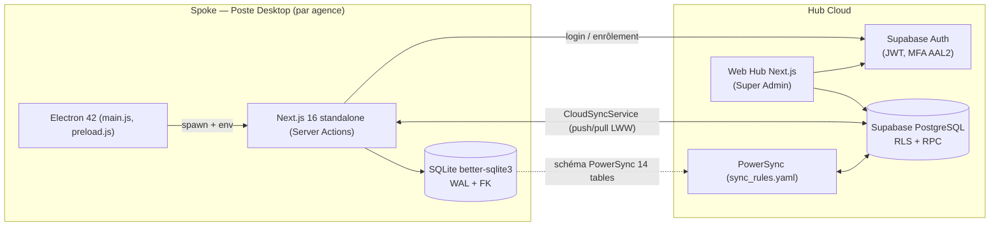

# Audit global et détaillé — « L'Étoile / Facturier » (Global Maintenance)

> **Date de l'audit** : 27 octobre 2026
> **Périmètre** : monorepo complet (`apps/desktop`, `apps/web-hub`, `packages/database`, `packages/ui`, `supabase/`, `powersync/`, `docs/`, CI).
> **Méthode** : lecture du code source, exécution réelle des suites de tests et du compilateur TypeScript, analyse de l'historique Git (492 commits).
> **Statut de ce document** : matière première pour le rapport. Chaque affirmation est vérifiable dans le code (références fournies). Ce document **remplace l'audit du 19/10/2026** ([AUDIT_AND_MASTER_PLAN.md](../AUDIT_AND_MASTER_PLAN.md)), dont plusieurs points critiques sont désormais corrigés (voir §8).

---

## 1. Synthèse exécutive

| Indicateur | Valeur mesurée | Source |
| :--- | :---: | :--- |
| Période de développement | 15/05/2026 → 27/10/2026 (≈ 23 semaines) | `git log` |
| Nombre de commits | **492** | `git rev-list --count HEAD` |
| Lignes de code (TS/TSX/JS, hors tests/node_modules) | **≈ 36 500** | comptage PowerShell |
| Tests automatisés Desktop | **261 tests / 48 fichiers : 100 % passés** | `vitest run` (89 s) |
| Tests automatisés Web Hub | **58 tests / 8 fichiers : 100 % passés** | `vitest run` (3 s) |
| Erreurs TypeScript Desktop | **0** (`tsc --noEmit`, `ignoreBuildErrors: false`) | `next.config.mjs` |
| Fiches de décision d'architecture (ADR) | **33** | `docs/decisions/` |
| Tables SQLite locales | 13 métier + 3 techniques de synchro | `lib/db.ts`, `localSchema.ts` |
| Tables PostgreSQL Supabase | 22 (4 migrations) | `supabase/migrations/` |
| Composants UI partagés | 35 (Shadcn/Radix) | `packages/ui` |
| Performance du moteur fiscal | 10 000 lignes en **0,37 à 0,85 ms** | `performance.test.ts`, `computeTotals.bench.test.ts` |

**Verdict global** : produit **fonctionnellement complet et techniquement mature** pour un projet de stage (tunnel Devis → Facture → Paiement → Avoir, hors-ligne, multi-entreprises, synchronisation cloud, licences, installeur Windows). Les risques résiduels sont principalement des **points de conformité fiscale à valider avec l'encadreur** (§5.1) et de la **dette de robustesse** (§6), pas des défauts bloquants.

### Score de maturité par sous-système

| Sous-système | Maturité | Commentaire |
| :--- | :---: | :--- |
| Cœur métier Desktop (devis, factures, paiements, avoirs) | 90 % | Complet, testé, transactions atomiques. Écarts fiscaux à confirmer. |
| Isolation multi-tenant locale | 80 % | Filtre `tenant_id` généralisé ; tolérance `NULL` à durcir (§5.2). |
| Synchronisation cloud (CloudSyncService + PowerSync) | 80 % | Push/pull LWW, tombstones, anti-collision. Numérotation à améliorer (§5.3). |
| Sécurité Desktop (auth, Electron) | 80 % | bcrypt, sandbox, contextIsolation, verrouillage. Limites listées (§6). |
| Web Hub (Super Admin) | 85 % | 8 modules, MFA AAL2, audit. |
| Licences & mode lecture seule | 90 % | Période de grâce 7 jours. |
| Packaging / distribution | 75 % | NSIS + auto-update. Pas de signature de code, pas de CI de tests. |
| Documentation & gouvernance | 95 % | 33 ADR + Living Docs + vérificateur automatique. |

---

## 2. Architecture réelle constatée

### 2.1 Vue Hub & Spoke



### 2.2 Structure du monorepo (Turborepo + npm workspaces)

| Dossier | Rôle | Éléments clés |
| :--- | :--- | :--- |
| `apps/desktop` | Client lourd Windows | 13 fichiers de Server Actions, 6 services, 5 repositories, 13 composants de pages, `main.js` (1 287 l.) |
| `apps/web-hub` | Portail Super Admin | 8 modules : dashboard, tenants 360°, flotte & synchro, finance, adoption, sécurité/audit, licences, annonces ; MFA |
| `packages/database` | Contrats partagés | 21 interfaces `I*`, moteur fiscal pur `@workspace/database/fiscal` |
| `packages/ui` | Design system | 35 composants, thème clair/sombre |
| `supabase/` | Cloud | 4 migrations SQL, RLS, RPC `provision_tenant`, `attach_member`, `hub_record_sync_telemetry` |
| `docs/decisions` | Gouvernance | 33 ADR + modèle + contrôle `npm run quality:decisions` |

### 2.3 Flux d'une écriture (exemple : création de facture)

1. Composant React → **Server Action** (`invoice.actions.ts`) ;
2. `getSession()` : cookie signé HttpOnly → `userId`, `role`, `tenantId` ;
3. Validation **Zod** (`invoiceSchema`) : entiers XAF, dates ISO, ≥ 1 ligne ;
4. Garde de licence (`assertLicenseAllowsCreation`) ;
5. `InvoiceService.createInvoice` dans une **transaction SQLite** : numérotation + insertion facture + lignes + éventuel passage du devis en `CONVERTI` ;
6. Triggers SQLite : `updated_at` auto → ligne « sale » pour la synchro ;
7. `CloudSyncRunner` : push vers Supabase quand le réseau est disponible.

---

## 3. Audit fonctionnel (par module)

### 3.1 Clients (Module 1)
- Champs : nom, email (optionnel), **téléphone obligatoire** (regex `+?[0-9\s-]{6,25}`), adresse, NIF, RCCM, statut.
- Soft delete (`deletedAt`), index composites `(tenant_id, lower(name))` (ADR-0031).
- RBAC : l'opérateur peut créer/éditer (ADR-0029), l'admin gère tout.

### 3.2 Catalogue de services/produits
- `services(name, description, category, unitPrice)`, prix en XAF entiers.
- **Constat** : le catalogue ne porte **pas de régime fiscal par ligne** (voir §5.1).

### 3.3 Devis (Module 2)
- Cycle : `EN_ATTENTE → ENVOYE → CONVERTI | REFUSE | EXPIRE`.
- Validité (`validUntil`) : conversion refusée si dépassée ; devis converti **verrouillé** ; duplication réservée à l'opérateur propriétaire.
- Conversion en facture **atomique** (transaction) avec journal d'audit.

### 3.4 Factures et paiements (Module 3)
- Statuts calculés : `UNPAID → PARTIALLY_PAID → PAID` à partir de la somme réelle des paiements (`updateInvoiceStatus`).
- Contrôle : un paiement ne peut pas dépasser le reste à payer.
- Modes proposés à l'écran : Espèces, Chèque, Virement, Airtel Money, Moov Money (`invoices.tsx`). **Incohérence relevée** : la constante `PAYMENT_METHODS` (`constants.ts`) ne contient pas « chèque » et utilise des clés techniques (`airtel`, `moov`) différentes des libellés réellement enregistrés (« Airtel Money »), et `paymentMethod` est validé comme simple `z.string()`. → Recommandation : un enum Zod unique partagé UI / validation / statistiques.
- Échéance `dueDate` (défaut +30 j).

### 3.5 Avoirs
- Numérotation `AV-…`, annulation de la facture si l'avoir couvre le total.

### 3.6 Documents imprimables
- PDF via `@react-pdf/renderer` et impression native Electron (`print-document`, `export-pdf`), format A4, charte Global Maintenance.
- Export Excel via `exceljs` (charte bleu `#003399` / vert `#2CA02C`).

### 3.7 Administration et sécurité
- Utilisateurs (admin/opérateur), changement de mot de passe forcé, journal d'audit (`audit_logs`), paramètres société (taux, préfixes, logo, mentions légales).
- Tableau de bord admin (CA, impayés, top clients, performance par opérateur) et tableau de bord opérateur.

### 3.8 Hub Cloud
- Gestion des tenants (statut `active/trial/suspended/expired`, plan, expiration), flotte de postes (`sync_devices`, `sync_runs`), KPI quotidiens (`kpi_tenant_daily`), alertes, annonces diffusées vers les postes, audit Hub (`hub_audit_logs`), MFA obligatoire (`is_superadmin_aal2`).

### 3.9 Matrice des rôles (réelle)

| Fonction | Super Admin (Hub) | Admin (entreprise) | Opérateur |
| :--- | :---: | :---: | :---: |
| Gérer entreprises, licences, annonces | ✅ | ❌ | ❌ |
| Synchroniser le Desktop | ❌ (bloqué volontairement) | ✅ | ✅ |
| Paramètres société / utilisateurs | — | ✅ | ❌ |
| Journal d'audit | ✅ (Hub) | ✅ | ❌ |
| Clients | — | ✅ | ✅ créer/éditer |
| Catalogue services | — | ✅ gérer | 👁 lecture |
| Devis / factures | — | ✅ tous | ✅ les siens |
| Enregistrer un paiement | — | ✅ | ✅ (ses factures) |
| Supprimer un paiement | — | ✅ | ❌ |
| Dupliquer un devis | — | ❌ | ✅ (les siens) |

---

## 4. Audit de la qualité et des tests

### 4.1 Pyramide de tests

| Niveau | Contenu | Volume |
| :--- | :--- | :---: |
| Unitaire | Fiscalité, arrondis, numérotation, statuts, RBAC, mots de passe, validations, schéma PowerSync | majorité des 48 fichiers |
| Intégration | Services devis/factures/avoirs avec SQLite réelle, isolation multi-tenant, onboarding | `tests/integration/` |
| Sécurité | Brute-force, audit RBAC, performance du hash | `tests/security/` |
| Performance | `computeTotals` 10 000 lignes, paiements | `tests/performance/` |
| Composants | Pages clients, factures, services, utilisateurs (Testing Library) | `tests/unit/components/` |
| E2E | Playwright + `e2e_runner.js` | configuré |
| Hub | Auth, MFA, licences, finance, rendu des pages | 8 fichiers / 58 tests |

### 4.2 Méthode de test structurée (3 volets par module)
Les fichiers `module{1,2,3}-{correctif,curative,preventif}.test.ts` formalisent une **maintenance en trois volets** (correctif / curatif / préventif), chacun associé à un ADR (0028 à 0033). C'est un excellent argument pour le chapitre « Tests et recette ».

### 4.3 Résultats
- Desktop : `Test Files 48 passed (48) · Tests 261 passed (261)`.
- Hub : `Test Files 8 passed (8) · Tests 58 passed (58)`.
- `tsc --noEmit` : 0 erreur.

### 4.4 Lacunes de qualité
| Réf. | Lacune | Impact |
| :--- | :--- | :---: |
| Q1 | **Aucune CI de tests** : le seul workflow (`release.yml`) construit et publie sur tag `v*`, sans exécuter `vitest` ni `tsc`. | Moyen |
| Q2 | Pas de rapport de **couverture** (`--coverage`) ni de seuil minimal. | Faible |
| Q3 | Doublons de fichiers de test (`QuoteService.test.ts` / `quote-service.test.ts`). | Faible |
| Q4 | Usage de `any` (ex. `InvoiceService.createInvoice(data: any)`, `db.ts`) alors que `.antigravity` §5 l'interdit sans justification. | Faible |
| Q5 | Préfixe `I` des interfaces appliqué dans `packages/database` mais pas dans `apps/desktop` (`Db*`, `*Response`). | Faible |
| Q6 | Composants volumineux : `setup-client.tsx` (80 Ko), `clients.tsx` (51 Ko), `invoices.tsx` (42 Ko), `lib/store.ts` (986 l.). | Moyen (maintenabilité) |

---

## 5. Constats critiques et majeurs (à traiter ou à documenter)

### 5.1 ⚠️ Conformité fiscale — À VALIDER AVEC L'ENCADREUR (priorité 1)

**Constat 1 — Pas de ventilation par nature de ligne.** `computeTotals` ([fiscal/index.ts](../../packages/database/src/fiscal/index.ts)) applique **la même cascade à toutes les lignes** :

```
Net HT = Σ(qté × PU) − remise
CSS    = Net HT × 1 %
Base   = Net HT + CSS
TPS    = Base × 9,5 %
TVA    = Base × 18 %
TTC    = Base + TPS + TVA
```

Or le document d'entreprise rédigé pour la Partie I affirme que « la TVA (18 %) s'applique aux ventes d'équipements, la TPS (9,5 %) aux prestations de maintenance/formation ». **Le code applique TVA et TPS cumulées sur toute la facture** (soit 27,5 % + CSS), y compris pour une vente de seul extincteur.

> [!IMPORTANT]
> Deux options pour le rapport : (a) **faire confirmer** par l'encadreur/la comptabilité que la cascade cumulée est bien la règle voulue (alors corriger la phrase de la Partie I) ; (b) présenter l'écart comme **évolution prioritaire** : ajouter un champ `taxRegime` (`GOODS` / `SERVICES` / `EXEMPT`) à `services`, `invoice_items`, `quote_items` et ventiler le calcul ligne par ligne. Je n'ai pas pu vérifier le Code Général des Impôts gabonais : la règle doit être validée par un référent fiscal.

**Constat 2 — Arrondis.** Chaque taxe est arrondie séparément (`Math.round`) : correct pour le XAF sans décimale, mais le total peut différer d'1 XAF d'un calcul « total puis décomposition » (cf. `fiscal-calculations.test.ts`, 18 Ko de cas limites).

**Constat 3 — Avoirs.** `CreditNoteService` :
- ne vérifie **ni** que le montant de l'avoir ≤ solde facturé, **ni** le cumul des avoirs déjà émis sur la même facture ;
- n'annule la facture que si **un seul** avoir ≥ total ;
- ne tient pas compte des avoirs dans `updateInvoiceStatus` ni dans le reste à payer.
→ Risque de sur-crédit. **Correctif recommandé** : somme des avoirs actifs de la facture, plafonnée au TTC, et statut dérivé `total − avoirs − paiements`.

**Constat 4 — Statut `overdue`.** Présent dans les types, constantes et exports, mais `updateInvoiceStatus` ne produit que `UNPAID/PARTIALLY_PAID/PAID`. Le retard doit donc être calculé à la volée (`dueDate < aujourd'hui`) : vérifier la cohérence tableau de bord / liste.

### 5.2 Isolation multi-tenant : tolérance `NULL`

`buildTenantFilter` ([tenant.ts](../../apps/desktop/lib/api/tenant.ts)) produit :

```sql
AND (tenant_id = ? OR tenant_id IS NULL OR tenant_id = '')
```

Ce choix (ADR-0002) garantit la compatibilité avec les bases V1 et les tests, mais **toute ligne sans `tenant_id` est visible de tous les tenants** du poste. Atténuations existantes : `migrateLegacy` et `reconcileLocalTenantId` rattachent les lignes orphelines. **Recommandation** : après migration, appliquer `NOT NULL DEFAULT` via reconstruction de table et supprimer la clause `OR IS NULL` (tests à adapter).

À noter aussi : `resolveActiveTenantId` se rabat sur « le premier admin » si la session n'a pas de `tenantId`.

### 5.3 Numérotation documentaire multi-postes

- Table `sequences(name, current_value, last_year)` **locale**, sans `tenant_id` : deux entreprises sur le même poste partageraient un compteur.
- Anti-collision multi-postes : (1) préfixe de poste optionnel via `FACTURIER_DEVICE_PREFIX` (`FAC-P1-001/GM/2026`) ; (2) à la synchronisation, en cas d'erreur Postgres `23505`, le numéro est **suffixé** par 4 caractères de l'UUID (`FAC-001/GM/2026-A3F9`).
- **Écart avec l'ADR-0002** qui annonce « le prochain numéro disponible ».
- **Enjeu comptable** : une numérotation fiscale doit être continue et chronologique ; le suffixe garantit l'unicité mais **pas la continuité**.
- **Recommandation** : plages de numéros réservées par poste (bloc de 100 alloué en ligne) ou numéro définitif attribué à la validation/synchronisation, numéro provisoire avant.

---

## 6. Audit de sécurité

### 6.1 Mesures en place (points forts à valoriser)

| Domaine | Mesure | Référence |
| :--- | :--- | :--- |
| Mots de passe | bcrypt (coût 10), migration transparente des anciens hash, hash factice pour égaliser le temps de réponse (anti-énumération) | `auth.actions.ts` L.105-123 |
| Brute-force | 5 échecs → verrouillage 15 min, journalisé (`LOGIN_LOCKED`) | `auth.actions.ts` L.28-66 |
| Session | Cookie **HttpOnly** signé, 7 jours, secret ≥ 32 car. exigé | `auth.actions.ts` L.134, 253 |
| Secrets | `secrets.json` généré aléatoirement (48 octets), droits `0600`, persistés dans `userData` | `main.js` L.425-470 |
| Electron | `nodeIntegration:false`, `contextIsolation:true`, `sandbox:true`, `webSecurity` en prod, IPC en `invoke` uniquement, API restreinte via `contextBridge` | `main.js` L.279, 575-579 ; `preload.js` |
| Données | Soft delete partout, UUIDv4, transactions ACID, WAL, clés étrangères actives | `db.ts` |
| Cloud | RLS `tenant_isolation` sur toutes les tables ; Superadmin interdit sur Desktop ; JWT `custom_access_token_hook` ; **MFA AAL2** obligatoire au Hub ; audit Hub | `20261013_desktop_sync.sql`, `20261020_hub_security.sql` |
| Licence | Statuts `suspended/expired` → lecture seule ; grâce 7 j | `license.ts` |
| Chiffrement | File `pending_cloud_members` chiffrée AES-256-GCM (ADR-0003) | `crypto/secretStore.ts` |
| Mises à jour | `electron-updater` via GitHub Releases | `main.js` L.1246+ |
| Sauvegarde | Copie journalière, rétention 7 jours | `performDailyBackup` |

### 6.2 Vulnérabilités / améliorations

| Réf. | Constat | Gravité | Recommandation |
| :--- | :--- | :---: | :--- |
| S1 | Compteur de tentatives **en mémoire** (`Map`) : perdu au redémarrage, non partagé. Contournable en relançant l'application. | Moyenne | Persister dans SQLite (`login_attempts`) avec horodatage. |
| S2 | `secrets.json` en clair dans AppData (protégé seulement par les droits du compte Windows). | Moyenne | Chiffrer avec `safeStorage` d'Electron (DPAPI). |
| S3 | Mot de passe minimal de **6 caractères** à l'enrôlement Cloud. | Moyenne | ≥ 10 caractères + liste de mots de passe courants. |
| S4 | Aucune **signature de code** de l'installeur → avertissement SmartScreen. | Moyenne | Certificat Authenticode (ou Azure Trusted Signing). |
| S5 | Sauvegarde par `copyFileSync` sur le même disque, non chiffrée, sans vérification d'intégrité. | Moyenne | `db.backup()` de better-sqlite3 + `PRAGMA integrity_check` + copie externe/cloud. |
| S6 | Pas de rotation du cookie de session ni de révocation côté serveur (7 j fixes). | Faible | Jeton de session stocké et révocable. |
| S7 | Journal d'audit modifiable (même base locale). | Faible | Chaînage de hash (hash-chain) des entrées. |

> **Analyse de risque pour le rapport** : application **locale** (surface réseau limitée au seul port interne Next.js ↔ Electron et à Supabase en HTTPS) ; les menaces principales sont le vol de poste et l'erreur humaine, d'où l'importance des sauvegardes et du chiffrement local.

---

## 7. Audit de performance et de robustesse

| Sujet | Constat | Évaluation |
| :--- | :--- | :---: |
| Calcul fiscal | 10 000 lignes en < 1 ms | Excellent |
| Requêtes SQLite | Statements préparés **mis en cache** (`prepareCached`), index composites partiels `(tenant_id, …) WHERE deletedAt IS NULL` (ADR-0031/32/33) | Très bon |
| Concurrence | WAL + `synchronous=NORMAL` + `timeout 5000` | Bon |
| Arrêt propre | Checkpoint WAL + `close()` sur `exit/SIGINT/SIGTERM/SIGBREAK` | Très bon |
| Résolution du chemin de base | 3 niveaux (userData → cwd en dev → homedir) évitant l'écriture dans `Program Files` | Très bon |
| Démarrage | Code-splitting du login (ADR-0025) | Bon |
| Synchro | Lots de 200 (push), pages de 1 000 (pull), timeouts, télémétrie non bloquante | Bon |
| Synchro | Résolution LWW sur `updated_at` : possible perte d'une modification concurrente sur la même ligne | À documenter |
| Résilience UI | Error boundaries, toasts Sonner | Bon |
| Portabilité | Binaire natif `better-sqlite3` à recompiler **deux fois** (ABI Node pour tests, ABI Electron pour l'installeur) | Fragile (voir §9) |

---

## 8. Évolution depuis l'audit du 19/10/2026

| Point de l'audit initial | État au 27/10/2026 | Preuve |
| :--- | :---: | :--- |
| P0-1 Absence de filtre `tenant_id` local | ✅ **Corrigé** (avec réserve §5.2) | `buildTenantFilter` utilisé dans actions/services |
| P0-2 `dueDate` absent des `INSERT` | ✅ Corrigé | `InvoiceService`, `QuoteService` |
| P0-2 Collisions de numérotation | ⚠️ Partiel (unicité oui, continuité non) | §5.3 |
| P0-3 Dualité PowerSync / CloudSync | ✅ Clarifié (ADR-0018, schéma 14 tables) | `AppSchema.ts`, `sync_rules.yaml` |
| P1-1 Contradiction RBAC | ✅ Matrice harmonisée | `store.ts` L.105-143 |
| P1-2 `packages/database` vide | ✅ 21 interfaces `I*` + moteur fiscal | `packages/database/src` |
| P1-3 Web Hub non implémenté | ✅ 8 modules + MFA | `apps/web-hub/src` |
| `ignoreBuildErrors: true` | ✅ `false`, 0 erreur `tsc` | `next.config.mjs` L.30 |
| Chiffrement `pending_cloud_members` | ✅ AES-256-GCM | ADR-0003 |

---

## 9. Incidents techniques rencontrés (matière pour le chapitre IV §1.2)

| Incident | Cause racine | Résolution | Trace |
| :--- | :--- | :--- | :--- |
| Écran blanc / erreur 500 au démarrage de l'installeur | Binaire `better_sqlite3.node` compilé pour l'ABI Node et non Electron | Scripts `rebuild:electron`, `sync-sqlite`, purge du cache ABI, `asarUnpack: **/*.node` | ADR-0020, 0022 |
| Base inscriptible impossible sous `Program Files` | `process.cwd()` en lecture seule en production | Résolution du chemin en 3 niveaux, `ELECTRON_USERDATA_PATH` | `db.ts` L.7-105 |
| Sessions invalidées et mots de passe illisibles à chaque lancement | Secrets régénérés aléatoirement à chaque démarrage | Persistance dans `secrets.json` | `main.js` L.428-470 |
| `process.chdir` interdit dans le serveur standalone | Spécificité Next.js standalone dans l'ASAR | Script `patch-standalone` | `package.json` |
| Ressources absentes de l'installeur | Dossier standalone non copié | `extraResources` | ADR-0022 |
| Icône/écran de démarrage absents | Ressources de build non empaquetées | ADR-0023 | |
| Fuite de mémoire / double base WASM | PowerSync WASM + better-sqlite3 en parallèle | Unification du pipeline (ADR-0018) | |
| Collision de numéros hors-ligne | Séquences locales | Préfixe de poste + désambiguïsation à la synchro | `CloudSyncService` L.165-200 |
| Temps de connexion lent | Bundle login volumineux | Code-splitting (ADR-0025) | ADR-0025 |
| Force brute sur le login | Absence de limitation | Verrouillage 15 min (ADR-0026) | ADR-0026 |

---

## 10. Plan d'amélioration priorisé (pour le chapitre V « Suggestions »)

### Court terme (≤ 2 semaines)
1. **Valider la règle fiscale** TVA/TPS/CSS avec la comptabilité (§5.1) et adapter la Partie I ou le code.
2. **Plafonner les avoirs** et cumuler (§5.1 constat 3) — ~1 jour + tests.
3. **CI GitHub Actions** : `npm ci` → `tsc --noEmit` → `vitest run` sur chaque PR (§4.4 Q1).
4. Sauvegarde fiable : `db.backup()`, contrôle d'intégrité, bouton « Exporter une sauvegarde » (S5).
5. Politique de mot de passe renforcée (S3).

### Moyen terme (1–3 mois)
6. Régime fiscal **par ligne** (`GOODS/SERVICES`) (§5.1).
7. Numérotation par **plages réservées** par poste (§5.3).
8. `safeStorage` pour les secrets (S2) ; persistance du verrouillage (S1).
9. Signature de code Windows (S4).
10. Retrait de la tolérance `tenant_id IS NULL` (§5.2).
11. Découpage des composants > 30 Ko et du store Zustand par domaine (Q6).

### Long terme
12. Facture électronique normalisée (QR code/signature, selon l'évolution DGI).
13. Application mobile de consultation, module de relance automatique des impayés (SMS/WhatsApp).
14. Journal d'audit infalsifiable (hash-chain) ; export comptable (Sage/Ciel).
15. Support macOS/Linux (déjà configuré dans `electron-builder`).

---

## 11. Conclusion de l'audit

L'application répond aux exigences d'un **projet informatique de niveau professionnel** : architecture explicitement décidée et documentée (33 ADR), cycle de test automatisé à 100 %, sécurité multicouche, résilience hors-ligne, et gouvernance logicielle rare à ce niveau (contrôle automatique des ADR, Living Docs). Les écarts identifiés sont **assumables en rapport** s'ils sont présentés honnêtement comme *retour d'expérience* et *perspectives d'amélioration* — ce qui valorise la démarche critique attendue par le jury.
