# Dossier de conception — Processus 2TUP, Agile et modélisation UML

> Matière pour la **Deuxième partie** du rapport (Chapitres III et IV).
> Tous les diagrammes sont en **Mermaid** : ils s'affichent dans l'aperçu Markdown de VS Code/GitHub. Pour Word, exportez-les en PNG (https://mermaid.live → *Actions → PNG*) puis légendez : « Figure III.x : … ».
> Les faits techniques proviennent du code ; les éléments marqués ✏️ sont des **hypothèses à confirmer** avec vos souvenirs/dates réels.

---

## 1. Pourquoi 2TUP (Two Track Unified Process) ?

### 1.1 Justification scientifique du choix
2TUP est un processus **itératif et incrémental** issu d'UP, centré sur l'architecture, piloté par les risques et adapté aux projets où **deux dimensions évoluent indépendamment** :

| Dimension | Question | Dans notre projet |
| :--- | :--- | :--- |
| **Fonctionnelle** (branche gauche) | *Que doit faire le système ?* | Facturation gabonaise : devis, factures, TVA/TPS/CSS, avoirs, paiements |
| **Technique** (branche droite) | *Avec quelles contraintes et quelle architecture ?* | Hors-ligne, multi-entreprises, synchronisation, Windows, sécurité, licences |

Un projet de facturation classique n'aurait qu'une branche forte. Ici, **les contraintes techniques (offline-first, multi-tenant, sync) sont aussi structurantes que le besoin métier** : 2TUP permet de les étudier *séparément* puis de les *fusionner* à la conception. C'est exactement la séparation du rapport :

- **Chapitre III, Section 1** → *branche droite* : étude comparative des technologies et choix de l'architecture ;
- **Chapitre III, Section 2** → *branche centrale* : modélisation UML et base de données ;
- **Chapitre IV** → *branche centrale (suite)* : codage, tests, recette, déploiement.

### 1.2 Le cycle en Y du projet

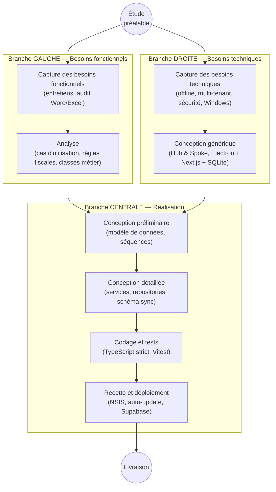
*Figure III.1 : Cycle de développement en Y (2TUP) appliqué au projet L'Étoile*

### 1.3 Correspondance 2TUP ↔ livrables réels

| Étape 2TUP | Livrable du projet | Où le trouver |
| :--- | :--- | :--- |
| Étude préalable | Audit de l'existant (Word/Excel), SWOT, cahier des charges | Partie I, Chap. II |
| Capture besoins fonctionnels | SF1–SF6, acteurs, cas d'utilisation | §3 ci-dessous |
| Analyse | Diagramme de classes métier, règles fiscales | §5 |
| Capture besoins techniques | ST1–ST6, exigences non fonctionnelles | §4 |
| Conception générique | Architecture Hub & Spoke, ADR-0001 à 0027 | `docs/decisions/` |
| Conception préliminaire | Modèle relationnel SQLite/PostgreSQL | §6 |
| Conception détaillée | Séquences, états, services transactionnels | §7–§8 |
| Codage | Monorepo Turborepo, ≈ 36 500 lignes | dépôt |
| Tests | 261 + 58 tests automatisés, 100 % de réussite | Audit §4 |
| Recette | Scénarios S1–S5, ADR-0028 à 0033 | §11 |
| Déploiement | Installeur NSIS, GitHub Releases, Supabase | Audit §9 |

---

## 2. Méthode Agile (Scrum adapté) et gestion de projet

### 2.1 Positionnement
2TUP définit **le cycle de vie** (quoi concevoir, dans quel ordre) ; **Scrum** organise **le travail quotidien** (comment avancer par incréments). L'équipe étant composée d'un étudiant développeur et d'un encadreur *Product Owner*, Scrum a été adapté :

| Rôle Scrum | Titulaire | Responsabilité |
| :--- | :--- | :--- |
| Product Owner | Encadreur professionnel (Global Maintenance) | Priorise le backlog, valide les règles métier (codes de documents, régimes fiscaux, mentions légales) |
| Scrum Master / Équipe de développement | Stagiaire (+ assistants IA de code) | Planifie, développe, teste, documente |
| Parties prenantes | Direction, service administratif et commercial | Tests d'acceptation, retours d'usage |

### 2.2 Artefacts et cérémonies réellement observés
| Artefact / cérémonie | Preuve dans le dépôt |
| :--- | :--- |
| Backlog produit et plan directeur | `docs/AUDIT_AND_MASTER_PLAN.md`, `docs/PLAN_CONTINUATION_ET_FINALISATION.md` |
| Definition of Done | `.antigravity` §9 : *« toute fonctionnalité doit être accompagnée de son test Vitest »* ; `npm run quality:decisions` |
| Revue de code / Pull requests | `.github/pull_request_template.md`, PR #1 et #2 fusionnées (15/05/2026) |
| Incréments livrés | 492 commits, convention `feat:`, `fix:`, `chore:` (Conventional Commits) |
| Rétrospective | Fiches ADR (contexte → décision → alternatives → risques → vérification) |
| Intégration/déploiement | `release.yml` (build Windows sur tag `v*`) |

### 2.3 Planning (reconstitué depuis l'historique Git ✏️)
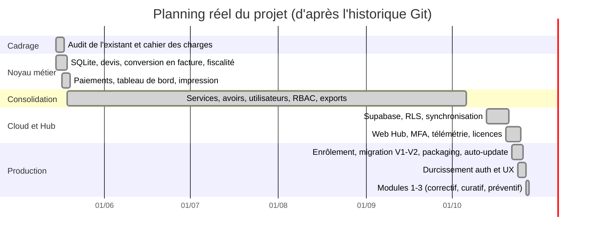
*Figure III.2 : Diagramme de Gantt du projet*

> ✏️ La période de juin à septembre est volontairement regroupée : le dépôt montre 492 commits mais je n'ai pas détaillé les itérations intermédiaires. Complétez avec vos vraies dates de sprint (idéalement : 2 semaines par sprint).

### 2.4 Gestion des risques
| Risque | Probabilité | Impact | Parade mise en œuvre |
| :--- | :---: | :---: | :--- |
| Perte de données locales | Moyenne | Critique | WAL, transactions, sauvegarde quotidienne 7 j, synchro cloud |
| Erreur de calcul fiscal | Moyenne | Critique | Moteur pur isolé, 18 Ko de tests de cas limites, arrondis XAF |
| Absence de connexion Internet | Forte | Élevé | Architecture offline-first |
| Collision de numérotation multi-postes | Moyenne | Élevé | Préfixe de poste + désambiguïsation à la synchro (limite : audit §5.3) |
| Incompatibilité ABI `better-sqlite3`/Electron | Forte | Élevé | Scripts de reconstruction, `asarUnpack` |
| Fuite de données entre entreprises | Faible | Critique | `tenant_id` partout + RLS Postgres |
| Dérive de périmètre | Moyenne | Moyen | ADR + backlog priorisé par l'encadreur |
| Dépendance à des bibliothèques en évolution rapide (Next 16, Electron 42) | Moyenne | Moyen | Consultation de la documentation versionnée (Context7) avant implémentation |

### 2.5 Indicateurs de suivi
Commits : 492 · Tests : 319 (261 + 58) · ADR : 33 · Erreurs TypeScript : 0 · Taux de réussite des tests : 100 %.

---

## 3. Capture des besoins fonctionnels (branche gauche)

### 3.1 Acteurs
| Acteur | Type | Description |
| :--- | :---: | :--- |
| Opérateur | Principal | Agent administratif/commercial : crée devis, factures, encaisse |
| Administrateur | Principal | Dirigeant/responsable : paramètre la société, gère utilisateurs et catalogue, supervise |
| Super Administrateur | Principal | Éditeur de la solution : gère entreprises, licences, annonces (Web Hub) |
| Supabase (Cloud) | Secondaire | Authentification, stockage, synchronisation |
| Client final | Externe | Destinataire des documents (n'interagit pas avec l'application) |

### 3.2 Exigences fonctionnelles (reprises du cahier des charges)
| Code | Exigence | Priorité (MoSCoW) |
| :--- | :--- | :---: |
| SF1 | Gestion des clients (NIF, RCCM, téléphone obligatoire) | Must |
| SF2 | Catalogue produits / prestations / formations en XAF | Must |
| SF3 | Devis → facture sans ressaisie, numérotation automatique | Must |
| SF4 | Calcul fiscal : remise, CSS, TPS, TVA, arrondis XAF | Must |
| SF5 | Paiements partiels, solde restant, statuts automatiques | Must |
| SF6 | PDF/impression A4 à l'en-tête de l'entreprise, export Excel, tableau de bord | Must |
| SF7 | Avoirs (notes de crédit) | Should |
| SF8 | Utilisateurs, rôles, changement de mot de passe forcé | Must |
| SF9 | Journal d'audit des actions sensibles | Should |
| SF10 | Multi-entreprises (multi-tenant) et enrôlement d'un poste | Should |
| SF11 | Synchronisation cloud et licence (lecture seule si expirée) | Should |
| SF12 | Supervision centralisée (Hub) : flotte, finances, annonces | Could |

### 3.3 Exigences non fonctionnelles et techniques (branche droite)
| Code | Exigence | Mesure / preuve |
| :--- | :--- | :--- |
| ST1 | Fonctionnement 100 % hors-ligne | SQLite local, aucune dépendance réseau pour facturer |
| ST2 | Intégrité ACID, clés primaires UUID, soft delete | `db.ts`, transactions |
| ST3 | Sécurité : hash des mots de passe, verrouillage, sandbox Electron | Audit §6 |
| ST4 | Performance : calcul d'une facture de 10 000 lignes < 50 ms | Mesuré : 0,37–0,85 ms |
| ST5 | Isolation multi-entreprises | `tenant_id` + RLS |
| ST6 | Distribution : installeur Windows, mise à jour automatique | NSIS + `electron-updater` |
| ST7 | Maintenabilité : TypeScript strict, tests, ADR | 0 erreur `tsc`, 319 tests |
| ST8 | Ergonomie : mode sombre, accessibilité clavier, toasts | `packages/ui` |

### 3.4 Diagramme de cas d'utilisation

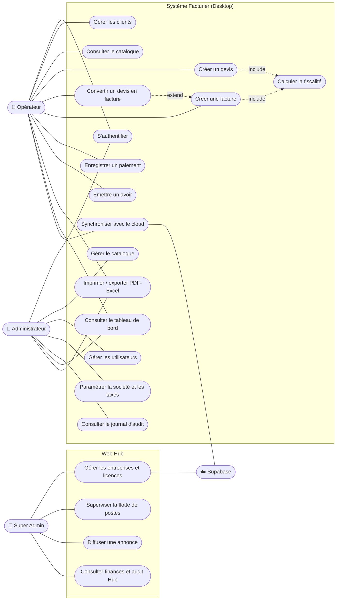
*Figure III.3 : Diagramme de cas d'utilisation général*

### 3.5 Description textuelle — cas « Convertir un devis en facture »
| Champ | Contenu |
| :--- | :--- |
| Acteur | Opérateur (propriétaire du devis) ou Administrateur |
| Pré-conditions | Authentifié ; licence active ; devis non supprimé, non converti, non expiré |
| Déclencheur | Clic sur « Convertir en facture » |
| Scénario nominal | 1. Le système charge le devis et ses lignes. 2. Vérifie droits, statut et validité. 3. Génère le numéro `FAC-…`. 4. Crée la facture (échéance J+30) et copie les lignes. 5. Passe le devis à `CONVERTI`. 6. Écrit une entrée d'audit. 7. Retourne le numéro. |
| Scénarios alternatifs | A1 devis introuvable (404) · A2 non propriétaire (403) · A3 devis déjà converti · A4 devis expiré · A5 licence en lecture seule |
| Post-conditions | Facture `UNPAID` ; devis verrouillé ; ligne marquée « à synchroniser » |
| Garantie | Opération **atomique** : tout ou rien |

### 3.6 Description textuelle — cas « Enregistrer un paiement »
| Champ | Contenu |
| :--- | :--- |
| Pré-conditions | Facture existante, non supprimée ; l'opérateur est propriétaire (ou admin) |
| Scénario nominal | Saisie montant/mode/date/référence → validation Zod → calcul du reste à payer → insertion du paiement → recalcul du statut (`UNPAID/PARTIALLY_PAID/PAID`) → audit |
| Alternatifs | Montant > reste à payer → refus avec message « excède le reste à charge » ; facture supprimée → refus |
| Post-conditions | Statut de la facture mis à jour dans la même transaction |

---

## 4. Conception générique — choix technologiques (Section 1 du Chapitre III)

### 4.1 Comparatif des architectures de solution
| Critère (poids) | Tableur Word/Excel (existant) | Application Web SaaS pure | **Client lourd Offline-First + Cloud** (retenu) | Logiciel du marché (Sage, EBP) |
| :--- | :---: | :---: | :---: | :---: |
| Fonctionne sans Internet (25) | ✅ | ❌ | ✅ | ✅ |
| Conformité fiscale gabonaise sur mesure (25) | ❌ | ✅ | ✅ | ⚠️ à paramétrer |
| Coût de licence (15) | ✅ gratuit | ⚠️ hébergement | ✅ | ❌ élevé |
| Intégrité et traçabilité (15) | ❌ | ✅ | ✅ | ✅ |
| Multi-agences (10) | ❌ | ✅ | ✅ (sync) | ⚠️ |
| Maîtrise du code (10) | — | ✅ | ✅ | ❌ |
| **Verdict** | Écarté | Écarté (connectivité) | **Retenu** | Écarté (coût/adaptation) |

### 4.2 Comparatif des technologies

| Couche | Options étudiées | **Choix** | Justification |
| :--- | :--- | :---: | :--- |
| Coque desktop | Electron · Tauri · .NET WPF/WinForms | **Electron 42** | Écosystème web réutilisable, impression PDF native, auto-update mature ; Tauri exigerait Rust, WPF fermerait la voie à la réutilisation web (Hub) |
| Framework UI | Next.js · React+Vite · Angular | **Next.js 16 (App Router, standalone)** | Server Actions = couche métier sécurisée côté serveur local ; partage du code avec le Hub |
| Base locale | SQLite · PostgreSQL local · IndexedDB · Excel | **SQLite (`better-sqlite3`)** | Zéro administration, fichier unique, ACID, WAL, synchrone et très rapide |
| Cloud | Supabase · Firebase · API Node maison | **Supabase** | PostgreSQL + RLS native (isolation multi-tenant), Auth + MFA, RPC |
| Synchronisation | PowerSync · CouchDB/PouchDB · Firebase · service maison | **CloudSyncService (maison) + schéma/règles PowerSync** | Contrôle des conflits de numérotation et de la licence ; PowerSync prêt pour le temps réel |
| État UI | Zustand · Redux Toolkit · Context | **Zustand 5** | Minimaliste, sans boilerplate |
| Validation | Zod · Yup · Joi | **Zod 3** | Inférence TypeScript, validation partagée client/serveur |
| Mots de passe | bcryptjs · argon2 · scrypt | **bcryptjs** | Pas de compilation native supplémentaire (déjà source de fragilité avec SQLite) ; argon2 en évolution |
| PDF | `@react-pdf/renderer` · Puppeteer · impression Chromium | **react-pdf + `printToPDF` Electron** | Rendu fidèle A4 sans navigateur externe |
| Tests | Vitest · Jest · Playwright | **Vitest + Testing Library + Playwright** | Rapidité, compatibilité ESM/TypeScript |
| Monorepo | Turborepo · Nx · Lerna | **Turborepo + npm workspaces** | Cache de tâches, peu de configuration |
| Style | Tailwind 4 + Radix/Shadcn · MUI · Bootstrap | **Tailwind 4 + Shadcn** | Design system sur mesure, mode sombre |
| Packaging | electron-builder · electron-forge | **electron-builder (NSIS)** | Auto-update GitHub, installeur Windows |

> ⚠️ **Cohérence avec la Partie I** : le texte déjà rédigé cite « Electron, React, **Vite**, Tailwind CSS ». Le code réel utilise **Next.js 16** (Vite n'apparaît que via Vitest). Corrigez la phrase (voir guide de rédaction).

### 4.3 Architecture technique retenue
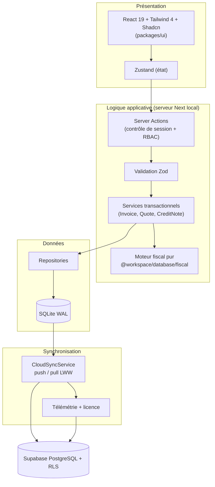
*Figure III.4 : Architecture logicielle en couches*

---

## 5. Modélisation statique — Diagramme de classes

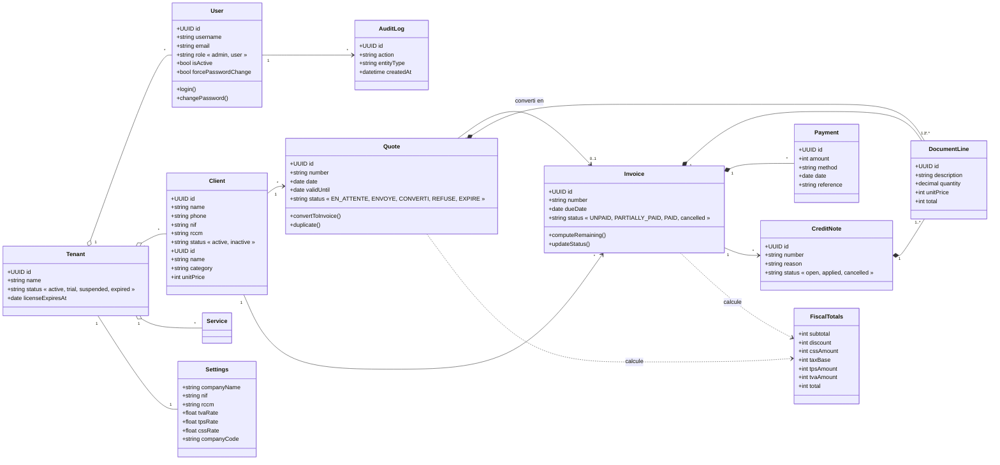
*Figure III.5 : Diagramme de classes du domaine métier*

> Note de modélisation : en base, `DocumentLine` est matérialisée en trois tables (`quote_items`, `invoice_items`, `credit_note_items`) ; la généralisation est un choix d'analyse, la spécialisation un choix de conception.

---

## 6. Modèle de données relationnel (SQLite local)

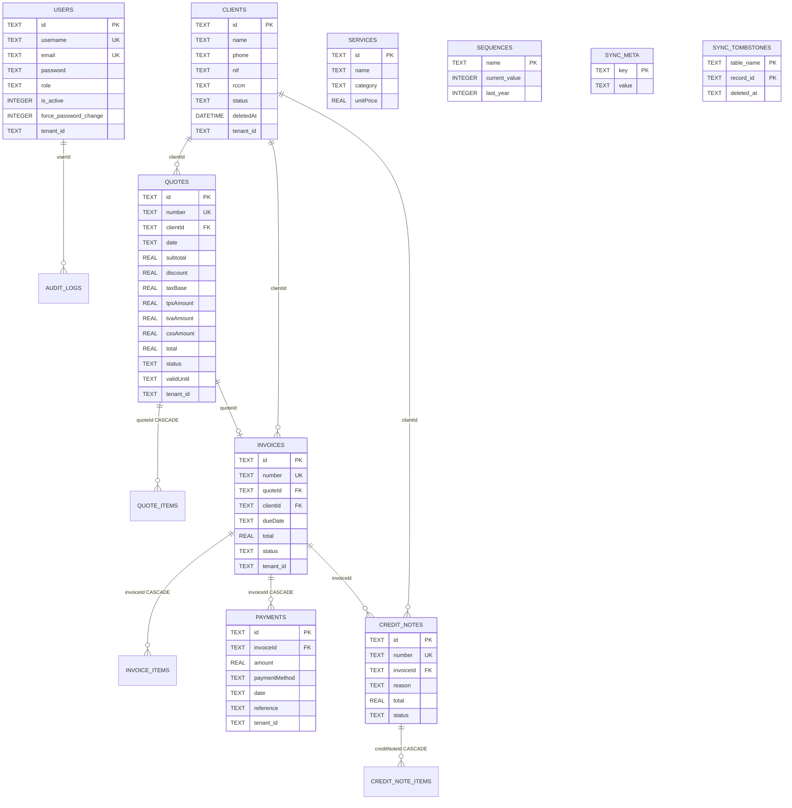
*Figure III.6 : Modèle entité-association de la base locale*
(Extrait : lignes `quote_items`, `invoice_items`, `credit_note_items`, `audit_logs`, `settings` et `pending_cloud_members` omises pour la lisibilité ; les colonnes `updated_at` et `synced_at` sont ajoutées par `ensureSyncSchema` à toutes les tables synchronisées.)

### 6.1 Règles de conception de la base
| Règle | Mise en œuvre |
| :--- | :--- |
| Clés primaires **UUIDv4** générées côté client | `crypto.randomUUID()` : pas de conflit entre postes hors-ligne |
| **Soft delete** | Colonne `deletedAt` ; filtre `deletedAt IS NULL` systématique |
| Isolation multi-entreprises | Colonne `tenant_id` + index composites `(tenant_id, deletedAt)` |
| Montants **entiers** (XAF) | Validation `z.number().int()` + `Math.round` |
| Intégrité référentielle | `PRAGMA foreign_keys = ON`, `ON DELETE CASCADE` sur les lignes |
| Suivi de synchronisation | Triggers qui renseignent `updated_at` ; table `sync_tombstones` pour les suppressions physiques |
| Migration non destructive | `ALTER TABLE ... ADD COLUMN` idempotents + `migrateLegacy` avec sauvegarde |
| Performance | Index partiels `WHERE deletedAt IS NULL` ; statements préparés mis en cache |

### 6.2 Moteur fiscal — formalisation
Soit `S = Σ(qᵢ × pᵢ)` (arrondi par ligne), `R` la remise, `H = max(0, S − R)` :

| Étape | Formule | Arrondi |
| :--- | :--- | :--- |
| CSS | `H × cssRate/100` | entier |
| Base taxable | `B = H + CSS` | — |
| TPS | `B × tpsRate/100` | entier |
| TVA | `B × tvaRate/100` | entier |
| **Total TTC** | `B + TPS + TVA` | — |

**Exemple chiffré** (S = 1 000 000 XAF, R = 0 ; taux 1 % / 9,5 % / 18 %) :
CSS = 10 000 → Base = 1 010 000 → TPS = 95 950 → TVA = 181 800 → **TTC = 1 287 750 XAF**.

> ✏️ À valider avec l'encadreur (cf. audit §5.1) : application des deux taxes à toutes les lignes, et base taxable incluant la CSS.

---

## 7. Modélisation dynamique

### 7.1 Diagramme de séquence — Devis converti, puis paiement
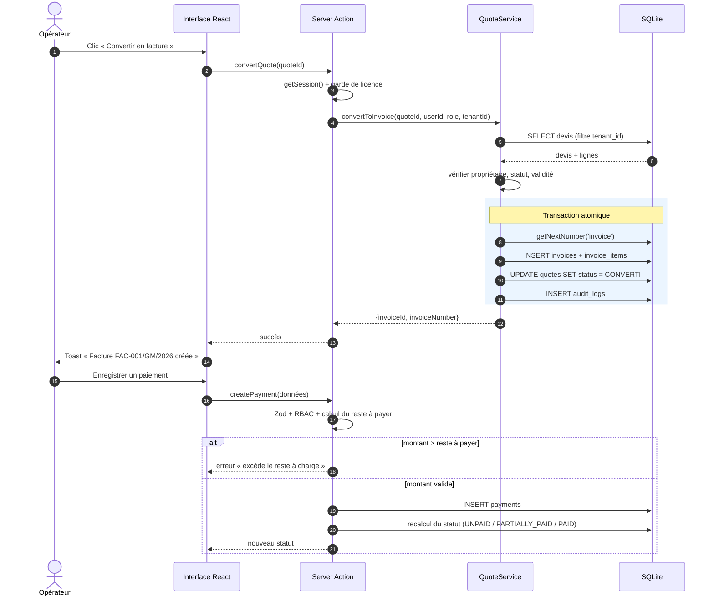
*Figure III.7 : Séquence « Devis → Facture → Paiement »*

### 7.2 Diagramme de séquence — Synchronisation cloud
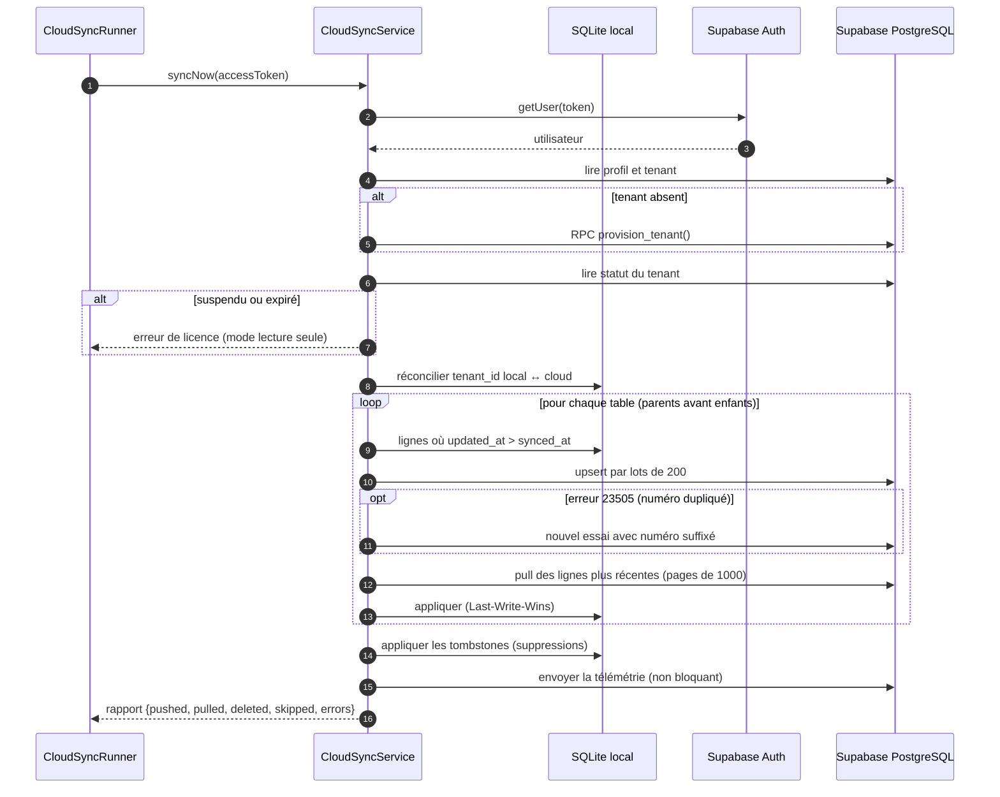
*Figure III.8 : Séquence de synchronisation Desktop ↔ Cloud*

### 7.3 Diagramme de séquence — Authentification hors-ligne
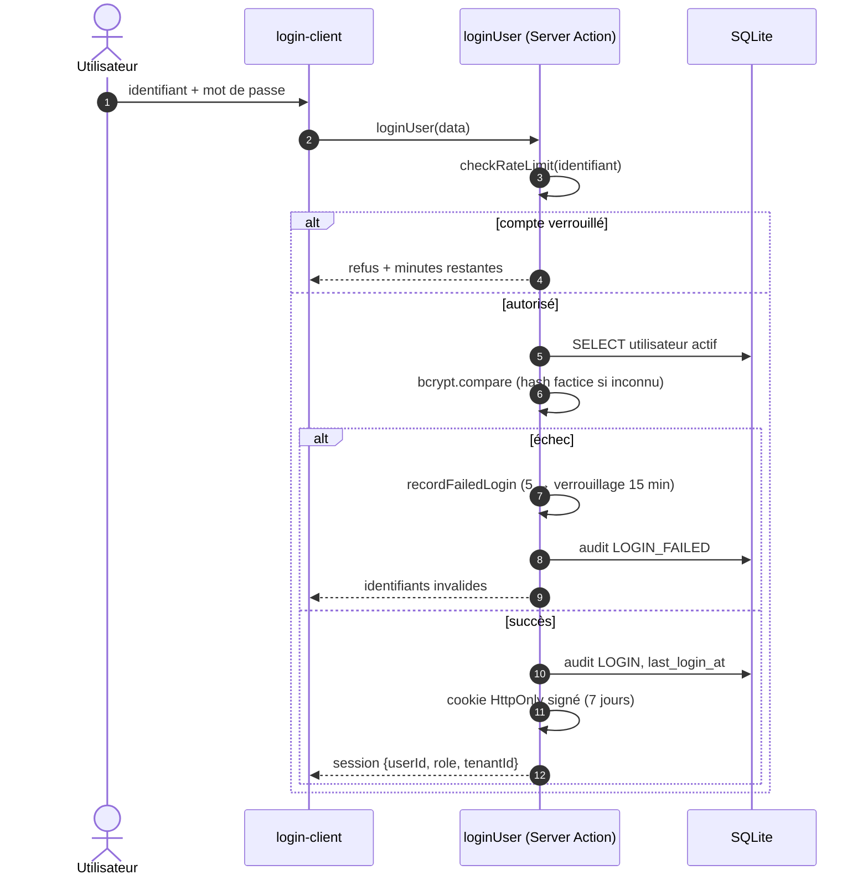
*Figure III.9 : Séquence d'authentification*

### 7.4 Diagrammes d'états
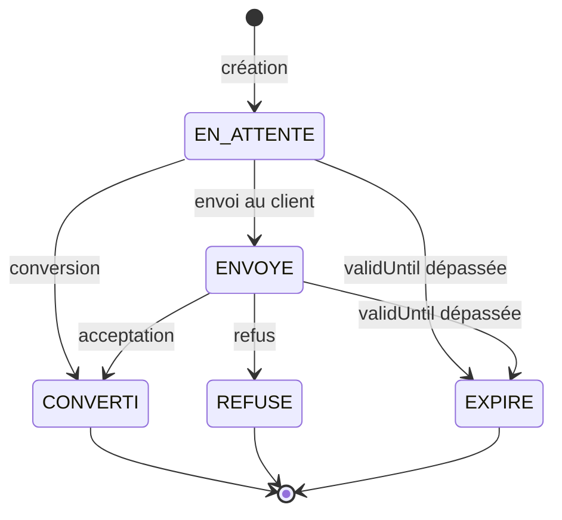
*Figure III.10 : Cycle de vie d'un devis*

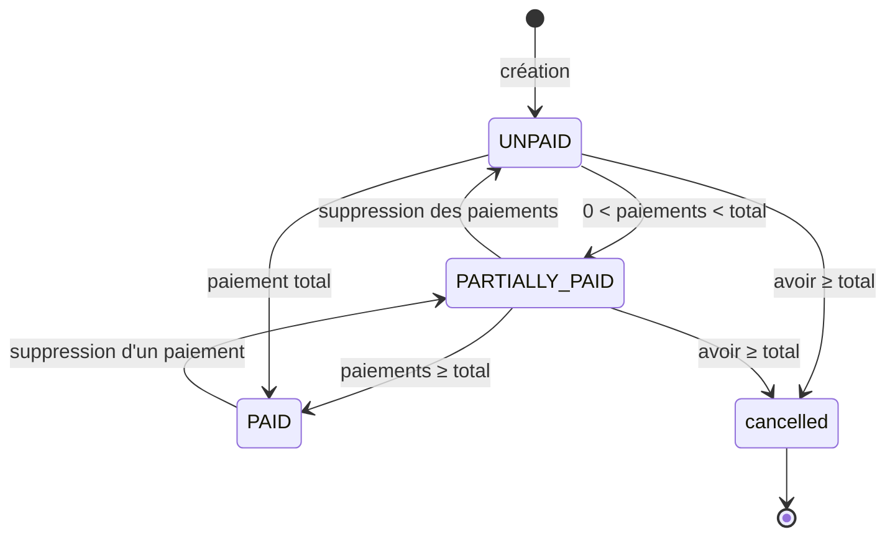
*Figure III.11 : Cycle de vie d'une facture (statuts persistés)*

### 7.5 Diagramme d'activité — Émission d'une facture
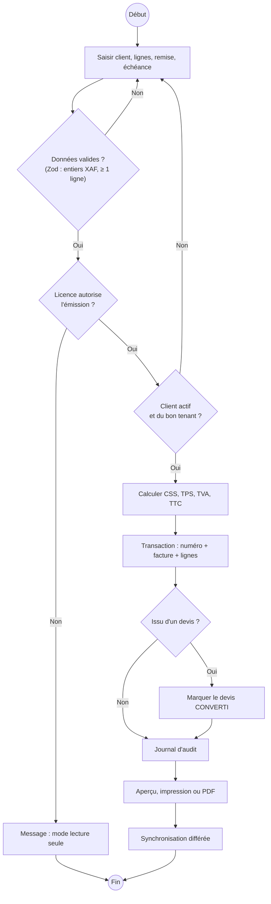
*Figure III.12 : Activité « Émettre une facture »*

---

## 8. Conception technique (diagrammes d'architecture)

### 8.1 Diagramme de composants
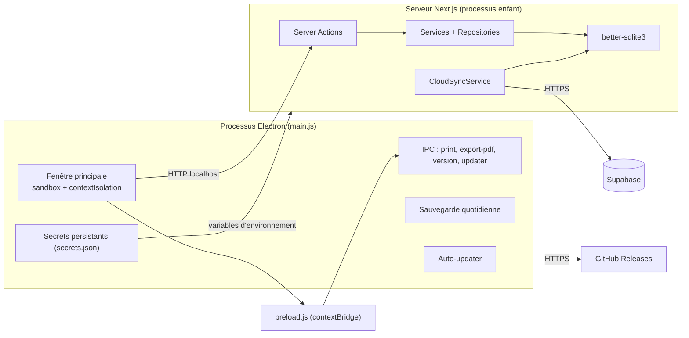
*Figure III.13 : Diagramme de composants du poste Desktop*

### 8.2 Diagramme de déploiement
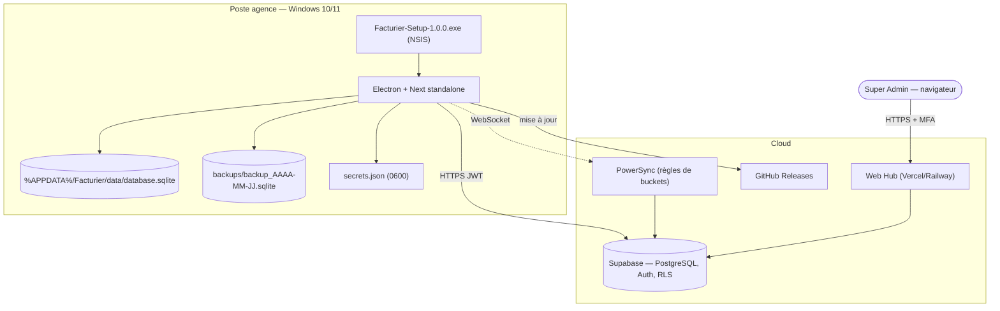
*Figure III.14 : Diagramme de déploiement*

### 8.3 Isolation multi-entreprises côté cloud (RLS)
La migration `20261013_desktop_sync.sql` crée, pour chaque table métier, une politique `tenant_isolation` (`for all to authenticated`) fondée sur `public.current_tenant_id()` ; `tenants` et `profiles` ont des politiques dédiées, et le rôle `superadmin` (AAL2 pour le Hub) un accès global tracé dans `hub_audit_logs`.

### 8.4 Règles de synchronisation PowerSync (buckets)
| Bucket | Paramètre | Contenu |
| :--- | :--- | :--- |
| `tenant_data` | `tenant_id` du JWT ou du profil | Toutes les tables métier de l'entreprise |
| `user_profile` | `user_id` | Profil de l'utilisateur connecté |
| `announcements` | `tenant_id` | Annonces actives (globales ou ciblées) |

---

## 9. Conception détaillée : patrons et choix de code remarquables
| Patron / pratique | Illustration |
| :--- | :--- |
| Architecture en couches | Action → Service → Repository → SQLite |
| Service transactionnel | `db.transaction(() => { … })` pour numéro + facture + lignes + audit |
| Moteur pur / fonction sans effet de bord | `computeTotals` testé sur 10 000 lignes |
| Garde (Guard clause) | `assertLicenseAllowsCreation`, vérifications RBAC en tête d'action |
| Façade de cache | `Proxy` de la base qui redirige `prepare` vers un cache de statements |
| Idempotence des migrations | `CREATE TABLE IF NOT EXISTS`, `PRAGMA table_info` avant `ALTER` |
| Last-Write-Wins + tombstones | `CloudSyncService`, `sync_tombstones` |
| Journal d'audit transverse | `logAudit` appelé dans les transactions |
| Résilience | Error boundaries, télémétrie non bloquante, repli du chemin de base à 3 niveaux |
| Décisions documentées | 33 ADR (contexte, décision, alternatives, risques, vérification) |

---

## 10. Interface homme-machine (IHM)
Éléments à illustrer par des **captures d'écran** (Figure IV.x) : écran de connexion · assistant de configuration initiale (`/setup`) · tableau de bord administrateur et opérateur · liste/édition des devis · éditeur de facture avec calcul en temps réel · fenêtre de paiement · prévisualisation A4 · avoirs · paramètres (taux, logo, mentions) · gestion des utilisateurs · journal d'audit · mises à jour · Web Hub (vue d'ensemble, tenants 360°, flotte, finances, licences).
Principes appliqués : design system unique (`packages/ui`), mode sombre natif, focus clavier visible (WCAG 2.1), retours par *toasts*, indicateurs d'état colorés (statuts), obligatoires marqués d'un astérisque, trois formats d'affichage des listes (tableau / horizontal / blocs).

---

## 11. Stratégie de test et recette (Section 2 du Chapitre IV)

### 11.1 Protocole
1. **Tests unitaires et d'intégration** automatisés (Vitest) à chaque évolution — critère « Definition of Done ».
2. **Maintenance en trois volets** par module (ADR-0028 → 0033) : *correctif* (anomalies fonctionnelles), *curatif* (intégrité et assainissement), *préventif* (index, durcissement multi-tenant).
3. **Recette utilisateur** par l'encadreur et le personnel administratif.

### 11.2 Scénarios de recette (cahier de tests)
| N° | Scénario | Résultat attendu | Statut |
| :---: | :--- | :--- | :---: |
| R1 | Configuration initiale : société, NIF, RCCM, code, taux | Paramètres enregistrés, administrateur créé | ✅ |
| R2 | Créer un client sans téléphone | Refus « numéro requis » | ✅ |
| R3 | Devis de 3 lignes avec remise | Totaux conformes au moteur fiscal (valeur de référence §6.2) | ✅ |
| R4 | Convertir un devis expiré | Refus explicite | ✅ |
| R5 | Convertir deux fois le même devis | Second essai refusé | ✅ |
| R6 | Paiement partiel puis solde | Statuts `PARTIALLY_PAID` → `PAID` | ✅ |
| R7 | Paiement supérieur au reste | Refus avec montant restant | ✅ |
| R8 | Opérateur A consulte les factures de B | Accès refusé (RBAC) | ✅ |
| R9 | 5 mots de passe erronés | Verrouillage 15 min + audit | ✅ |
| R10 | Facturation hors-ligne puis reconnexion | Synchronisation silencieuse | ✅ |
| R11 | Deux postes créent le même numéro | Unicité garantie à la synchronisation | ✅ (limite : continuité, audit §5.3) |
| R12 | Tenant suspendu depuis le Hub | Émission bloquée, consultation conservée | ✅ |
| R13 | Licence expirée depuis 8 jours | Lecture seule ; 5 jours : période de grâce | ✅ |
| R14 | Migration d'une base V1 | Sauvegarde + rattachement au tenant, idempotente | ✅ |
| R15 | Installation sur poste vierge | Application démarre, base dans `%APPDATA%` | ✅ |
| R16 | Impression A4 et export PDF/Excel | Document conforme à la charte | ✅ |

> ✏️ Les statuts ✅ s'appuient sur les tests automatisés existants (`tests/unit`, `tests/integration`, `tests/security`). Pour R15 et R16, ajoutez vos **captures** et la date de recette réelle.

### 11.3 Indicateurs de résultats (tableau IV.x)
| Indicateur | Avant (Word/Excel) | Après (L'Étoile) | Gain |
| :--- | :---: | :---: | :---: |
| Temps de création d'une facture | ✏️ ~15 min (à mesurer) | ✏️ ~2 min (à mesurer) | ✏️ ~85 % |
| Erreurs de calcul fiscal | Fréquentes (manuel) | 0 (moteur testé) | 100 % |
| Doublons de numéros | Possibles | 0 en local ; unicité garantie en synchro | — |
| Disponibilité hors connexion | Oui (fichiers) | Oui | = |
| Traçabilité des actions | Aucune | Audit complet | ✔ |
| Suivi des impayés | Manuel | Tableau de bord temps réel | ✔ |

> ✏️ **Chronométrez** réellement 5 créations de facture avant/après auprès du personnel : des chiffres mesurés valent bien plus qu'une estimation devant le jury.
