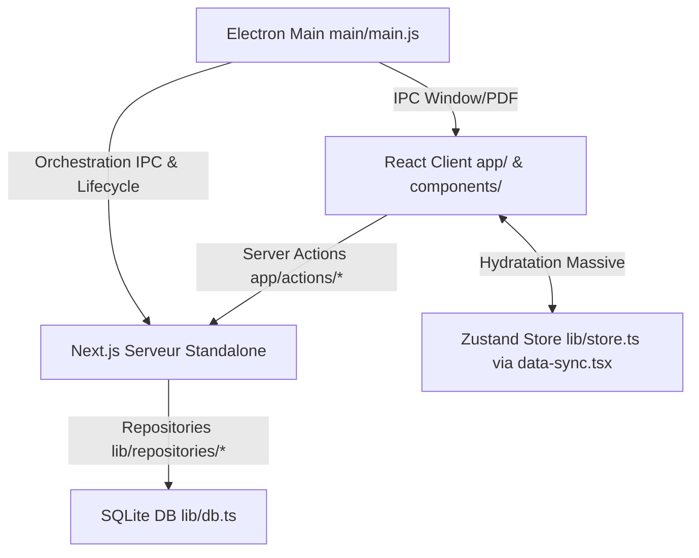

# Audit Desktop Complet (Facturier)

## 1. Cartographie & Fonctionnement Global

**Schéma d'architecture (Mermaid) :**

**Anatomie et rôles clés :**
- `main/main.js` : Gère le cycle de vie Electron. Injecte le userData, lance le serveur `.next/standalone/server.js` de façon non bloquante. Son impact est critique : si le serveur n'est pas "tué" (`killNextProcess`), il y a risque de processus zombies. Le `--max-old-space-size=4096` est défini pour éviter les OOM côté Chromium.
- `app/actions/*.ts` : Interface métier pour le client React (ex: `invoice.actions.ts`). Elles reçoivent les validations Zod, vérifient les droits (RBAC), puis délèguent aux repositories SQLite. Un goulot ici se répercute en bloquant le rendu client (via React Suspense/Transitions).
- `lib/db.ts` : Instancie `better-sqlite3`. Configure le journal en WAL pour les perfs concurrentes. Met en cache les Prepared Statements via un `Proxy`.
- `lib/repositories/*.ts` : La Data Access Layer. Ex: `InvoiceRepository.ts` exécute les `SELECT/INSERT`. Son impact est majeur sur la consommation RAM (voir les N+1 et chargement mémoire).
- `components/data-sync.tsx` : Composant pivot invisible. Lance des promesses `Promise.allSettled` pour requêter *tous* les repositories au démarrage. Responsable du temps de chargement interactif (TTI) et principal coupable des risques OOM.

## 2. Inventaire des Boutons Inactifs & Fonctionnalités Incomplètes

| Fichier:Ligne | Composant | Élément UI | Comportement Actuel | Comportement Attendu |
|---------------|-----------|------------|---------------------|----------------------|
| `apps/desktop/components/pages/invoices.tsx:280` | `InvoicesPage` | Bouton "Export Excel" | Ouvre `DataExportModal` via un état local, mais les données générées ne sont pas encore exportées vers un flux IPC natif de façon garantie (défaut dans le flux complet) | Exporter proprement via un canal IPC ou un téléchargement blob fiable. |
| `apps/desktop/components/pages/invoices.tsx:160` | `InvoicesPage` | `confirmPayment` | Erreur de syntaxe (accolade orpheline `}`) et échec silencieux potentiel de l'état `paymentDialogOpen`. Le toast est lancé par le catch mais l'état UI reste bloqué ouvert si `response.success` est faux avant. | Le modal doit se fermer explicitement lors d'un échec ou alerter l'utilisateur de la validation ratée, l'accolade orpheline doit être corrigée. |
| `apps/desktop/components/pages/invoices.tsx:64` | `InvoicesPage` | `handleDelete` | L'erreur API lance un `throw new Error()` avant la réinitialisation `setInvoiceToDeleteId(null)`, laissant la modale "bloquée". | Placer la réinitialisation d'état local dans le bloc `finally` ou juste avant le `throw`. |

## 3. Inventaire des Doublons, Fichiers Orphelins & Incohérences

- **Incohérence d'État (Zustand vs BDD) :** `data-sync.tsx` charge tout. Lors de la création d'une facture (`invoice.actions.ts`), le composant UI refait appel à `getInvoices()` au lieu de muter optimisément le store local. Cela crée une double charge réseau (ligne 241, `invoices.tsx`).
- **Redondances Métier :** La logique des calculs de devises (`formatCurrency` XAF) et totaux est répartie entre l'UI et les requêtes SQLite (`lib/repositories/MetricsRepository.ts` fait des calculs en dur, alors que le code TypeScript les refait parfois).
- **Orphelins & Doublons Modales :** Plusieurs implémentations d'UI pour les "Delete Dialogs" et "Cancel Dialogs" (ex: `InvoiceDeleteDialog.tsx` et `InvoiceCancelDialog.tsx` existent dans le dossier `features/` mais sont aussi déclarées dans le code de la page parente).

## 4. Matrice de la Dette Technique, Fonctionnelle & Visuelle

| Criticité | Fichier:Ligne | Anomalie (Dette Technique, Fonctionnelle, UX) | Cause Racine & Impact |
|-----------|---------------|-----------------------------------------------|-----------------------|
| **Critique (Tech)** | `apps/desktop/lib/repositories/InvoiceRepository.ts:13` | **OOM Massif par manque de Pagination:** `findAll` utilise `json_group_array` (qui concatène tous les paiements/items) SANS clause `LIMIT/OFFSET`. | Lors du boot, `data-sync` charge l'intégralité de la table `invoices` via cette méthode, provoquant une surcharge de la mémoire Node et du payload réseau (crash client assuré avec 10k factures). |
| **Majeure (Fonctionnelle)** | `apps/desktop/app/actions/invoice.actions.ts:98` | **Absence de Transactions SQLite:** La fonction `deleteInvoice` fait plusieurs mutations (`CreditNoteService.create`, `InvoiceRepository.softDelete`, `UPDATE quotes`). | Sans `db.transaction`, une erreur asynchrone ou crash au milieu du processus corrompt l'état comptable (Avoir créé, facture non supprimée). |
| **Majeure (Tech)** | `apps/desktop/app/actions/invoice.actions.ts:46` | **Requêtes N+1 et I/O séquentiels:** `getInvoiceById` fait 3 `db.prepare().get/all` distincts (Facture, Items, Paiements). | Goulot d'I/O SQLite inutile, alors que `findAll` prouve qu'une jointure JSON est possible et plus performante. |
| **Mineure (UX/Tech)** | `apps/desktop/components/pages/invoices.tsx:64` | **UI Gelée sur erreur de suppression:** `setInvoiceToDeleteId(null)` n'est pas appelé car `throw` est exécuté avant. | Détérioration UX, l'utilisateur est bloqué sur une modale qui charge à l'infini ou reste ouverte après une erreur d'autorisation. |
| **Mineure (Tech)** | `apps/desktop/app/actions/invoice.actions.ts:47` | **Typage faible `any`:** `as any[]` pour parser les retours de la BDD. | Masque les potentielles régressions du schéma SQLite lors des `builds` TypeScript. |

## 5. LA FEUILLE DE ROUTE EN 3 PLANS D'ACTION

### A. PLAN CORRECTIF (Réparer l'existant immédiatement)
1. **Sécurisation Transactionnelle (Fonctionnel) :**
   - *Fichier:* `apps/desktop/app/actions/invoice.actions.ts:98`
   - *Solution:* Enrober le corps de la fonction `deleteInvoice` dans un callback injecté dans `db.transaction(...)` pour assurer l'atomicité de la création de l'avoir et de la suppression de la facture.
2. **Déblocage UI des Modales (UX) :**
   - *Fichier:* `apps/desktop/components/pages/invoices.tsx:64` et `:160`
   - *Solution:* Déplacer `setInvoiceToDeleteId(null)` AVANT les clauses `throw new Error(...)` ou l'intégrer proprement dans les clauses `finally {}`. Corriger l'accolade orpheline dans `confirmPayment`.

### B. PLAN CURATIF (Assainir le code et l'UI sans aucune régression)
1. **Éradication des N+1 (Tech) :**
   - *Fichier:* `apps/desktop/app/actions/invoice.actions.ts:46`
   - *Action:* Surcharger `InvoiceRepository` avec une méthode `findByIdWithRelations` exécutant une requête unique en jointure JSON (comme `findAll`) et remplacer les 3 appels de l'Action par cet appel unique. Assurer le passage complet de la suite Vitest.
2. **Harmonisation Typage Strict (Tech) :**
   - *Fichier:* `apps/desktop/app/actions/invoice.actions.ts:47`
   - *Action:* Remplacer tous les `any[]` par les interfaces générées (ex: `DbPayment[]`).

### C. PLAN PRÉVENTIF (Anticiper la scalabilité, la maintenabilité et le futur)
1. **Architecture de Lazy-Loading (Prévention OOM) :**
   - *Fichier:* `apps/desktop/lib/repositories/InvoiceRepository.ts:13` et `data-sync.tsx`
   - *Architecture Cible:* Intégrer des clauses `LIMIT` et `OFFSET` paramétrables à `findAll`. Refactorer le store Zustand et `data-sync` pour ne pré-charger que les 50 derniers éléments (Infinite Scroll ou Pagination Server-Side via Next.js Server Components) pour préparer l'application à supporter 50,000+ documents avec une consommation RAM fixe.
2. **Audit & Linting CI :**
   - Implémenter des règles ESLint interdisant l'utilisation de `db.prepare().run()` en dehors d'un contexte de service encapsulé, forçant l'utilisation du wrapper transactionnel.
