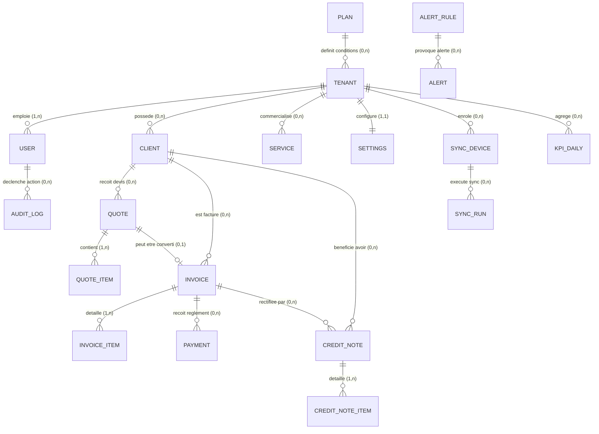
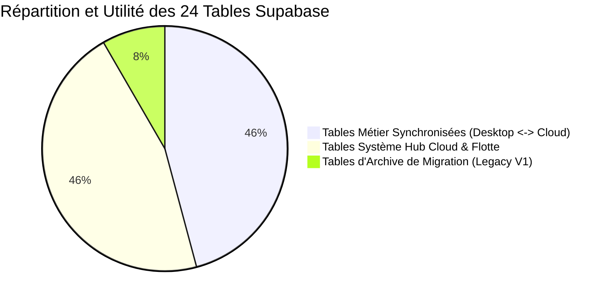

# Modélisation des Données — MCD, MLD, Dictionnaire et Audit Exhaustif des Tables (Supabase & SQLite)

> **Document de Référence** : Fichier 1 / 3 — Modélisation des Données, Associations, Cardinalités et Intégrité du Schéma  
> **Projet** : « L'Étoile — Facturier » (Global Maintenance)  
> **Auteur** : Projet de Stage de Fin de Cycle — INPTIC  
> **Technologies** : SQLite 3 (`better-sqlite3`, mode WAL) pour le Spoke Desktop & PostgreSQL 15+ (Supabase avec Row-Level Security) pour le Hub Cloud  

---

## 1. Introduction et Démarche de Modélisation

La gestion commerciale et fiscale d'une entreprise multisites telle que **Global Maintenance** impose une structure de données d'une rigueur absolue. Les données doivent répondre à trois exigences majeures :
1. **L'intégrité comptable et financière** : Aucune facture émise ne doit pouvoir être altérée sans laisser de trace d'audit. Les totaux doivent être rigoureusement exprimés en nombres entiers sans décimales en Francs CFA (XAF), conformément aux normes bancaires de la zone CEMAC.
2. **L'étanchéité multi-entreprises (Multi-Tenancy)** : Chaque entité de données (client, devis, facture, ligne d'article, paiement, avoir, paramètre) doit être rattachée à un identifiant unique d'entreprise (`tenant_id`), interdisant formellement toute fuite d'information entre entités juridiques ou agences indépendantes.
3. **La résilience déconnectée (Architecture Local-First)** : Les clés primaires doivent être générées de manière décentralisée sans risque de collision lors du retour de la connectivité réseau, ce qui impose l'usage exclusif d'identifiants uniques universels de version 4 (**UUIDv4**).

Ce document formalise la modélisation conceptuelle (MCD) et logique (MLD) des données, fournit le dictionnaire exhaustif de chaque champ (en distinguant les attributs consommés par l'interface utilisateur et ceux réservés aux traitements techniques), et établit un **audit complet des 24 tables présentes dans le projet Supabase**.

---

## 2. Modèle Conceptuel des Données (MCD — Approche Entités / Associations)

### 2.1 Définition des Entités Métier et Système

Dans notre modèle, nous distinguons deux grandes familles d'entités :
- **Entités Métier (Cœur de Facturation)** : `ENTREPRISE` (Tenant), `CLIENT`, `PRESTATION_SERVICE`, `DEVIS`, `LIGNE_DEVIS`, `FACTURE`, `LIGNE_FACTURE`, `REGLEMENT` (Paiement), `AVOIR` (Note de crédit), `LIGNE_AVOIR`, `PARAMETRES_SOCIETE`.
- **Entités Système, Sécurité et Supervision (Hub Cloud)** : `UTILISATEUR_LOCAL`, `PROFIL_CLOUD`, `FORFAIT_LICENCE` (Plan), `DISPOSITIF_CAISSE` (Sync Device), `SESSION_SYNCHRONISATION` (Sync Run), `JOURNAL_AUDIT_LOCAL`, `JOURNAL_AUDIT_HUB`, `INDICATEUR_JOURNALIER` (KPI Daily), `REGLE_ALERTE`, `NOTIFICATION_ALERTE`, `DIFFUSION_ANNONCE`, `OPTION_FONCTIONNELLE` (Tenant Flags).

---

### 2.2 Formalisation des Associations et Cardinalités

Le tableau ci-dessous explicite chaque relation sémantique avec ses cardinalités minimales et maximales normalisées :

| Association | Entité Source | Cardinalité | Entité Cible | Cardinalité | Règle Métier et Justification Technique |
| :--- | :---: | :---: | :---: | :---: | :--- |
| **Rattachement Utilisateur** | `ENTREPRISE` | 1,n | `UTILISATEUR` | 1,1 | Une entreprise possède au moins un utilisateur (l'administrateur initial) et peut employer plusieurs opérateurs. Un utilisateur appartient strictement à une entreprise active. |
| **Gestion Clientèle** | `ENTREPRISE` | 0,n | `CLIENT` | 1,1 | Une entreprise gère son portefeuille de clients B2B (mines, PME) ou B2C. Un client est la propriété exclusive d'une entreprise (`tenant_id`). |
| **Offre de Services** | `ENTREPRISE` | 0,n | `SERVICE` | 1,1 | Une entreprise propose un catalogue d'articles physiques et de prestations (extincteurs, RIA/PIA, formations HSE). Chaque prestation dépend d'une entreprise. |
| **Émission Devis** | `CLIENT` | 0,n | `DEVIS` | 1,1 | Un client peut recevoir plusieurs propositions commerciales au cours de son cycle de vie. Un devis est obligatoirement adressé à un et un seul client répertorié. |
| **Composition Devis** | `DEVIS` | 1,n | `LIGNE_DEVIS` | 1,1 | Un devis contient au minimum une ligne de prestation/produit chiffrée. Une ligne appartient exclusivement à son devis parent (suppression en cascade). |
| **Conversion Commerciale** | `DEVIS` | 0,1 | `FACTURE` | 0,1 | Un devis accepté peut être converti en une facture unique (`quoteId`). Une facture peut être créée directement sans devis préalable (`quoteId` optionnel). |
| **Facturation Client** | `CLIENT` | 0,n | `FACTURE` | 1,1 | Un client se voit adresser zéro ou plusieurs factures définitives. Une facture désigne obligatoirement un client existant non archivé. |
| **Composition Facture** | `FACTURE` | 1,n | `LIGNE_FACTURE` | 1,1 | Une facture comporte une ou plusieurs lignes de détail tarifaire. Les lignes sont supprimées si la facture est purgée (`ON DELETE CASCADE`). |
| **Encaissement** | `FACTURE` | 0,n | `REGLEMENT` | 1,1 | Une facture peut être réglée en une fois, faire l'objet de plusieurs acomptes partiels ou n'avoir reçu aucun règlement (`UNPAID`). Un paiement est associé à une seule facture. |
| **Rectification Avoir** | `FACTURE` | 0,n | `AVOIR` | 1,1 | Une facture erronée ou contestée peut donner lieu à l'émission d'un ou plusieurs avoirs (notes de crédit). L'avoir fait référence à la facture d'origine. |
| **Composition Avoir** | `AVOIR` | 1,n | `LIGNE_AVOIR` | 1,1 | Un avoir détaille les quantités et montants HT rétrocédés au client (restitution de matériel, remise a posteriori). Suppression en cascade avec l'avoir. |
| **Paramétrage Société** | `ENTREPRISE` | 1,1 | `PARAMETRES` | 1,1 | Chaque entreprise dispose d'un profil de configuration unique (NIF, RCCM, coordonnées bancaires, taux légaux de TVA/TPS/CSS, logo officiel). |
| **Abonnement / Licence** | `FORFAIT` | 0,n | `ENTREPRISE` | 0,1 | Un forfait commercial (Starter, Pro, Enterprise) régit les quotas d'une ou plusieurs entreprises abonnées. Une entreprise est rattachée à un plan actif. |
| **Flotte de Caisses** | `ENTREPRISE` | 0,n | `DISPOSITIF` | 1,1 | Une entreprise peut exploiter plusieurs terminaux Desktop (agence Libreville, agence Moanda, etc.). Un poste physique est enrôlé sous un `tenant_id`. |
| **Exécution Réplication** | `DISPOSITIF` | 0,n | `SESSION_SYNC`| 1,1 | Un terminal de caisse effectue de multiples synchronisations dans le temps. Chaque session de synchronisation identifie la machine émettrice. |
| **Traçabilité Opération** | `UTILISATEUR` | 0,n | `JOURNAL_AUDIT`| 0,1 | Les actions sensibles (création, modification, suppression logique) génèrent une trace d'audit rattachée à l'opérateur et à l'entreprise. |
| **Agrégation KPIs** | `ENTREPRISE` | 0,n | `KPI_JOURNALIER`| 1,1 | Les métriques d'activité (CA généré, nombre de pièces, santé de réplication) sont compilées quotidiennement par entreprise pour le Hub de supervision. |
| **Génération Alerte** | `REGLE_ALERTE`| 0,n | `ALERTE` | 1,1 | Une règle de seuil (ex: échec réplication répété, licence expirée) peut déclencher une ou plusieurs alertes administratives sur le Hub. |
| **Diffusion Annonce** | `ENTREPRISE` | 0,n | `ANNONCE` | 0,1 | Une annonce diffusée depuis le Hub peut cibler spécifiquement une entreprise cliente ou être diffusée globalement (`target_tenant_id IS NULL`). |

---

### 2.3 Schéma Conceptuel Graphique (Mermaid MCD)

---

## 3. Modèle Logique des Données (MLD Relationnel Normalisé)

Dans le MLD, chaque entité devient une table relationnelle. Les identifiants primaires sont tous en **UUID** (chaînes de 36 caractères) générés côté client, à l'exception de la table locale des paramètres qui agit comme un singleton d'agence (`id = 1`) synchronisé avec `tenant_settings`.

### 3.1 Règles de Transformation MLD appliquées
1. **Clé primaire UUIDv4 universelle** : Garantit l'absence totale de collision entre agences travaillant en mode déconnecté.
2. **Clés étrangères avec contrainte référentielle** : Les tables filles de lignes d'articles (`quote_items`, `invoice_items`, `credit_note_items`) portent une contrainte `ON DELETE CASCADE` garantissant la cohérence orpheline.
3. **Soft-Delete généralisé** : Remplacement de la suppression physique par l'horodatage `deletedAt DATETIME` sur toutes les entités comptables maîtresses.
4. **Attributs de Synchronisation LWW** : Présence des champs `updated_at`, `synced_at` et `server_updated_at` pour le suivi incrémental et l'arbitrage par date la plus récente (*Last-Write-Wins*).

---

### 3.2 Formalisation des Tables du MLD (Schémas Détaillés)

#### A. Domaine Référentiels & Utilisateurs
- **`tenants`** (
  <u>id</u> VARCHAR(36), 
  name VARCHAR(255) NOT NULL, 
  status VARCHAR(20) DEFAULT 'active', 
  #plan_id VARCHAR(36) NULL REFERENCES `plans`(id), 
  trial_ends_at TIMESTAMPTZ, 
  license_expires_at TIMESTAMPTZ, 
  country VARCHAR(100) DEFAULT 'Gabon', 
  suspended_reason TEXT, 
  suspended_at TIMESTAMPTZ, 
  notes TEXT, 
  created_at TIMESTAMPTZ NOT NULL, 
  updated_at TIMESTAMPTZ NOT NULL
)
- **`profiles` / `users`** (
  <u>id</u> VARCHAR(36), 
  #tenant_id VARCHAR(36) REFERENCES `tenants`(id), 
  email VARCHAR(255) NOT NULL UNIQUE, 
  role VARCHAR(20) CHECK (role IN ('superadmin', 'admin', 'user')), 
  full_name VARCHAR(255), 
  phone VARCHAR(50), 
  is_active BOOLEAN DEFAULT TRUE, 
  force_password_change BOOLEAN DEFAULT FALSE, 
  created_at TIMESTAMPTZ, 
  updated_at TIMESTAMPTZ
)
- **`clients`** (
  <u>id</u> VARCHAR(36), 
  #tenant_id VARCHAR(36) REFERENCES `tenants`(id), 
  name VARCHAR(255) NOT NULL, 
  email VARCHAR(255), 
  phone VARCHAR(50) NOT NULL, 
  address TEXT, 
  nif VARCHAR(100), 
  rccm VARCHAR(100), 
  status VARCHAR(20) DEFAULT 'active', 
  created_at TIMESTAMPTZ, 
  updated_at TIMESTAMPTZ, 
  deleted_at TIMESTAMPTZ NULL, 
  #created_by VARCHAR(36)
)
- **`services`** (
  <u>id</u> VARCHAR(36), 
  #tenant_id VARCHAR(36) REFERENCES `tenants`(id), 
  name VARCHAR(255) NOT NULL, 
  description TEXT, 
  category VARCHAR(100), 
  unit_price BIGINT NOT NULL DEFAULT 0, 
  created_at TIMESTAMPTZ, 
  updated_at TIMESTAMPTZ, 
  deleted_at TIMESTAMPTZ NULL, 
  #created_by VARCHAR(36)
)

#### B. Domaine Devis & Factures Commerciales
- **`quotes`** (
  <u>id</u> VARCHAR(36), 
  #tenant_id VARCHAR(36) REFERENCES `tenants`(id), 
  number VARCHAR(100) NOT NULL, 
  #client_id VARCHAR(36) NOT NULL REFERENCES `clients`(id), 
  client_name VARCHAR(255) NOT NULL, 
  client_email VARCHAR(255), 
  date DATE NOT NULL, 
  valid_until DATE, 
  subject VARCHAR(255), 
  subtotal BIGINT NOT NULL, 
  discount BIGINT NOT NULL DEFAULT 0, 
  tax_base BIGINT NOT NULL, 
  tva_amount BIGINT NOT NULL, 
  tps_amount BIGINT NOT NULL DEFAULT 0, 
  css_amount BIGINT NOT NULL, 
  total BIGINT NOT NULL, 
  status VARCHAR(30) DEFAULT 'EN_ATTENTE', 
  notes TEXT, 
  created_at TIMESTAMPTZ, 
  updated_at TIMESTAMPTZ, 
  deleted_at TIMESTAMPTZ NULL, 
  #created_by VARCHAR(36),
  CONSTRAINT uq_quotes_tenant_number UNIQUE (tenant_id, number)
)
- **`quote_items`** (
  <u>id</u> VARCHAR(36), 
  #tenant_id VARCHAR(36) REFERENCES `tenants`(id), 
  #quote_id VARCHAR(36) NOT NULL REFERENCES `quotes`(id) ON DELETE CASCADE, 
  description TEXT NOT NULL, 
  quantity NUMERIC(10,2) NOT NULL, 
  unit_price BIGINT NOT NULL, 
  total BIGINT NOT NULL, 
  updated_at TIMESTAMPTZ
)
- **`invoices`** (
  <u>id</u> VARCHAR(36), 
  #tenant_id VARCHAR(36) REFERENCES `tenants`(id), 
  number VARCHAR(100) NOT NULL, 
  #quote_id VARCHAR(36) NULL REFERENCES `quotes`(id), 
  #client_id VARCHAR(36) NOT NULL REFERENCES `clients`(id), 
  client_name VARCHAR(255) NOT NULL, 
  client_email VARCHAR(255), 
  date DATE NOT NULL, 
  due_date DATE NOT NULL, 
  subject VARCHAR(255), 
  subtotal BIGINT NOT NULL, 
  discount BIGINT NOT NULL DEFAULT 0, 
  tax_base BIGINT NOT NULL, 
  tva_amount BIGINT NOT NULL, 
  tps_amount BIGINT NOT NULL DEFAULT 0, 
  css_amount BIGINT NOT NULL, 
  total BIGINT NOT NULL, 
  status VARCHAR(30) DEFAULT 'UNPAID', 
  notes TEXT, 
  created_at TIMESTAMPTZ, 
  updated_at TIMESTAMPTZ, 
  deleted_at TIMESTAMPTZ NULL, 
  #created_by VARCHAR(36),
  CONSTRAINT uq_invoices_tenant_number UNIQUE (tenant_id, number)
)
- **`invoice_items`** (
  <u>id</u> VARCHAR(36), 
  #tenant_id VARCHAR(36) REFERENCES `tenants`(id), 
  #invoice_id VARCHAR(36) NOT NULL REFERENCES `invoices`(id) ON DELETE CASCADE, 
  description TEXT NOT NULL, 
  quantity NUMERIC(10,2) NOT NULL, 
  unit_price BIGINT NOT NULL, 
  total BIGINT NOT NULL, 
  updated_at TIMESTAMPTZ
)

#### C. Domaine Règlements, Avoirs & Audit
- **`payments`** (
  <u>id</u> VARCHAR(36), 
  #tenant_id VARCHAR(36) REFERENCES `tenants`(id), 
  #invoice_id VARCHAR(36) NOT NULL REFERENCES `invoices`(id) ON DELETE CASCADE, 
  amount BIGINT NOT NULL, 
  payment_method VARCHAR(50) NOT NULL, 
  date DATE NOT NULL, 
  reference VARCHAR(100), 
  created_at TIMESTAMPTZ, 
  updated_at TIMESTAMPTZ, 
  deleted_at TIMESTAMPTZ NULL, 
  #created_by VARCHAR(36)
)
- **`credit_notes`** (
  <u>id</u> VARCHAR(36), 
  #tenant_id VARCHAR(36) REFERENCES `tenants`(id), 
  number VARCHAR(100) NOT NULL, 
  #invoice_id VARCHAR(36) NOT NULL REFERENCES `invoices`(id), 
  #client_id VARCHAR(36) NOT NULL REFERENCES `clients`(id), 
  client_name VARCHAR(255) NOT NULL, 
  date DATE NOT NULL, 
  reason TEXT NOT NULL, 
  subtotal BIGINT NOT NULL, 
  tax_base BIGINT NOT NULL, 
  tva_amount BIGINT NOT NULL, 
  tps_amount BIGINT NOT NULL DEFAULT 0, 
  css_amount BIGINT NOT NULL, 
  total BIGINT NOT NULL, 
  status VARCHAR(20) DEFAULT 'open', 
  created_at TIMESTAMPTZ, 
  updated_at TIMESTAMPTZ, 
  deleted_at TIMESTAMPTZ NULL, 
  #created_by VARCHAR(36),
  CONSTRAINT uq_credit_notes_tenant_number UNIQUE (tenant_id, number)
)
- **`credit_note_items`** (
  <u>id</u> VARCHAR(36), 
  #tenant_id VARCHAR(36) REFERENCES `tenants`(id), 
  #credit_note_id VARCHAR(36) NOT NULL REFERENCES `credit_notes`(id) ON DELETE CASCADE, 
  description TEXT NOT NULL, 
  quantity NUMERIC(10,2) NOT NULL, 
  unit_price BIGINT NOT NULL, 
  total BIGINT NOT NULL, 
  updated_at TIMESTAMPTZ
)
- **`audit_logs`** (
  <u>id</u> VARCHAR(36), 
  #tenant_id VARCHAR(36) REFERENCES `tenants`(id), 
  #user_id VARCHAR(36), 
  user_name VARCHAR(255), 
  action VARCHAR(50) NOT NULL, 
  entity_type VARCHAR(50) NOT NULL, 
  entity_id VARCHAR(36), 
  details TEXT, 
  created_at TIMESTAMPTZ DEFAULT CURRENT_TIMESTAMP
)
- **`tenant_settings`** (
  <u>tenant_id</u> VARCHAR(36) PRIMARY KEY REFERENCES `tenants`(id), 
  company_name VARCHAR(255), 
  legal_form VARCHAR(50), 
  nif VARCHAR(100), 
  rccm VARCHAR(100), 
  address TEXT, 
  email VARCHAR(255), 
  phone VARCHAR(50), 
  bank_name VARCHAR(100), 
  bank_agency VARCHAR(100), 
  account_number VARCHAR(100), 
  swift_code VARCHAR(50), 
  iban VARCHAR(100), 
  tva_rate NUMERIC(5,2) DEFAULT 18.00, 
  tps_rate NUMERIC(5,2) DEFAULT 9.50, 
  css_rate NUMERIC(5,2) DEFAULT 1.00, 
  session_timeout INT DEFAULT 15, 
  invoice_prefix VARCHAR(10) DEFAULT 'FAC', 
  quote_prefix VARCHAR(10) DEFAULT 'DEV', 
  company_code VARCHAR(10) DEFAULT 'GM', 
  mentions_legales TEXT, 
  logo TEXT, 
  updated_at TIMESTAMPTZ
)

---

## 4. Dictionnaire Détaillé des Données (Données Consommées vs Traitements Système)

Le dictionnaire ci-dessous explicite le rôle fonctionnel et technique de chaque donnée :

| Table | Attribut / Colonne | Type & Contrainte | Destination IHM (Écran / Affichage) | Rôle Système, Traitement Fiscal & Synchronisation |
| :--- | :--- | :--- | :--- | :--- |
| **`clients`** | `id` | UUID PK | Invisible (stocké dans le state) | Clé primaire d'intégrité, liaison `clientId` dans devis/factures. |
| | `name` | VARCHAR(255) | Titre carte client, colonne tableau, sélecteur | Dénomination légale B2B (ex: COMILOG) ou nom particulier. Indexé. |
| | `phone` | VARCHAR(50) | Colonne tableau, fiche contact, entête PDF | Contact téléphonique principal obligatoire. Validé par Regex Zod. |
| | `email` | VARCHAR(255) | Fiche contact client, expédition devis PDF | Coordonnée optionnelle. Si saisie, format email validé par Zod. |
| | `nif` / `rccm` | VARCHAR(100) | Encart d'identification client sur devis/facture | Identifiants fiscaux gabonais obligatoires pour facturation inter-entreprises. |
| | `status` | VARCHAR(20) | Badge statut vert ("Actif") / gris ("Inactif") | Filtre d'exclusion lors de la création d'une nouvelle pièce commerciale. |
| | `deletedAt` | DATETIME | Aucun (exclu des requêtes) | **Soft-Delete** : évite les ruptures de clés étrangères vers l'historique. |
| | `tenant_id` | UUID FK | Aucun (filtrage transparent) | **Isolation Multi-Tenant** : partitionnement strict des requêtes SQLite et RLS. |
| **`services`** | `name` | VARCHAR(255) | Liste déroulante articles, tableau services | Libellé de la prestation (ex: "Recharge Extincteur CO2 5kg"). |
| | `category` | VARCHAR(100) | Filtre par onglet (Incendie, Formation, EPI) | Catégorisation du catalogue officiel Global Maintenance. |
| | `unit_price` | BIGINT | Colonne prix catalogue, pré-remplissage devis | Montant unitaire en XAF entiers (zéro décimale). Base du calcul de ligne. |
| **`invoices`** | `number` | VARCHAR(100) | Titre facture, document A4, historique client | Numéro chronologique officiel certifié (ex: `FAC-012/GM/2026`). Index Unique. |
| | `date` | DATE | Date d'émission sur document officiel | Date fiscale déterminant l'exercice comptable et la séquence annuelle. |
| | `due_date` | DATE | Date d'échéance sur le PDF, filtre retards | Date limite de paiement. Calcule le statut dynamique de retard (`overdue`). |
| | `subtotal` | BIGINT | Ligne "Sous-total Brut HT" sur facture A4 | Somme arithmétique `Σ(quantité × prix unitaire)` sans aucune taxe. |
| | `discount` | BIGINT | Ligne "Remise Commerciale" | Déduction commerciale directe en XAF déduite avant assiette de taxe. |
| | `tax_base` | BIGINT | Ligne "Base Imposable" | Assiette fiscale DGI Gabon : `(Subtotal - Discount) + CSS`. |
| | `css_amount`| BIGINT | Ligne de taxe "CSS (1 %)" | Contribution Spéciale de Solidarité : `Net HT × 0,01`, arrondi à l'entier. |
| | `tps_amount`| BIGINT | Ligne de taxe "TPS (9,5 %)" | Taxe Prestation Services : `Base Imposable × 0,095`, arrondi à l'entier. |
| | `tva_amount`| BIGINT | Ligne de taxe "TVA (18 %)" | Taxe Valeur Ajoutée : `Base Imposable × 0,18`, arrondi à l'entier. |
| | `total` | BIGINT | Montant "Net à payer TTC" en gras agrandi | Montant final exigible en Francs CFA : `TaxBase + TPS + TVA`. |
| | `status` | VARCHAR(30) | Badge d'état coloré (Payé, Partiel, Impayé) | Statut calculé automatiquement par `updateInvoiceStatus` après paiement. |
| **`payments`** | `amount` | BIGINT | Tableau des encaissements sur la facture | Montant perçu. Déduit du reste à payer : `Reste = Total - Σ(Paiements)`. |
| | `payment_method` | VARCHAR(50) | Icône et libellé (Virement BGFI, Mobile Money) | Canal d'encaissement légal sélectionné dans le formulaire d'encaissement. |
| | `reference`| VARCHAR(100) | Référence bancaire / N° transaction GSM | Preuve de règlement (N° bordereau virement BGFI, ID transaction Airtel/Moov). |
| **`sync_runs`**| `duration_ms`| INT | Dashboard Hub : temps moyen de sync flotte | Mesure de performance et détection de latence anormale sur le réseau. |
| | `pushed` / `pulled` | INT | Compteurs d'objets répliqués sur le Hub | Contrôle de volumétrie et traçabilité de complétude de la synchronisation. |

---

## 5. Audit Approfondi des 24 Tables Supabase (Chasse aux Tables "Zombies")

À partir de l'inspection directe des captures d'écran de la console Supabase (`schema public` — 24 tables recensées), nous établissons la matrice d'audit d'utilité et de cycle de vie :

### Tableau d'Audit Exhaustif des 24 Tables Supabase

| N° | Nom exact de la Table | Nb Cols | Lignes estimées | Rôle dans l'Écosystème | Statut & Utilisation Réelle dans le Code | Risque de "Table Zombie" ? |
| :---: | :--- | :---: | :---: | :--- | :--- | :---: |
| **1** | `tenants` | 12 | 5 | Cœur du Multi-Tenant | **Active** : Découpage des entreprises clientes. Consultée par `CloudSyncService` et le Web Hub. | ❌ NON (Critique) |
| **2** | `profiles` | 9 | 11 | Comptes utilisateurs Cloud | **Active** : Extension de `auth.users`, porte le `role` ('superadmin', 'admin', 'user') et le `tenant_id`. | ❌ NON (Critique) |
| **3** | `tenant_settings` | 24 | 1 | Paramètres officiels entreprise | **Active** : Miroir Cloud de la table locale `settings`. Contient NIF, RCCM, taux de taxes. | ❌ NON (Indispensable) |
| **4** | `clients` | 12 | 2 | Référentiel Clients | **Active** : Répliquée bidirectionnellement entre Desktop SQLite et Cloud Supabase. | ❌ NON (Indispensable) |
| **5** | `services` | 11 | 0 | Catalogue des prestations/produits | **Active** : Stocke les extincteurs, RIA/PIA et formations HSE. Répliquée. | ❌ NON (Indispensable) |
| **6** | `quotes` | 23 | 0 | Devis commerciaux | **Active** : Synchronisation des devis émis en agence avec gestion des statuts. | ❌ NON (Indispensable) |
| **7** | `quote_items` | 9 | 0 | Lignes de devis | **Active** : Lignes d'articles des devis avec calcul unitaire et quantité. | ❌ NON (Indispensable) |
| **8** | `invoices` | 24 | 0 | Factures définitives | **Active** : Pièces maîtresses de facturation avec ventilation fiscale complète. | ❌ NON (Indispensable) |
| **9** | `invoice_items` | 9 | 0 | Lignes de facture | **Active** : Articles facturés liés à `invoices` via clé étrangère CASCADE. | ❌ NON (Indispensable) |
| **10**| `payments` | 12 | 0 | Encaissements et acomptes | **Active** : Historique des règlements multi-modes rattachés aux factures. | ❌ NON (Indispensable) |
| **11**| `credit_notes` | 20 | 0 | Avoirs (Notes de crédit) | **Active** : Factures d'avoir rectificatives rattachées aux factures initiales. | ❌ NON (Indispensable) |
| **12**| `credit_note_items`| 9 | 0 | Lignes d'avoir | **Active** : Détail des quantités et montants dégrevés. | ❌ NON (Indispensable) |
| **13**| `audit_logs` | 11 | 15 | Audit des agences locales | **Active** : Journal d'audit répliqué depuis chaque poste Desktop vers le Cloud. | ❌ NON (Indispensable) |
| **14**| `hub_audit_logs` | 12 | 1 | Audit Super Admin Web Hub | **Active** : Journalise les actions des Superadmins sur le Hub (création tenant, suspension). | ❌ NON (Sécurité) |
| **15**| `plans` | 12 | 4 | Grille tarifaire des abonnements | **Active** : Contient les forfaits SaaS (Starter, Pro, Enterprise) gérés sur le Hub. | ❌ NON (Commercial) |
| **16**| `sync_devices` | 11 | 0 | Parc des terminaux de caisse | **Active** : Répertorie chaque machine Desktop (`device_id`), son OS et sa version. | ❌ NON (Supervision) |
| **17**| `sync_runs` | 16 | 0 | Télémétrie des synchronisations | **Active** : Enregistre chaque cycle de réplication (durée, volume, erreurs éventuelles). | ❌ NON (Supervision) |
| **18**| `kpi_tenant_daily`| 14 | 0 | Agrégation analytique jour | **Active (Hub)** : Alimente les graphiques de CA et d'adoption du Web Hub. Alimentée par la fonction `hub_collect_daily_kpis()` via `pg_cron` (ou appel planifié externe). | ❌ NON (Pilotage en production) |
| **19**| `alert_rules` | 9 | 3 | Règles de détection d'incidents | **Cadrée (Hub)** : 3 règles par défaut (échecs sync, inactivité). Le moteur automatique d'évaluation est formalisé dans le plan curatif (Lot H2). | ⚠️ PARTIELLEMENT ACTIVE (À automatiser) |
| **20**| `alerts` | 10 | 0 | Alertes déclenchées | **En attente de trigger (Hub)** : Consultée et acquittée dans l'UI Hub (`announcementActions.ts`). Alimentée dès l'activation du cron d'évaluation. | ⚠️ PARTIELLEMENT ACTIVE (UI prête) |
| **21**| `announcements` | 9 | 0 | Notifications descendantes Hub | **Opérationnelle Hub / En attente Desktop** : Rédigée et gérée sur le Web Hub, présente dans le schéma de sync. La bannière Desktop est programmée au Lot H1. | ⚠️ CANAL DESCENDANT EN FINALISATION |
| **22**| `tenant_flags` | 6 | 0 | Feature Flags par entreprise | **Schéma en réserve** : Table créée en migration pour le pilotage fin des modules SaaS par agence. Raccordement consommateur programmé au Lot H1. | ⚠️ DORMANT (À brancher ou purger) |
| **23**| `clients_legacy` | 9 | 0 | **Archive de migration V1** | ⚠️ **Table Conservatoire** : Créée par `20261013_desktop_sync.sql` lors du passage au schéma V2 pour sauvegarder les anciennes données clients sans risquer d'écrasement. Actuellement vide (0 row). Non requêtée par l'application active. | ⚠️ **ARCHIVE CONSERVATOIRE** (À purger après accord de recette). |
| **24**| `invoices_legacy`| 9 | 0 | **Archive de migration V1** | ⚠️ **Table Conservatoire** : Créée par la même routine de migration préventive pour isoler les anciennes factures antérieures au modèle multi-tenant. Actuellement vide (0 row). Non requêtée par l'application active. | ⚠️ **ARCHIVE CONSERVATOIRE** (À purger après accord de recette). |

### Conclusion de l'Audit des Tables :
Sur les **24 tables du schéma Supabase** :
- **17 tables sont pleinement actives et opérationnelles** (11 tables métier répliquées au cœur du poste de travail et 6 tables clés du Hub : `tenants`, `profiles`, `plans`, `tenant_settings`, `sync_devices`, `sync_runs`, `hub_audit_logs`).
- **5 tables de supervision et de flotte sont prêtes côté modèle/Hub mais nécessitent leur activation complète côté Desktop / Daemon** (`kpi_tenant_daily`, `alert_rules`, `alerts`, `announcements`, `tenant_flags`), prises en charge dans les plans d'assainissement (Lots E et H).
- **2 tables historiques conservatoires** (`clients_legacy`, `invoices_legacy`) résultent d'une **procédure d'ingénierie défensive** documentée dans la migration SQL `20261013_desktop_sync.sql` (renommage préventif des anciennes structures avant application du schéma multi-tenant pour empêcher toute destruction de données historiques).
- **Recommandation opérationnelle** : Étant donné que ces deux tables affichent `0 row` (aucun résidu de données non migrées), elles peuvent être archivées ou supprimées proprement par un script `DROP TABLE IF EXISTS clients_legacy, invoices_legacy;` après validation définitive du procès-verbal de recette sans aucun impact sur le code source de l'application.
