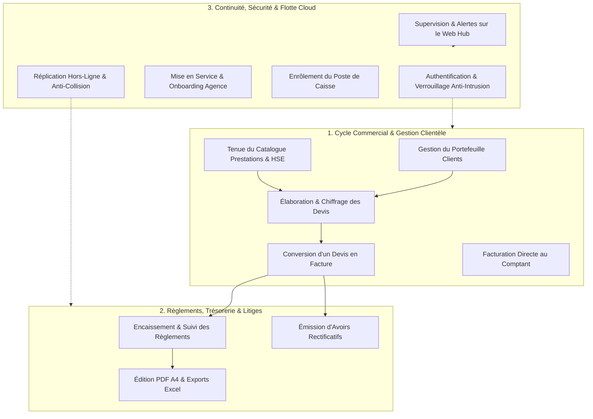

# Fonctionnement Métier et Système — Description Exhaustive des Fonctionnalités et Cas d'Utilisation

> **Document de Référence** : Fichier 2 / 3 — Panorama Fonctionnel, Tunnel Métier, Relations d'Inclusion (`<<include>>`) et d'Extension (`<<extend>>`)  
> **Application** : « L'Étoile — Facturier » (Global Maintenance)  
> **Cadre** : Conception de Système d'Information & Rapport de Stage de Fin de Cycle INPTIC  

---

## 1. Introduction et Philosophie du Système

Pour répondre aux défis de gestion quotidienne de **Global Maintenance** sur ses trois sites d'exploitation (**Libreville**, **Moanda** et **Franceville**), l'application « L'Étoile » a été conçue autour d'une logique métier fluide, centrée sur l'humain et libérée des contraintes techniques de réseau.

Dans ce document, chaque grand domaine fonctionnel est présenté avec la rigueur d'un cas d'utilisation professionnel. Nous mettons en lumière deux types de relations structurelles fondamentales de l'ingénierie logicielle :
- **Les relations d'inclusion (`<<include>>`)** : Désignent les règles métier obligatoires, les contrôles de sécurité ou les calculs fiscaux exécutés **systématiquement et de manière inséparable** lors de l'exécution de la fonctionnalité (ex: recalcul des taxes, vérification des habilitations, atomicité transactionnelle).
- **Les relations d'extension (`<<extend>>`)** : Désignent les branchements conditionnels, les fonctionnalités facultatives ou les scénarios de gestion des exceptions qui viennent **enrichir le cas nominal uniquement si certaines conditions sont remplies** (ex: verrouillage d'un devis converti, duplication, désambiguïsation d'un numéro en conflit, bascule en lecture seule).

---

## 2. Cartographie Globale des Domaines Fonctionnels

---

## 3. Description Détaillée des Fonctionnalités Métier

---

### FONCTIONNALITÉ 1 : La porte d'entrée du système — Authentification et protection contre les intrusions

#### Description concrète
Chaque employé de Global Maintenance (agent commercial au guichet de Lalala, responsable d'atelier à Moanda, administrateur général) accède à l'application via un écran de connexion épuré. Le système valide l'identité de l'opérateur localement sur SQLite sans avoir besoin d'interroger Internet, garantissant une ouverture de caisse instantanée même en cas de coupure de fibre optique.

#### Déroulement de l'opération
1. L'utilisateur saisit son identifiant (nom d'utilisateur ou adresse email) et son mot de passe secret.
2. Le système vérifie immédiatement si le compte n'est pas soumis à un blocage temporaire.
3. L'empreinte cryptographique du mot de passe est comparée au hash sécurisé stocké dans la base locale.
4. En cas de succès, un cookie de session chiffré et inviolable (`auth_session`, durée de 7 jours) est délivré au navigateur Electron avec le rôle attribué et le `tenant_id` de l'agence.
5. L'interface charge l'espace de travail correspondant aux prérogatives de l'utilisateur (tableau de bord administrateur ou vue simplifiée opérateur).

#### Relations d'Inclusion (`<<include>>`)
- **`<<include>> Contrôle de limitation de débit (Anti-Brute Force)`** : Le système comptabilise chaque échec de connexion. Le mécanisme s'exécute obligatoirement avant toute tentative de déchiffrement pour neutraliser les attaques par dictionnaire.
- **`<<include>> Égalisation du temps de réponse cryptographique`** : Si l'identifiant est introuvable, le système exécute une comparaison factice avec un hash prédéfini afin d'empêcher les pirates de deviner les identifiants valides par analyse du temps d'exécution (*timing attacks*).
- **`<<include>> Contrôle d'activation du compte`** : Vérifie que `is_active = 1` et que le compte n'a pas fait l'objet d'un archivage logique.
- **`<<include>> Journalisation de sécurité`** : Enregistrement obligatoire de la tentative (succès ou motif d'échec) dans la table `audit_logs`.

#### Relations d'Extension (`<<extend>>`)
- **`<<extend>> Verrouillage du compte pour 15 minutes`** : S'active automatiquement lorsque 5 tentatives infructueuses consécutives sont enregistrées sur le même identifiant.
- **`<<extend>> Forçage du changement de mot de passe temporaire`** : Se déclenche si le compte porte l'indicateur `force_password_change = 1` (compte nouvellement créé par l'administrateur ou réinitialisé après oubli). L'accès aux menus de facturation est totalement bloqué tant que l'opérateur n'a pas défini un mot de passe personnel robuste.
- **`<<extend>> Mise en cache locale des identifiants Cloud`** : Si l'opérateur s'est connecté pour la première fois avec un mot de passe validé auprès de Supabase Auth, le système génère et sauvegarde silencieusement le hash bcrypt dans SQLite local pour autoriser les futures connexions déconnectées.

---

### FONCTIONNALITÉ 2 : La gestion de la clientèle — Enregistrement et qualification du portefeuille clients

#### Description concrète
Global Maintenance collabore avec de grands donneurs d'ordres industriels et miniers (tels que la COMILOG), des PME de services, des administrations publiques et des particuliers. Cette fonctionnalité permet d'enregistrer et de tenir à jour les fiches d'identité administrative et fiscale des clients.

#### Déroulement de l'opération
1. L'opérateur ouvre le répertoire des clients et sélectionne « Nouveau Client ».
2. Il renseigne la raison sociale, le numéro de téléphone principal (obligatoire), l'adresse géographique de livraison/intervention, ainsi que les identifiants fiscaux légaux gabonais (NIF et RCCM).
3. Le formulaire valide la cohérence des formats et enregistre le client dans la base locale avec un statut `active`.
4. La fiche client devient immédiatement sélectionnable dans les formulaires de devis et de facturation.

#### Relations d'Inclusion (`<<include>>`)
- **`<<include>> Validation de conformité des données (Zod Schema)`** : Exécution impérative du schéma `clientSchema` qui impose la présence d'un nom non vide et d'un numéro de téléphone valide (format international ou national gabonais).
- **`<<include>> Partitionnement multi-tenant`** : Injection automatique du `tenant_id` actif de l'agence pour isoler ce client des autres organisations hébergées sur le même système.
- **`<<include>> Horodatage de synchronisation`** : Renseignement du champ `updated_at` à la date UTC courante pour marquer la fiche comme « prête pour la prochaine réplication vers le Cloud ».
- **`<<include>> Traçabilité administrative`** : Écriture dans le journal d'audit indiquant l'opérateur ayant créé ou modifié la fiche.

#### Relations d'Extension (`<<extend>>`)
- **`<<extend>> Archivage logique (Soft-Delete)`** : Lorsque l'administrateur décide de supprimer un client, le système ne procède à aucune suppression physique en base de données. Il renseigne la colonne `deletedAt = CURRENT_TIMESTAMP`. Le client disparaît des listes déroulantes de vente mais reste parfaitement conservé dans l'historique des anciennes factures émises.
- **`<<extend>> Consultation de l'historique commercial à 360°`** : L'utilisateur peut déployer un panneau latéral affichant l'intégralité des devis, factures, encaissements et soldes résiduels rattachés à ce client spécifique.

---

### FONCTIONNALITÉ 3 : Le catalogue des offres — Gestion des équipements, révisions et formations HSE

#### Description concrète
Global Maintenance propose une offre diversifiée combinant la vente d'équipements de sécurité incendie neufs, des prestations d'entretien technique périodique et des modules certifiés de formation humaine. Cette fonctionnalité permet de gérer le référentiel des prix unitaires en monnaie locale.

#### Déroulement de l'opération
1. L'administrateur accède au catalogue et définit un nouvel article ou sélectionne une prestation existante pour en réviser le tarif.
2. Il précise la désignation commerciale, la catégorie technique (Matériel Incendie, Réseau RIA/PIA, Formations Sécurité HSE, Équipements de Protection Individuelle) et le prix unitaire Hors Taxes en Francs CFA.
3. L'article est enregistré et devient immédiatement disponible avec auto-complétion lors de la saisie des devis et factures.

#### Relations d'Inclusion (`<<include>>`)
- **`<<include>> Contrôle des habilitations administratives (RBAC)`** : Seul le profil `admin` est habilité à créer, modifier ou archiver des articles au catalogue. Les opérateurs ont un accès en consultation stricte.
- **`<<include>> Imposition des montants entiers en Francs CFA (XAF)`** : Le système refuse tout prix comportant des centimes ou des décimales, conformément à la réglementation de la zone CEMAC.
- **`<<include>> Journalisation de la mise à jour tarifaire`** : Inscription de la modification de prix dans `audit_logs`.

#### Relations d'Extension (`<<extend>>`)
- **`<<extend>> Filtrage et recherche par catégorie métier`** : L'opérateur peut naviguer instantanément à travers les différents départements de l'entreprise (ex: isoler les 10 modules de formation HSE, les recharges d'extincteurs poudre/eau/CO2 ou la maintenance trimestrielle RIA selon la norme NF S 62-201).
- **`<<extend>> Désactivation sans rupture d'intégrité (Soft-Delete)`** : La suppression d'un article devenu obsolète n'altère pas les anciennes lignes de devis ou de factures déjà archivées.

---

### FONCTIONNALITÉ 4 : L'élaboration de la proposition — Création et chiffrage d'un devis

#### Description concrète
L'opérateur commercial prépare une proposition financière personnalisée en réponse à l'expression de besoin d'un prospect ou d'un client fidèle (par exemple pour l'équipement d'un nouveau site minier à Moanda comprenant la pose d'extincteurs et la formation d'une équipe de première intervention EPI).

#### Déroulement de l'opération
1. L'opérateur ouvre l'éditeur de devis, sélectionne le client dans la base et précise l'objet de la proposition ainsi que sa date d'échéance de validité.
2. Il ajoute les lignes de prestations en sélectionnant les articles du catalogue ou en rédigeant des descriptions sur mesure, avec quantités et prix unitaires.
3. Le moteur fiscal calcule en temps réel et au franc près l'ensemble de la cascade de taxes gabonaises.
4. L'opérateur applique éventuellement une remise commerciale globale en montant absolu.
5. Le devis est enregistré avec le statut initial `EN_ATTENTE` et reçoit son numéro officiel infalsifiable.

#### Relations d'Inclusion (`<<include>>`)
- **`<<include>> Contrôle de validité de la licence active`** : Le système vérifie que le poste de travail n'est pas bridé en mode consultation seule (`assertLicenseAllowsCreation`).
- **`<<include>> Attribution de la séquence chronologique`** : Appel obligatoire au générateur de séquences (`getNextNumber('quote')`) produisant un identifiant normalisé (ex: `DEV-014/GM/2026`).
- **`<<include>> Calcul rigoureux de la cascade fiscale DGI Gabon`** : Exécution systématique du moteur mathématique partagé (`@workspace/database/fiscal`) qui calcule :
  $$\text{Net HT} = \text{Sous-total} - \text{Remise}$$
  $$\text{CSS} = \text{Net HT} \times 1\%$$
  $$\text{Base Taxable} = \text{Net HT} + \text{CSS}$$
  $$\text{TPS} = \text{Base Taxable} \times 9,5\%$$
  $$\text{TVA} = \text{Base Taxable} \times 18\%$$
  $$\text{Total TTC (Net à payer)} = \text{Base Taxable} + \text{TPS} + \text{TVA}$$
- **`<<include>> Atomicité transactionnelle SQLite`** : Insertion inséparable de l'entête du devis et de toutes ses lignes d'articles au sein d'une transaction unique (`db.transaction`).

#### Relations d'Extension (`<<extend>>`)
- **`<<extend>> Duplication rapide d'une offre commerciale`** : Permet à l'opérateur de dupliquer en 1 clic un devis complexe existant pour créer une nouvelle offre. Cette extension est strictement réservée à l'opérateur créateur sur ses propres devis.
- **`<<extend>> Définition d'un délai d'expiration`** : Renseignement d'une date limite de validité de l'offre (`validUntil`). Si cette date est franchie sans acceptation du client, le statut bascule automatiquement vers `EXPIRE`.

---

### FONCTIONNALITÉ 5 : L'engagement contractuel — Conversion automatique d'un devis en facture définitive

#### Description concrète
Lorsque le client valide l'offre commerciale (retour du devis avec bon pour accord ou bon de commande officiel), l'opérateur transforme la proposition en facture officielle sans aucune ressaisie manuelle, éliminant tout risque d'erreur de recopie.

#### Déroulement de l'opération
1. L'opérateur consulte la liste de ses devis et clique sur « Convertir en Facture ».
2. Le système vérifie les critères d'éligibilité du devis.
3. Une nouvelle facture est générée instantanément avec report exact de toutes les lignes, montants et calculs fiscaux.
4. Le devis d'origine est automatiquement verrouillé et bascule au statut `CONVERTI`.
5. La facture créée prend le statut `UNPAID` avec échéance fixée à 30 jours et apparaît immédiatement dans le journal des encaissements.

#### Relations d'Inclusion (`<<include>>`)
- **`<<include>> Contrôle d'habilitation RBAC de conversion`** : L'opérateur ne peut convertir que ses propres devis. Seul l'administrateur peut convertir les devis de l'ensemble de l'équipe.
- **`<<include>> Vérification de l'intégrité du statut`** : Vérifie obligatoirement que le devis n'est pas archivé (`deletedAt IS NULL`), qu'il n'a pas déjà été converti (`status != 'CONVERTI'`) et que sa date de validité n'est pas dépassée.
- **`<<include>> Réservation du numéro de facture officiel`** : Attribution du prochain numéro séquentiel certifié (ex: `FAC-025/GM/2026`).
- **`<<include>> Transaction atomique de transfert`** : L'insertion de la facture, la duplication des lignes dans `invoice_items` et la mise à jour du statut du devis sont exécutées ensemble ou annulées en cas d'erreur.
- **`<<include>> Traçabilité croisée dans le journal d'audit`** : Enregistrement de l'association bilatérale (`Devis DEV-X converti en Facture FAC-Y`).

#### Relations d'Extension (`<<extend>>`)
- **`<<extend>> Verrouillage d'intégrité comptable du devis`** : Une fois converti, le devis devient non modifiable et non supprimable pour servir de justificatif contractuel d'origine en cas d'audit fiscal.

---

### FONCTIONNALITÉ 6 : La vente directe — Émission d'une facture comptant sans devis préalable

#### Description concrète
Dans le cadre d'achats directs au comptoir de l'agence (ex: achat immédiat d'un extincteur à poudre ABC de 6 kg ou d'accessoires de sécurité pour véhicules) ou d'interventions de dépannage d'urgence, l'opérateur génère une facture définitive directe.

#### Déroulement de l'opération
1. L'opérateur ouvre l'écran d'édition de facture, choisit le client, précise la date d'émission et la date limite de règlement.
2. Il saisit les lignes de fournitures et de prestations.
3. Le moteur fiscal calcule la facture en temps réel.
4. La facture est validée et enregistrée, prête pour impression immédiate ou encaissement direct au comptoir.

#### Relations d'Inclusion (`<<include>>`)
- **`<<include>> Contrôle de licence et d'habilitation`** : Vérification des droits d'émission de l'opérateur.
- **`<<include>> Calcul de la cascade fiscale gabonaise en XAF`** : Application rigoureuse des formules de TVA, TPS et CSS.
- **`<<include>> Génération de la séquence légale de facturation`**.

#### Relations d'Extension (`<<extend>>`)
- **`<<extend>> Enchaînement direct vers le formulaire d'encaissement`** : Pour les ventes au comptoir, l'application propose l'ouverture immédiate de la fenêtre de règlement en espèces ou Mobile Money.

---

### FONCTIONNALITÉ 7 : L'encaissement et le recouvrement — Enregistrement des paiements et régularisation des statuts

#### Description concrète
Cette fonctionnalité constitue le cœur financier de l'agence. Elle permet d'enregistrer les flux monétaires entrants, d'encaisser les acomptes à la commande et de suivre en temps réel le solde résiduel dû par chaque client jusqu'à l'apurement complet de sa dette.

#### Déroulement de l'opération
1. L'opérateur sélectionne une facture en attente de paiement et clique sur « Enregistrer un paiement ».
2. Il saisit le montant perçu, la date du règlement, le canal d'encaissement (Virement bancaire BGFIBank, Chèque, Espèces, Airtel Money, Moov Money) et le numéro de référence de la transaction (ex: N° de bordereau bancaire ou ID SMS Mobile Money).
3. Le système contrôle que le montant ne dépasse pas le solde exigible.
4. Le règlement est enregistré et le statut de la facture est recalculé automatiquement.

#### Relations d'Inclusion (`<<include>>`)
- **`<<include>> Contrôle de non-dépassement du solde dû`** : Le système calcule dynamiquement la somme de tous les paiements déjà enregistrés sur cette facture. Il rejette formellement toute tentative de saisir un montant supérieur au reste à payer :
  $$\text{Reste à payer} = \text{Total TTC Facture} - \sum \text{Paiements validés}$$
- **`<<include>> Mutation automatique et atomique du statut de la facture`** : Appel systématique de la fonction canonique `updateInvoiceStatus` qui fait transiter la facture vers :
  - `UNPAID` si la somme payée est nulle ;
  - `PARTIALLY_PAID` si le montant payé est strictement inférieur au TTC ;
  - `PAID` dès que la totalité du montant TTC a été perçue.
- **`<<include>> Rapprochement multi-tenant et audit financier`** : Enregistrement de l'auteur de l'encaissement avec date et heure précises.

#### Relations d'Extension (`<<extend>>`)
- **`<<extend>> Détection automatique des retards de paiement (Statut Overdue)`** : Si la date du jour dépasse la date d'échéance (`dueDate`) et que la facture n'est pas intégralement soldée, elle est automatiquement mise en surbrillance rouge dans les tableaux de bord pour relance prioritaire.
- **`<<extend>> Annulation administrative d'un paiement erroné`** : En cas d'erreur de saisie ou de chèque sans provision, l'administrateur peut supprimer un encaissement. Cette action recalcule instantanément le statut de la facture vers `PARTIALLY_PAID` ou `UNPAID` et trace le motif dans le journal d'audit.

---

### FONCTIONNALITÉ 8 : La rectification comptable — Émission d'un avoir (note de crédit)

#### Description concrète
En cas d'erreur sur une facture émise, de contestation de prestation ou de retour physique de matériel de sécurité incendie, la réglementation comptable interdit formellement de supprimer une facture définitive déjà numérotée. L'entreprise doit émettre une note de crédit officielle (avoir) venant en déduction de la créance.

#### Déroulement de l'opération
1. L'administrateur ou l'opérateur habilité sélectionne la facture concernée et clique sur « Émettre un avoir ».
2. Il saisit le motif de la régularisation (ex: « Retour de 2 extincteurs CO2 non conformes suite à l'audit sur site ») et détaille les lignes à créditer.
3. Le système génère une pièce d'avoir numérotée selon la série officielle des avoirs (`AV-001/GM/2026`).

#### Relations d'Inclusion (`<<include>>`)
- **`<<include>> Vérification de la facture d'origine`** : Le système s'assure que la facture de référence existe, qu'elle n'est pas supprimée et qu'elle n'est pas déjà totalement annulée.
- **`<<include>> Calcul fiscal conforme de la rétrocession`** : Application des taux de taxes initiaux (TVA, TPS, CSS) pour dégrever exactement le montant fiscal correspondant.
- **`<<include>> Attribution de la séquence d'avoir`** (`getNextNumber('credit_note')`).

#### Relations d'Extension (`<<extend>>`)
- **`<<extend>> Annulation automatique de la facture d'origine`** : Si le montant total de l'avoir émis compense ou dépasse le montant total TTC de la facture d'origine, le système mute automatiquement le statut de la facture vers `cancelled` (Annulée).

---

### FONCTIONNALITÉ 9 : L'édition documentaire — Génération PDF normalisée, impression A4 et exports Excel

#### Description concrète
Les offres et factures de Global Maintenance doivent refléter une image de marque irréprochable auprès des directions financières des grands comptes industriels. Cette fonctionnalité produit des documents administratifs certifiés conformes à la charte graphique de l'entreprise.

#### Déroulement de l'opération
1. L'utilisateur clique sur « Imprimer », « Exporter en PDF » ou « Export Excel ».
2. Pour les documents de vente, le moteur de rendu génère un document A4 vectoriel haute fidélité intégrant le logo officiel de Global Maintenance, les mentions obligatoires (NIF 2025 0200 2249R, RCCM, adresses et téléphones des agences de Libreville, Moanda et Franceville, domiciliation BGFIBank).
3. L'impression physique est transmise sans déformation à l'imprimante réseau via les canaux natifs d'Electron, ou le fichier PDF/Excel est sauvegardé dans l'ordinateur.

#### Relations d'Inclusion (`<<include>>`)
- **`<<include>> Formatage monétaire normalisé`** : Séparation obligatoire des milliers par des espaces fins insécables et ajout du symbole officiel de la devise en Francs CFA (ex: `1 287 750 XAF`).
- **`<<include>> Isolation sécurisée du processus d'impression Electron`** : L'impression s'exécute via une fenêtre Chromium cachée et isolée (`sandbox: true`, `contextIsolation: true`) pilotée par les gestionnaires IPC `print-document` et `export-pdf`.

#### Relations d'Extension (`<<extend>>`)
- **`<<extend>> Exportation du grand livre de facturation sous Excel`** : Génération par `ExcelJS` d'un classeur multi-onglets stylisé aux couleurs officielles de Global Maintenance (Bleu `#003399` et Vert `#2CA02C`) avec ventilation automatique des statuts, colonnes de taxes et calculs d'impayés pour la comptabilité générale.
- **`<<extend>> Sélection du format d'affichage à l'écran`** : L'utilisateur peut alterner entre trois modes d'ergonomie visuelle selon son écran (vue Tableau de données dense, vue Cartes horizontales synthétiques ou vue Blocs grand format).

---

### FONCTIONNALITÉ 10 : La mise en service de l'agence — Assistant de configuration initiale (Onboarding & Setup)

#### Description concrète
Lors de la première installation de l'application sur un poste informatique vierge dans une agence, un assistant d'onboarding guide l'administrateur pour initialiser le profil de l'entreprise.

#### Déroulement de l'opération
1. L'application détecte que la base de données ne contient aucun paramètre configuré et route immédiatement l'utilisateur vers `/setup`.
2. L'administrateur renseigne les coordonnées institutionnelles de Global Maintenance, les coordonnées bancaires, les préfixes de facturation (`FAC`, `DEV`, `AV`) et définit son compte Super-Utilisateur local.
3. Le système initialise la base de données, génère les secrets cryptographiques et bascule l'application en mode opérationnel.

#### Relations d'Inclusion (`<<include>>`)
- **`<<include>> Initialisation du singleton des paramètres`** : Enregistrement de l'enregistrement unique `settings` d'agence.
- **`<<include>> Création du compte Administrateur local`** : Hachage du mot de passe avec un sel cryptographique robuste (coût bcrypt 10) et attribution du rôle `admin`.
- **`<<include>> Génération et scellement des secrets de session`** : Création du fichier `secrets.json` dans `%APPDATA%\Facturier` avec permissions restreintes au seul utilisateur Windows (`0600`) pour pérenniser les sessions à travers les redémarrages.

#### Relations d'Extension (`<<extend>>`)
- **`<<extend>> Enrôlement direct vers le Cloud SaaS`** : Si une connexion Internet est disponible, l'administrateur peut associer directement le poste à l'organisation Cloud de Global Maintenance pour récupérer la licence en ligne.

---

### FONCTIONNALITÉ 11 : L'enrôlement et l'attribution de licence — Rattachement du terminal de caisse

#### Description concrète
Permet de relier un poste de travail physique installé en agence (ex: agence de Franceville) au Hub Cloud central de supervision et de valider les droits d'usage de la licence commerciale de l'entreprise.

#### Déroulement de l'opération
1. L'administrateur saisit ses identifiants Cloud certifiés dans l'écran de paramétrage de la synchronisation.
2. Le service d'enrôlement (`EnrollmentService`) authentifie le terminal auprès de Supabase Auth.
3. Le profil de l'entreprise et la validité de sa licence sont contrôlés sur le Cloud.
4. Le `tenant_id` Cloud officiel est réconcilié avec la base locale via `reconcileLocalTenantId`.

#### Relations d'Inclusion (`<<include>>`)
- **`<<include>> Contrôle de validité de la licence Cloud`** : Récupération du statut (`active`, `trial`, `suspended`, `expired`) et de la date d'échéance de l'abonnement.
- **`<<include>> Réconciliation des identifiants d'entreprise`** : Migration transactionnelle de toutes les données locales préexistantes créées hors-ligne pour les sceller sous le `tenant_id` canonique de l'organisation.

#### Relations d'Extension (`<<extend>>`)
- **`<<extend>> Migration transparente d'une ancienne base V1`** : Si l'ordinateur contenait une base de données d'une version antérieure sans colonne multi-tenant, le script `migrateLegacyDatabase` effectue d'abord une sauvegarde horodatée complète dans `%APPDATA%\backups` avant de convertir et d'indexer le schéma sans aucune perte d'historique.

---

### FONCTIONNALITÉ 12 : La continuité opérationnelle — Réplication asynchrone hors-ligne et réconciliation des données

#### Description concrète
Cette fonctionnalité assure la liaison vitale entre les agences déconnectées et le siège. Elle permet aux terminaux de caisse de fonctionner sans aucune interruption réseau, puis de propager et de recevoir automatiquement les mises à jour dès que la connectivité Internet est rétablie.

#### Déroulement de l'opération
1. Le composant d'arrière-plan `<CloudSyncRunner />` surveille l'état du réseau et déclenche un cycle de réplication périodique ou à la demande.
2. Le moteur `CloudSyncService` prépare les données modifiées localement.
3. **Phase de Push** : Les écritures locales ayant `updated_at > synced_at` sont transmises par paquets de 200 à Supabase (PostgreSQL), et les suppressions physiques d'articles sont propagées via la table `sync_tombstones`.
4. **Phase de Pull** : Les créations et modifications intervenues sur d'autres agences sont téléchargées par pages de 1 000 et appliquées localement selon la règle du *Last-Write-Wins* (LWW).
5. Le rapport de synchronisation (lignes poussées, tirées, supprimées) est mis à jour et une télémétrie non bloquante est transmise au Hub.

#### Relations d'Inclusion (`<<include>>`)
- **`<<include>> Filtrage multi-tenant et vérification RLS`** : Les requêtes transitent avec le jeton JWT authentifié de l'opérateur et sont rigoureusement isolées par les politiques RLS de PostgreSQL (`tenant_isolation`).
- **`<<include>> Respect de l'ordonnancement des dépendances relationnelles`** : Synchronisation séquentielle stricte des tables maîtresses avant les tables filles (ex: `clients` avant `invoices`, puis `invoice_items` et `payments`) pour éviter toute violation de clé étrangère.
- **`<<include>> Traitement de la file d'attente des utilisateurs différés`** : Création asynchrone sur Supabase Auth des nouveaux collaborateurs créés localement pendant la coupure réseau (`processPendingMembers`).

#### Relations d'Extension (`<<extend>>`)
- **`<<extend>> Résolution automatique des conflits de numérotation multi-postes (Code Postgres 23505)`** : Si deux agences ont émis hors-ligne une facture portant le même numéro séquentiel (ex: `FAC-010/GM/2026`), la tentative de push déclenche une violation d'unicité. Le moteur intercepte l'erreur, génère automatiquement un suffixe de désambiguïsation basé sur l'identifiant de la machine (ex: `FAC-010/GM/2026-A1B2`), met à jour la base locale et réussit la réplication sans aucune intervention humaine.
- **`<<extend>> Bascule dynamique en mode consultation seule (Barrière de Licence)`** : Si la synchronisation révèle que le statut du tenant est passé à `suspended` ou que la licence a expiré depuis plus de 7 jours (dépassement de la période de grâce), le système bascule immédiatement l'application Desktop locale en mode lecture seule. L'opérateur peut continuer à consulter, rechercher et imprimer tous les documents existants, mais toute nouvelle création de pièce commerciale est bloquée avec un message d'explication transparent.

---

### FONCTIONNALITÉ 13 : La supervision de la flotte — Tableau de bord Super Admin, alertes et diffusion d'annonces sur le Web Hub

#### Description concrète
Destiné à la Direction Générale et à l'administrateur du système informatique, le portail Web Hub (`apps/web-hub`) offre une tour de contrôle accessible en ligne depuis n'importe quel navigateur sécurisé pour superviser l'ensemble de l'activité commerciale et technique.

#### Déroulement de l'opération
1. Le Super Administrateur se connecte sur le portail Web avec ses identifiants et valide son code d'authentification forte multifacteur (MFA).
2. Il accède à la vue consolidée de l'ensemble des entreprises et agences clientes.
3. Il peut consulter le chiffre d'affaires global synchronisé, vérifier l'état de santé de chaque terminal de caisse (dernière réplication, version logicielle installée), gérer les quotas d'abonnements et diffuser des consignes urgentes.

#### Relations d'Inclusion (`<<include>>`)
- **`<<include>> Authentification multifacteur obligatoire (MFA AAL2)`** : Le middleware du Hub bloque l'accès à toute route d'administration si la session n'a pas validé le second facteur d'authentification (`public.is_superadmin_aal2()`).
- **`<<include>> Journalisation administrative centrale`** : Chaque action stratégique opérée sur le Hub (création d'un tenant, modification de statut, suspension de licence) est obligatoirement consignée dans la table `hub_audit_logs`.

#### Relations d'Extension (`<<extend>>`)
- **`<<extend>> Diffusion descendante d'annonces administratives`** : Le Superadmin peut rédiger une annonce urgente (ex: « Fermeture annuelle d'inventaire le 31 décembre »). Cette annonce est immédiatement propagée vers les terminaux Desktop concernés via le bucket PowerSync `announcements` et s'affiche sous forme de bannière prioritaire sur les postes de travail des agences.
- **`<<extend>> Suspension d'urgence d'une organisation`** : Permet de bloquer en temps réel les droits d'émission d'une entreprise défaillante sans interrompre la traçabilité de ses données historiques.

---

## 4. Synthèse Tabulaire des Relations de Cas d'Utilisation

Le tableau ci-dessous récapitule l'ensemble des relations d'ingénierie modélisées pour le rapport de stage :

| Cas d'Utilisation Principal | Relations d'Inclusion (`<<include>>`) | Relations d'Extension (`<<extend>>`) |
| :--- | :--- | :--- |
| **S'authentifier sur le poste** | • Contrôle anti-brute force • Égalisation de temps cryptographique • Attribution session HttpOnly • Journalisation d'audit | • Verrouillage 15 min après 5 échecs • Changement obligatoire de mot de passe • Cache local des accès hors-ligne |
| **Gérer les clients** | • Validation Zod (téléphone requis) • Partitionnement multi-tenant • Horodatage ISO UTC sync | • Soft-delete (archivage sans perte) • Consultation historique commercial 360° |
| **Gérer le catalogue** | • Contrôle RBAC rôle Admin • Imposition montants entiers XAF • Journalisation d'audit | • Filtrage par catégorie métier HSE • Désactivation logique de produit |
| **Créer un devis** | • Contrôle licence d'émission active • Génération séquence `DEV-xxx` • Calcul cascade fiscale DGI Gabon • Transaction atomique SQLite | • Duplication réservée à l'opérateur • Définition d'une date de péremption • Déclaration de refus client |
| **Convertir devis en facture** | • Vérification propriétaire / Admin • Contrôle d'état (non converti/non expiré) • Réservation séquence `FAC-xxx` • Transfert atomique des lignes • Traçabilité croisée d'audit | • Verrouillage d'intégrité du devis d'origine |
| **Émettre une facture directe** | • Contrôle habilitation et licence • Calcul cascade fiscale DGI Gabon • Attribution numéro `FAC-xxx` | • Enchaînement sur encaissement direct |
| **Enregistrer un paiement** | • Contrôle non-dépassement du solde • Mutation automatique du statut facture • Rapprochement référence de paiement | • Détection dynamique des retards (`overdue`) • Annulation administrative de paiement erroné |
| **Émettre un avoir** | • Vérification facture d'origine • Calcul fiscal dégrèvement en XAF • Attribution séquence `AV-xxx` | • Annulation automatique de la facture d'origine si solde couvert |
| **Imprimer / Exporter PDF-Excel**| • Formatage typographique XAF • Isolation processus Chromium Electron | • Génération grand livre Excel multi-onglets • Sélecteur de format d'affichage (Tableau/Cartes) |
| **Mise en service agence (Setup)**| • Initialisation singleton `settings` • Création Administrateur local bcrypt • Scellement des secrets dans `secrets.json` | • Enrôlement direct vers le Cloud |
| **Synchroniser avec le Cloud** | • Filtrage multi-tenant & RLS Postgres • Ordonnancement séquentiel des tables • Envoi télémétrie de synchronisation | • Résolution automatique des collisions de numéros • Barrière de licence échue (mode lecture seule) |
| **Superviser sur le Web Hub** | • Authentification multifacteur MFA AAL2 • Journalisation dans `hub_audit_logs` | • Diffusion descendante d'annonces d'urgence • Suspension administrative d'organisation |
