# Dossier de modélisation UML — Application Desktop « Facturier »

> Sources : historique git réel (`git log`), migrations SQLite `apps/desktop/lib/db/migrations/0001…0006`, Server Actions (`app/actions`), repositories/services (`lib/`), pages (`components/pages`), IPC Electron (`main/ipc.js`).
> Stack : Electron + Next.js 16 (App Router) + better-sqlite3, Zustand, sync cloud Supabase (Hub & Spoke), multi-tenant (`tenant_id`), soft delete (`deletedAt`), devise XAF (FCFA).

---

## 1. Chronologie réelle du développement (dates git)

Le dépôt démarre le **15/05/2026** (« Premier commit ») ; dernier commit au **04/11/2026**. Les dates ci-dessous sont les dates de commit réelles. Git ne contient pas d'étiquettes « Sprint » : le regroupement en phases/sprints est déduit des commits (à valider par vous pour les intitulés exacts).

| # | Phase / Sprint | Début | Fin | Contenu réel (commits) |
|---|---|---|---|---|
| 0 | Prototype SQLite + workflow Devis→Facture (web Next.js) | 15/05 | 18/05 | Backend SQLite, devis, conversion en facture, conformité fiscale gabonaise, dashboard, impression, paiements |
| 1 | Stabilisation métier & documents | 20/05 | 23/05 | Paramètres (logo, mentions légales), aperçus/PDF/impression, `@react-pdf`, rôles admin/user, audit 360° |
| 2 | RBAC, audit logs, sessions signées (« L'Étoile » v3→v5) | 25/05 | 29/05 | RBAC, journal d'audit, sessions HMAC, dashboards doubles, gestion des utilisateurs, tests |
| 3 | Release v4.0.0-prod & intégration desktop | 01/06 | 08/06 | Pagination, TPS 9,5 %, UI haute densité, 116 tests Vitest, formats de vue (tableau/bloc), FCFA, DD/MM/YYYY |
| 4 | Packaging Electron | 30/06 | 30/07 | Build `standalone` Next.js, corrections 500/écran noir Electron, sécurisation auth/RBAC/onboarding (17/07) |
| 5 | Viewer A4 / PDF natif, centralisation RBAC | 14/08 | 28/08 | Refonte viewer A4, rendu PDF, RBAC DRY, anti race-conditions, rebranding corporate |
| 6 | Cycle d'audits modulaires (QA, état, IPC, SQLite) | 03/09 | 29/09 | Refonte éditeurs, trésorerie, Zustand/IPC, tests QA, updater (08/09), rebranding « Facturier » (16/09) |
| 7 | Version 1 (splash, redirections) | 01/10 | 09/10 | E2E RBAC, finalisation v1 |
| 8 | **Architecture Hub & Spoke + packaging Windows** | 23/10 | 24/10 | Monorepo, sync multi-tenant, bundling standalone, icônes/splash |
| 9 | Setup « company-first » & sécurité auth | 24/10 | 27/10 | Setup guidé, préfixes FAC/DEV, Next 16.4.3, verrou d'init, rate-limit, cache bcrypt offline, anti-flash fenêtre |
| 10 | Module 1 — Clients / Services | 27/10 | 27/10 | NIF/RCCM, RBAC opérateur, dropdowns, index composites (ADR-0029→0031) |
| 11 | Module 2 — Devis | 27/10 | 27/10 | Correctif/curatif/préventif, verrou devis convertis, index (ADR-0032) |
| 12 | Module 3 — Factures & Avoirs | 27/10 | 27/10 | Cycle de vie, indicateurs, index (ADR-0033) |
| 13 | Plan correctif lots A→F | 28/10 | 28/10 | ADR-0035→0037 |
| 14 | Audit phases 1-3 (zéro-any, modularité, health guard) | 29/10 | 30/10 | Numérotation, settings SQLite, modularisation M-400, ADR-0046 |
| 15 | Stabilisation perf / OOM / login | 31/10 | 02/11 | Correctifs P0 backend, transactions, pagination, boucles de migration, KPI dashboard |
| 16 | Historique de paiements + création rapide | 02/11 | 02/11 | Historique progressif clients/factures, modales de succès |
| 17 | **Sprint A — Câblage UI** | 03/11 | 03/11 | Compteur devis, liens « + Nouveau », `CreationSuccessModal`, anti-boucle cloud sync |
| 18 | **Gestion de stock** | 03/11 | 03/11 | Migration 0004, mouvements, alertes (PR #190) |
| 19 | **Partage WhatsApp / e-mail** | 03/11 | 03/11 | `ShareService`, `ShareDocumentModal` |
| 20 | **Grand livre (Account Ledger)** | 03/11 | 04/11 | Migration 0005, `ledger_entries`, sync paiements, UI |
| 21 | Audit backend/frontend + remédiation lots 1-4 | 04/11 | 04/11 | Migration 0006 (`serviceId`), IPC `openExternal`, avoirs dans reste à payer, fix prerender Next 16 (ADR-0053) |

Remarque : les phases 10→12 et 17→20 sont livrées sur 1 à 2 jours (commits groupés/PR Jules) ; les dates reflètent le jour de commit, pas nécessairement le jour de travail.

---

## 2. Acteurs

| Acteur | Description |
|---|---|
| Administrateur (`admin`) | Tous droits : utilisateurs, paramètres, suppression, audit, dashboard global |
| Utilisateur / Opérateur (`user`, `operator`) | Crée/édite clients, services, devis, factures, paiements ; voit ses propres documents (filtre `created_by`) |
| Hub Cloud (Supabase) | Système externe : sync des données, enrôlement tenant, annonces, feature flags |
| Système de fichiers / OS | Impression, export PDF, ouverture WhatsApp / mail (via IPC) |

---

## 3. Liste des fonctionnalités par écran

| Écran (fichier) | Fonctions |
|---|---|
| **Setup** (`setup/page`, `setup.actions`) | Création société + 1er admin, paramètres fiscaux et préfixes FAC/DEV, aperçu facture live, enrôlement d'un tenant cloud existant (`enrollExistingTenant`), verrou si app déjà initialisée |
| **Login** (`login/page`, `auth.actions`) | Connexion (username/e-mail + mot de passe), rate-limit, cache bcrypt offline, changement de mot de passe forcé, sync session Supabase, déconnexion |
| **Dashboard** (`dashboard.tsx`) | KPI : CA encaissé, en attente, en retard, nombre de factures, devis en attente, top clients, performance par utilisateur, CA journalier/mensuel, répartition modes de paiement, activité récente, filtre période (mois/trimestre/année/tout), annonces du Hub |
| **Clients** (`clients.tsx` + `clients/*`) | Lister (pagination, filtres, vues tableau/bloc), créer, modifier, supprimer (soft + garde-fous), détails, historique de paiements, reste à payer net d'avoirs, statut actif/inactif, import/export CSV |
| **Services / Produits** (`services.tsx`) | Lister, créer, modifier, supprimer, détails, catégorie, prix unitaire, activer suivi de stock (quantité, seuil d'alerte, unité) |
| **Stock** (`stock.tsx` + `stock/*`) | Catalogue de stock, alertes de stock bas, mouvement manuel (entrée/sortie/ajustement), historique des mouvements par service |
| **Devis** (`quotes.tsx`, `quote-editor.tsx`) | Lister/filtrer par statut, créer, modifier, dupliquer, supprimer, changer statut (EN_ATTENTE, ENVOYE, REFUSE, EXPIRE, CONVERTI), convertir en facture, aperçu A4, PDF, impression, partage |
| **Factures** (`invoices.tsx`, `invoice-editor.tsx`) | Lister/filtrer, créer (lignes issues des services, remise, TVA 18 %, CSS 1 %, TPS 9,5 %), supprimer/annuler (libère le devis, réintègre stock), enregistrer paiement, historique de paiements, aperçu A4, PDF, impression, partage |
| **Avoirs** (`credit-notes.tsx`) | Lister, créer depuis une facture, supprimer, aperçu/PDF ; réintégration du stock |
| **Grand livre** (`ledger.tsx` + `ledger/*`) | Entrées/sorties (IN/OUT), KPI (total, solde), filtres, création manuelle, suppression (bloquée si liée à facture/paiement), sync auto des paiements |
| **Utilisateurs** (`users.tsx`, `user-editor.tsx`) | Lister, créer, modifier rôle/statut, réinitialiser mot de passe, supprimer (soft), activer/désactiver |
| **Paramètres** (`settings.tsx`) | Identité société, NIF/RCCM, coordonnées bancaires, logo, taux TVA/CSS/TPS, préfixes, code société, mentions légales, durée de session |
| **Journal d'audit** (`audit-logs.tsx`) | Liste paginée des actions (utilisateur, action, entité, détails) |
| **Shell / Navigation** (`protected-app-shell.tsx`) | Garde de session, menu par rôle, compteurs, synchronisation cloud (`CloudSyncRunner`), annonces/feature flags |
| **Transverse** | Impression/PDF (IPC `print-to-pdf`, `export-pdf`), partage (`app:open-external` limité à wa.me / api.whatsapp.com / mailto), export Excel (`ExportService`), mises à jour auto, splash |

---

## 4. Cas d'utilisation

### 4.1 Diagramme

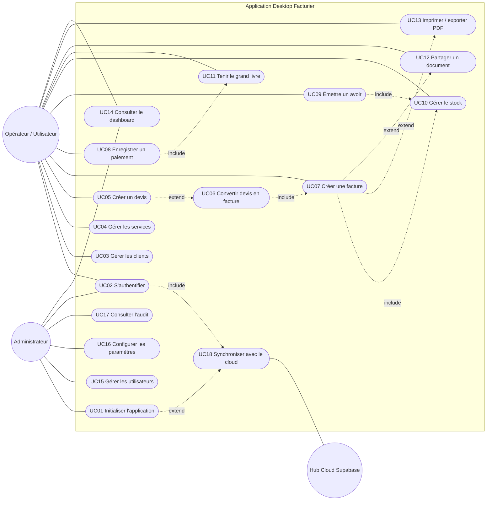

### 4.2 Descriptions détaillées

> Notation : **Préc.** précondition · **Post.** postcondition · **Nom.** scénario nominal · **Alt.** alternatif · **Exc.** exception.

#### UC01 — Initialiser l'application
- **Acteur** : Administrateur. **Préc.** table `users` vide.
- **Nom.** 1) L'app redirige vers `/setup`. 2) L'admin saisit société (nom, forme juridique, NIF, RCCM, adresse, contacts), taux fiscaux, préfixes, compte admin. 3) Le système valide (Zod), hache le mot de passe, crée tenant, utilisateur, `settings` dans une transaction. 4) Session créée, redirection vers l'app.
- **Alt.** A1 : l'admin rattache un tenant cloud existant (enrôlement) → récupération des données du Hub.
- **Exc.** E1 : app déjà initialisée → redirection `/login` (403 côté API). E2 : données invalides → erreurs de champ. E3 : e-mail déjà existant → réutilisation/mise à jour du compte.
- **Post.** App initialisée, audit `FIRST_RUN_SETUP`.

#### UC02 — S'authentifier
- **Préc.** App initialisée. **Nom.** 1) Saisie identifiants. 2) Vérification bcrypt. 3) Cookie `auth_session` signé HMAC (7 j). 4) Redirection `/`.
- **Alt.** A1 : premier login imposant `force_password_change` → changement de mot de passe. A2 : utilisateur cloud hors ligne → cache bcrypt local.
- **Exc.** E1 : identifiants invalides → message. E2 : trop de tentatives → blocage temporaire (rate-limit). E3 : compte inactif → refus. E4 : superadmin → interdit sur Desktop.

#### UC03 — Gérer les clients
- **Nom.** Créer : saisie nom (obligatoire), téléphone, statut, catégorie… → insertion avec `tenant_id`, `created_by` → modale de succès.
- **Alt.** Modifier ; désactiver ; consulter détails + historique de paiements ; import/export CSV.
- **Exc.** Doublon (nom/e-mail/NIF) → rejet ; suppression d'un client ayant des documents → refusée (garde-fou) ; champ invalide.

#### UC04 — Gérer les services/produits
- **Nom.** Saisie nom, catégorie, prix (entier XAF), éventuel suivi de stock (quantité, seuil, unité) → enregistrement.
- **Alt.** Modification préservant le stock ; suppression douce.
- **Exc.** Prix négatif ; nom dupliqué ; service utilisé dans documents → suppression douce uniquement.

#### UC05 — Créer un devis
- **Préc.** ≥ 1 client. **Nom.** 1) Choix client. 2) Ajout de lignes (service ou libre). 3) Remise. 4) Calcul HT/TVA/CSS/TPS/TTC. 5) Numérotation `DEV-…` via `sequences`. 6) Enregistrement `EN_ATTENTE` (transaction).
- **Alt.** A1 : création rapide d'un client/service depuis l'éditeur. A2 : duplication d'un devis. A3 : modification.
- **Exc.** E1 : aucune ligne → refus. E2 : devis converti → verrouillé. E3 : date de validité dépassée → statut `EXPIRE`.

#### UC06 — Convertir un devis en facture
- **Préc.** Devis non converti, non refusé. **Nom.** 1) Action « Convertir ». 2) Transaction : création facture + lignes copiées, devis → `CONVERTI`, numéro `FAC-…`. 3) Ouverture de la facture.
- **Exc.** Devis déjà converti ; échec transaction → rollback complet.

#### UC07 — Créer une facture
- **Nom.** Sélection client, lignes (avec `serviceId`), remise → calculs fiscaux → transaction : insertion facture, lignes, déduction de stock (`INVOICE_DEDUCTION`), audit → statut `UNPAID`.
- **Alt.** A1 : facture issue d'un devis (UC06). A2 : suppression/annulation → libération du devis, réintégration du stock.
- **Exc.** Stock insuffisant ; client absent ; montant incohérent ; erreur SQL → rollback.

#### UC08 — Enregistrer un paiement
- **Préc.** Facture non payée/non annulée. **Nom.** 1) Saisie montant, mode (cash, virement, Airtel, Moov), date, référence. 2) Contrôle ≤ reste à payer net d'avoirs. 3) Insertion `payments` + mise à jour statut (`PARTIALLY_PAID` / `PAID`) + écriture grand livre (transaction).
- **Exc.** Montant > reste à payer ; facture annulée ; montant ≤ 0.

#### UC09 — Émettre un avoir
- **Préc.** Facture existante. **Nom.** Sélection facture → lignes/quantités ≤ facturé → total → numérotation `AV-…` → insertion + réintégration de stock (`CREDIT_NOTE_RESTOCK`).
- **Exc.** Quantité > facturé ; facture annulée ; rollback.

#### UC10 — Gérer le stock
- **Nom.** Consultation du catalogue → mouvement manuel (type, quantité, motif) → mise à jour `stockQuantity` + `stock_movements` (previous/new).
- **Alt.** Alertes sous seuil ; historique d'un service.
- **Exc.** Sortie > stock ; service sans suivi de stock.

#### UC11 — Tenir le grand livre
- **Nom.** Saisie d'une écriture IN/OUT (catégorie, montant, mode, contrepartie) ; paiements synchronisés automatiquement.
- **Exc.** Montant < 0 ; suppression d'une écriture liée à facture/paiement → bloquée.

#### UC12 — Partager un document
- **Nom.** Ouvrir modale → choisir WhatsApp/e-mail → message généré (net HT, TTC, reste à payer pour factures) → IPC `app:open-external` → audit du partage.
- **Exc.** URL hors liste blanche refusée ; téléphone/e-mail manquant.

#### UC13 — Imprimer / exporter PDF
- **Nom.** Aperçu A4 → IPC `print-document` / `export-pdf` → fichier/impression ; ouverture dossier (`app:show-item-in-folder`).
- **Exc.** Échec d'impression/écriture disque.

#### UC14 — Consulter le dashboard
- **Nom.** Choix de période → agrégations SQL (filtrées par rôle/tenant) → KPI et graphiques. **Alt.** Vue admin globale vs vue utilisateur. **Exc.** Aucune donnée → valeurs 0 (COALESCE).

#### UC15 — Gérer les utilisateurs
- **Préc.** Admin. **Nom.** Création (nom, e-mail, rôle, mot de passe temporaire) ; modification ; désactivation ; suppression douce. **Exc.** E-mail/username déjà utilisé ; admin ne peut se supprimer lui-même ; compte cloud non provisionné → file `pending_cloud_members`.

#### UC16 — Configurer les paramètres
- **Préc.** Admin. **Nom.** Édition société/taux/préfixes/logo → validation Zod → `settings` (id = 1). **Exc.** Taux invalide ; logo trop lourd/format invalide.

#### UC17 — Consulter l'audit
- **Préc.** Admin. **Nom.** Liste paginée/filtrée de `audit_logs`. **Exc.** Accès non-admin refusé.

#### UC18 — Synchroniser avec le cloud
- **Nom.** `CloudSyncRunner` → push `_sync_outbox` → pull par curseurs (`sync_meta`) → résolution par `updated_at`. **Alt.** Suppressions via `sync_tombstones`. **Exc.** Hors ligne → report ; échec enregistrement → `sync_failures` (retry, compteur).

---

## 5. Diagramme de classes (complet — couches Desktop)

### 5.1 Domaine (entités persistées)

```mermaid
classDiagram
  class Settings { +int id=1; +string companyName; +string legalForm; +string nif; +string rccm; +float tvaRate; +float tpsRate; +float cssRate; +string invoicePrefix; +string quotePrefix; +string companyCode; +string mentionsLegales; +string logo; +int sessionTimeout; +string tenant_id }
  class User { +string id; +string username; +string email; +string password; +string name; +Role role; +int is_active; +int force_password_change; +string phone; +string tenant_id }
  class Client { +string id; +string name; +string email; +string phone; +string address; +string nif; +string rccm; +ClientStatus status; +string tenant_id }
  class Service { +string id; +string name; +string description; +string category; +int unitPrice; +int trackStock; +int stockQuantity; +int minStockAlert; +string unit; +string tenant_id }
  class Quote { +string id; +string number; +string clientId; +string date; +int subtotal; +int discount; +int taxBase; +int tpsAmount; +int tvaAmount; +int cssAmount; +int total; +QuoteStatus status; +string validUntil; +string notes; +string subject }
  class QuoteItem { +string id; +string quoteId; +string serviceId; +string description; +float quantity; +int unitPrice; +int total }
  class Invoice { +string id; +string number; +string quoteId; +string clientId; +string date; +int subtotal; +int discount; +int taxBase; +int tpsAmount; +int tvaAmount; +int cssAmount; +int total; +InvoiceStatus status }
  class InvoiceItem { +string id; +string invoiceId; +string serviceId; +string description; +float quantity; +int unitPrice; +int total }
  class Payment { +string id; +string invoiceId; +int amount; +string paymentMethod; +string date; +string reference }
  class CreditNote { +string id; +string number; +string invoiceId; +string clientId; +string reason; +int total; +CreditStatus status }
  class CreditNoteItem { +string id; +string creditNoteId; +string serviceId; +string description; +float quantity; +int unitPrice; +int total }
  class StockMovement { +string id; +string serviceId; +string type; +int quantity; +int previousStock; +int newStock; +string referenceDoc; +string notes }
  class LedgerEntry { +string id; +string date; +IN_OUT type; +string category; +string description; +int amount; +string paymentMethod; +string linkedInvoiceId; +string linkedPaymentId }
  class AuditLog { +string id; +string userId; +string action; +string entityType; +string entityId; +string details }
  class Sequence { +string name; +int current_value; +int last_year }
  Client "1" --> "0..*" Quote
  Client "1" --> "0..*" Invoice
  Client "1" --> "0..*" CreditNote
  Quote "1" *-- "1..*" QuoteItem
  Quote "0..1" --> "0..1" Invoice : converti en
  Invoice "1" *-- "1..*" InvoiceItem
  Invoice "1" *-- "0..*" Payment
  Invoice "1" --> "0..*" CreditNote
  CreditNote "1" *-- "1..*" CreditNoteItem
  Service "1" --> "0..*" StockMovement
  Service "0..1" <-- InvoiceItem
  Service "0..1" <-- QuoteItem
  Service "0..1" <-- CreditNoteItem
  Payment "0..1" <-- LedgerEntry : linkedPaymentId
  Invoice "0..1" <-- LedgerEntry : linkedInvoiceId
  User "1" --> "0..*" AuditLog
```

### 5.2 Couches applicatives

```mermaid
classDiagram
  class Page { <<React>> }
  class ZustandStore { <<state>> +hydrate(); +setInvoices(); +setQuotes() }
  class ServerActions { <<use server>> }
  class AuthApi { +getSession(); +signSession(); +verifySignature() }
  class InvoiceService { +createInvoice(data,userId,role,tenantId) }
  class QuoteService { +convertToInvoice(); +duplicateQuote() }
  class CreditNoteService { +createCreditNote() }
  class SetupService { +isInitialized(); +initializeApp() }
  class EnrollmentService { +enrollWithCloudTenant() }
  class ShareService { +buildMessage(); +buildUrl() }
  class ExportService { +exportExcel() }
  class InvoiceRepository { +findAll(); +findById(); +updateQuoteStatus() }
  class QuoteRepository { +findAll(); +findById(); +findWithStatus() }
  class PaymentRepository { +findPaymentsByClientId(); +findPaymentsByInvoiceId() }
  class StockRepository { +getStockCatalog(); +getStockMovements(); +getLowStockAlerts() }
  class LedgerRepository { +findAll(); +getSummary(); +create(); +softDelete() }
  class MetricsRepository { +getTotalRevenue(); +getTopClients(); +getMonthlyRevenueGrouped() }
  class SettingsRepository { +hasSettings(); +upsertInitialSettings() }
  class UserRepository { +findByUsername(); +create(); +update(); +softDelete() }
  class CloudSyncService { +runCloudSync() }
  class Database { <<better-sqlite3>> +transaction(); +prepare() }
  class ElectronMain { <<IPC>> +app:open-external; +print-document; +export-pdf }
  Page --> ZustandStore
  Page --> ServerActions
  Page ..> ElectronMain : window.electron
  ServerActions --> AuthApi
  ServerActions --> InvoiceService
  ServerActions --> QuoteService
  ServerActions --> CreditNoteService
  ServerActions --> SetupService
  ServerActions --> ShareService
  ServerActions --> CloudSyncService
  ServerActions --> InvoiceRepository
  ServerActions --> QuoteRepository
  ServerActions --> PaymentRepository
  ServerActions --> StockRepository
  ServerActions --> LedgerRepository
  ServerActions --> MetricsRepository
  ServerActions --> UserRepository
  InvoiceService --> Database
  QuoteService --> Database
  CreditNoteService --> Database
  InvoiceRepository --> Database
  QuoteRepository --> Database
  PaymentRepository --> Database
  StockRepository --> Database
  LedgerRepository --> Database
  MetricsRepository --> Database
  UserRepository --> Database
  SettingsRepository --> Database
  SetupService --> UserRepository
  SetupService --> SettingsRepository
  CloudSyncService --> Database
  EnrollmentService --> CloudSyncService
```

### 5.3 Server Actions exposées (réelles)

`audit` : getAuditLogs, getPaginatedAuditLogs · `auth` : loginUser, logoutUser, getMe, changeOwnPassword, syncSupabaseSession · `client` : getClients, getClientById, createClient, updateClient, deleteClient · `credit-note` : getCreditNotes, getCreditNoteById, createCreditNote, deleteCreditNote · `dashboard` : getDashboardMetrics · `hub` : getDesktopAnnouncementsAction, checkFeatureFlagAction · `invoice` : getInvoices, getInvoiceById, createInvoice, deleteInvoice · `ledger` : getLedgerEntriesAction, getLedgerSummaryAction, createLedgerEntryAction, deleteLedgerEntryAction · `payment` : getPayments, createPayment, deletePayment, getClientPaymentHistory, getInvoicePaymentHistory · `quote` : getQuotes, getQuoteById, createQuote, updateQuote, deleteQuote, updateQuoteStatus, convertQuoteToInvoice · `service` : getServices, getServiceById, createService, updateService, deleteService · `settings` : getSettings, updateSettings · `setup` : setupApp, enrollExistingTenant · `share` : logDocumentShareAction · `stock` : getStockCatalog, getStockMovements, getLowStockAlerts, recordStockMovement · `sync` : runCloudSync · `user` : getUsers, createUser, updateUser, deleteUser.

---

## 6. Diagrammes de séquence

### 6.1 Authentification (UC02)
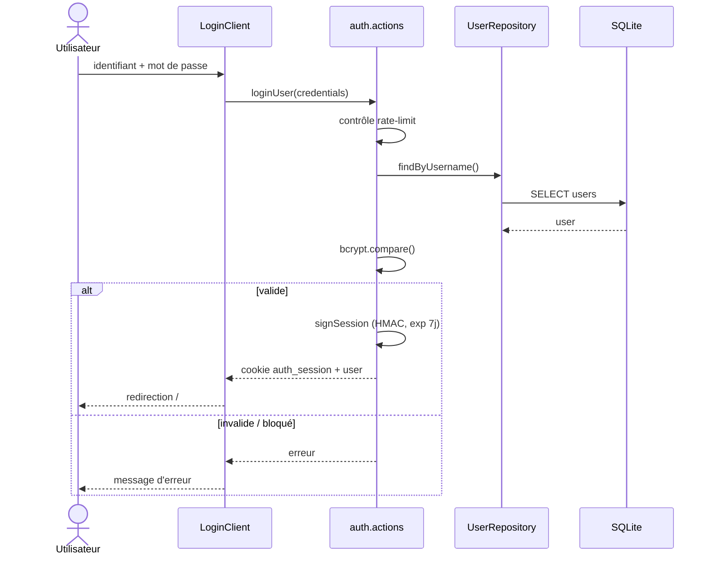

### 6.2 Création d'une facture avec déduction de stock (UC07)
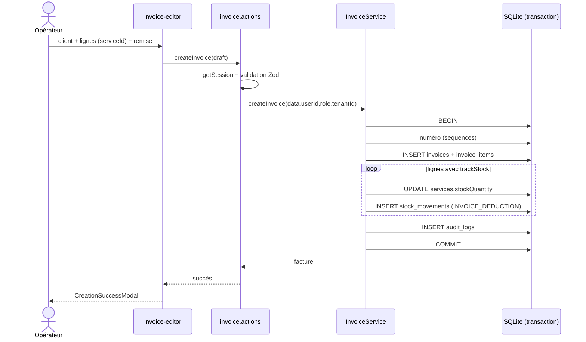

### 6.3 Conversion devis → facture (UC06)
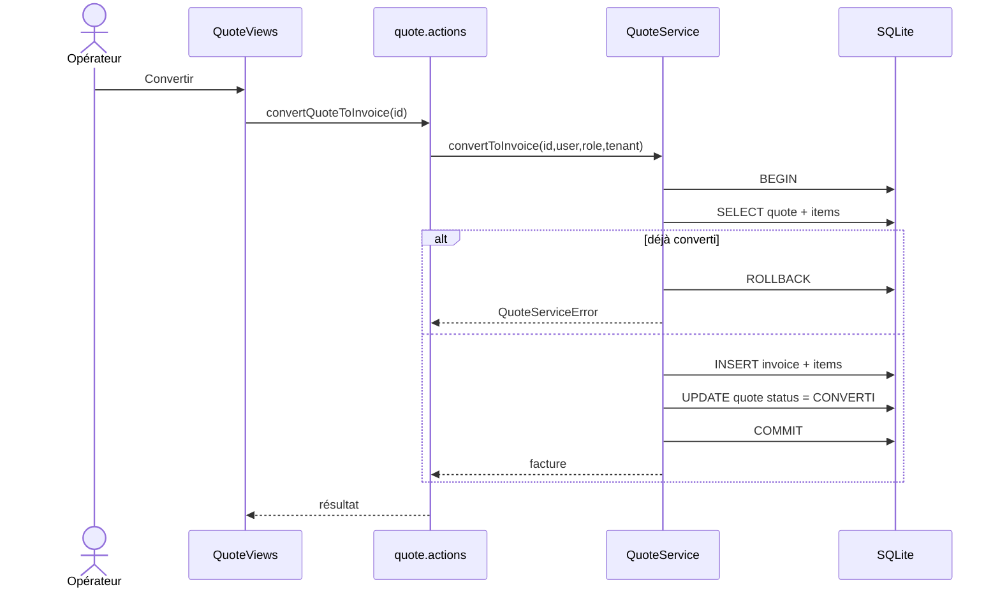

### 6.4 Enregistrement d'un paiement (UC08)
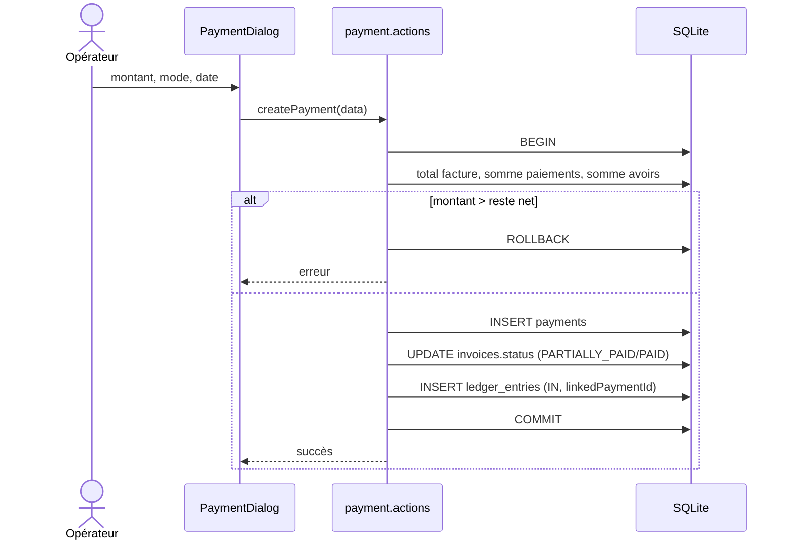

### 6.5 Émission d'un avoir (UC09)
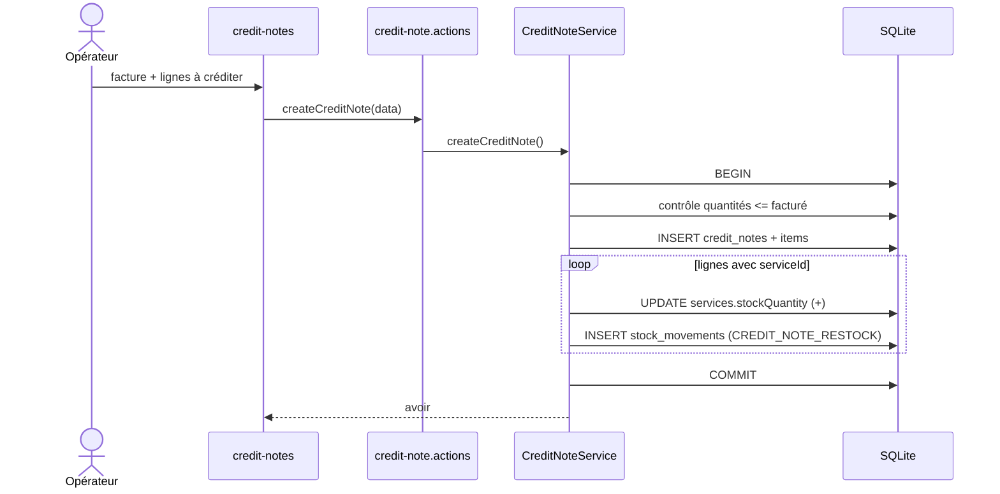

### 6.6 Partage WhatsApp (UC12)
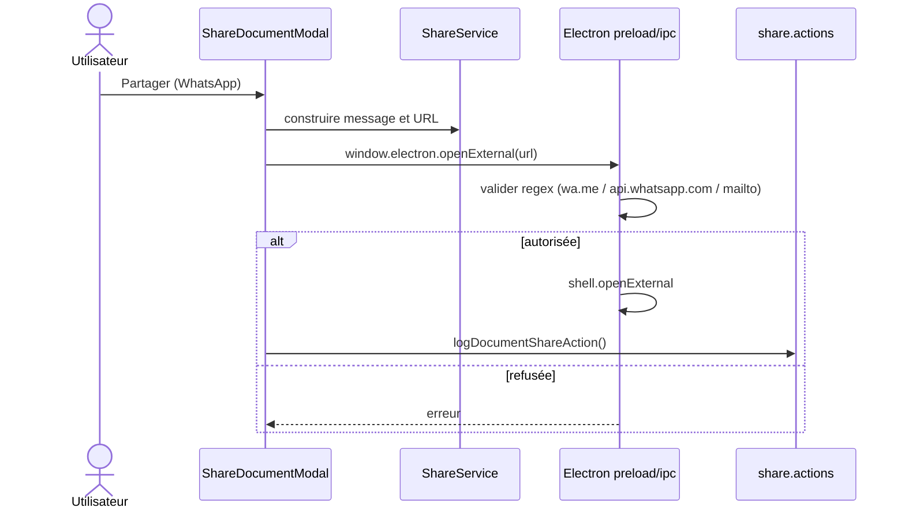

### 6.7 Synchronisation cloud (UC18)
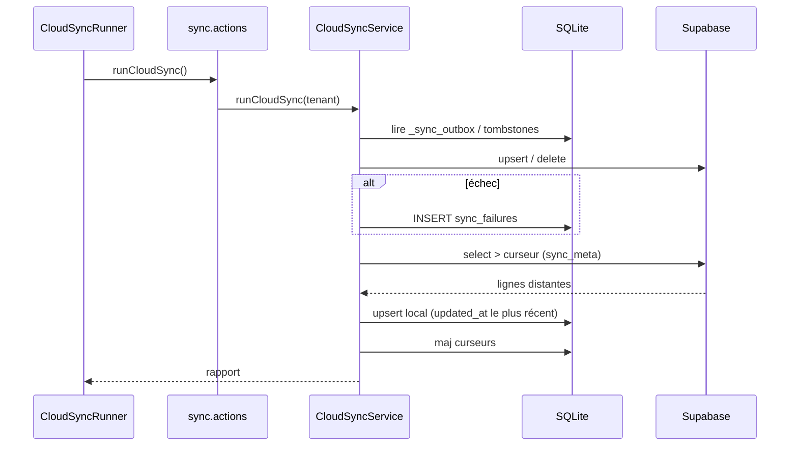

### 6.8 Setup initial (UC01)
```mermaid
sequenceDiagram
  actor Admin
  participant S as SetupClient
  participant A as setup.actions
  participant SV as SetupService
  participant D as SQLite
  Admin->>S: formulaire société + admin
  S->>A: setupApp(data)
  A->>SV: isInitialized()
  alt déjà initialisée
    A-->>S: 403
  else
    A->>SV: initializeApp(data, hash)
    SV->>D: BEGIN; INSERT users; UPSERT settings; COMMIT
    A->>D: INSERT audit_logs FIRST_RUN_SETUP
    A-->>S: cookie session
  end
```

---

## 7. Types réels des colonnes (SQLite — état après migrations 0001→0006)

Conventions : monnaie XAF en **INTEGER** (entier, `CHECK >= 0`) depuis la migration 0002 (était `REAL` en 0001) ; quantités **REAL** ; dates : `DATETIME` (défaut `CURRENT_TIMESTAMP`) ou `TEXT` ISO ; booléens **INTEGER** 0/1 ; ids **TEXT** (UUID v4). Colonnes de sync `updated_at TEXT`, `synced_at TEXT` ajoutées sur les tables synchronisées (0002 / `ensureSyncSchema` en 0003) + table `_sync_outbox` et triggers.

### settings
| Colonne | Type | Contrainte |
|---|---|---|
| id | INTEGER | PK, CHECK(id=1) |
| companyName, legalForm, nif, rccm, address, email, phone | TEXT | |
| bankName, bankAgency, accountNumber, swiftCode, iban | TEXT | |
| tvaRate | REAL | |
| tpsRate | REAL | DEFAULT 9.5 |
| cssRate | REAL | |
| sessionTimeout | INTEGER | |
| invoicePrefix, quotePrefix, companyCode, mentionsLegales, logo | TEXT | |
| logo_path, logo_sha256, updated_at, synced_at | TEXT | (0002) |
| tenant_id | TEXT | (ajout `migrateLegacy`) |

### clients
id TEXT PK · name TEXT NOT NULL · email, phone, address, nif, rccm TEXT · status TEXT NOT NULL DEFAULT 'active' CHECK IN ('active','inactive') · createdAt DATETIME DEFAULT CURRENT_TIMESTAMP · deletedAt DATETIME · created_by TEXT · tenant_id TEXT NOT NULL · updated_at, synced_at TEXT.

### services
id TEXT PK · name TEXT NOT NULL · description, category TEXT · unitPrice INTEGER NOT NULL DEFAULT 0 CHECK ≥ 0 · createdAt DATETIME · deletedAt DATETIME · created_by TEXT · tenant_id TEXT NOT NULL · updated_at, synced_at TEXT · **(0004)** trackStock INTEGER NOT NULL DEFAULT 0 · stockQuantity INTEGER NOT NULL DEFAULT 0 · minStockAlert INTEGER NOT NULL DEFAULT 5 · unit TEXT DEFAULT 'Unité'.

### quotes
id TEXT PK · number TEXT UNIQUE NOT NULL · clientId TEXT NOT NULL FK→clients · clientName, clientEmail TEXT · date TEXT NOT NULL · dueDate TEXT · subtotal, discount, taxBase, tpsAmount, tvaAmount, cssAmount, total INTEGER NOT NULL DEFAULT 0 CHECK ≥ 0 · status TEXT NOT NULL DEFAULT 'EN_ATTENTE' CHECK IN (EN_ATTENTE, VALIDE, REFUSE, BROUILLON, ENVOYE, CONVERTI, EXPIRE, EXPIRED, draft, sent, accepted, rejected, converti) · notes, subject, validUntil TEXT · createdAt DATETIME · deletedAt DATETIME · created_by TEXT · tenant_id TEXT NOT NULL · updated_at, synced_at TEXT.

### quote_items
id TEXT PK · quoteId TEXT NOT NULL FK→quotes ON DELETE CASCADE · description TEXT NOT NULL · quantity REAL NOT NULL DEFAULT 1 · unitPrice INTEGER NOT NULL DEFAULT 0 CHECK ≥ 0 · total INTEGER NOT NULL DEFAULT 0 CHECK ≥ 0 · tenant_id TEXT NOT NULL · deletedAt DATETIME · updated_at, synced_at TEXT · **serviceId TEXT FK→services (0006)**.

### invoices
id TEXT PK · number TEXT UNIQUE NOT NULL · quoteId TEXT FK→quotes · clientId TEXT NOT NULL FK→clients · clientName, clientEmail TEXT · date TEXT NOT NULL · dueDate TEXT · subtotal, discount, taxBase, tpsAmount, tvaAmount, cssAmount, total INTEGER NOT NULL DEFAULT 0 CHECK ≥ 0 · status TEXT NOT NULL DEFAULT 'UNPAID' CHECK IN (UNPAID, PAID, PARTIALLY_PAID, CANCELLED, OVERDUE, pending, sent, open, paid, partially_paid, partial, cancelled, draft, BROUILLON) · notes, subject, validUntil TEXT · createdAt DATETIME · deletedAt DATETIME · created_by TEXT · tenant_id TEXT NOT NULL · updated_at, synced_at TEXT.

### invoice_items
Identique à `quote_items` avec `invoiceId TEXT NOT NULL FK→invoices ON DELETE CASCADE` ; `serviceId TEXT FK→services` (0006).

### payments
id TEXT PK · invoiceId TEXT NOT NULL FK→invoices ON DELETE CASCADE · amount INTEGER NOT NULL DEFAULT 0 CHECK ≥ 0 · paymentMethod TEXT NOT NULL · date TEXT NOT NULL · reference TEXT · createdAt DATETIME · deletedAt DATETIME · created_by TEXT · tenant_id TEXT NOT NULL · updated_at, synced_at TEXT.

### credit_notes
id TEXT PK · number TEXT UNIQUE NOT NULL · invoiceId TEXT NOT NULL FK · clientId TEXT NOT NULL FK · clientName TEXT · date TEXT NOT NULL · reason TEXT · subtotal, taxBase, tpsAmount, tvaAmount, cssAmount, total INTEGER NOT NULL DEFAULT 0 CHECK ≥ 0 · status TEXT NOT NULL DEFAULT 'open' CHECK IN ('open','applied','cancelled') · createdAt DATETIME · created_by TEXT · deletedAt DATETIME · tenant_id TEXT NOT NULL · updated_at, synced_at TEXT.

### credit_note_items
Identique à `quote_items` avec `creditNoteId TEXT NOT NULL FK→credit_notes ON DELETE CASCADE` ; `serviceId` (0006).

### users
id TEXT PK · username TEXT UNIQUE NOT NULL · email TEXT UNIQUE · password TEXT NOT NULL (hash bcrypt) · name TEXT NOT NULL · role TEXT NOT NULL DEFAULT 'user' CHECK IN ('admin','user') · is_active INTEGER NOT NULL DEFAULT 1 · force_password_change INTEGER NOT NULL DEFAULT 0 · created_at DATETIME DEFAULT CURRENT_TIMESTAMP · last_login_at DATETIME · created_by TEXT · phone TEXT · deletedAt DATETIME · tenant_id TEXT.

### audit_logs
id TEXT PK · userId, userName TEXT · action TEXT NOT NULL · entityType TEXT NOT NULL · entityId, details TEXT · createdAt DATETIME DEFAULT CURRENT_TIMESTAMP · tenant_id TEXT.

### sequences
name TEXT PK · current_value INTEGER DEFAULT 0 · last_year INTEGER.

### stock_movements (0004)
id TEXT PK · tenant_id TEXT NOT NULL · serviceId TEXT NOT NULL FK→services · type TEXT NOT NULL · quantity INTEGER NOT NULL · previousStock INTEGER NOT NULL · newStock INTEGER NOT NULL · referenceDoc, notes, created_by TEXT · createdAt TEXT NOT NULL DEFAULT datetime('now') · updatedAt TEXT NOT NULL DEFAULT datetime('now') · deletedAt TEXT.

### ledger_entries (0005)
id TEXT PK · tenant_id TEXT NOT NULL · date TEXT NOT NULL · type TEXT NOT NULL CHECK IN ('IN','OUT') · category TEXT NOT NULL · description TEXT NOT NULL · amount INTEGER NOT NULL CHECK ≥ 0 · paymentMethod TEXT NOT NULL DEFAULT 'Espèces' · reference, counterparty, linkedInvoiceId, linkedPaymentId, created_by TEXT · createdAt, updatedAt TEXT NOT NULL DEFAULT datetime('now') · deletedAt TEXT.

### Tables techniques (sync / hub)
| Table | Colonnes (type) |
|---|---|
| hub_cache | kind TEXT, key TEXT, payload TEXT, fetched_at TEXT (PK kind+key) |
| sync_meta | key TEXT PK, value TEXT |
| sync_tombstones | table_name TEXT, record_id TEXT, deleted_at TEXT (PK composite) |
| sync_failures | table_name TEXT, record_id TEXT, error TEXT, attempts INTEGER DEFAULT 1, last_attempt_at TEXT (PK composite) |
| pending_cloud_members | email TEXT PK, password TEXT, name TEXT, phone TEXT, role TEXT, attempts INTEGER DEFAULT 0, last_error TEXT, created_at TEXT |

### Diagramme ER
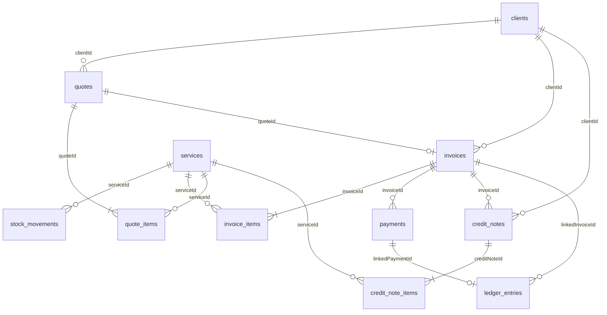

> Points à noter pour votre rapport : (1) `users.role` est limité à `admin|user` par `CHECK` alors que `constants.ts` définit aussi `operator` ; (2) `quotes` et `invoices` contiennent chacune `dueDate` et `validUntil` (héritage de la reconstruction 0002) ; (3) les statuts acceptent des variantes de casse historiques.

